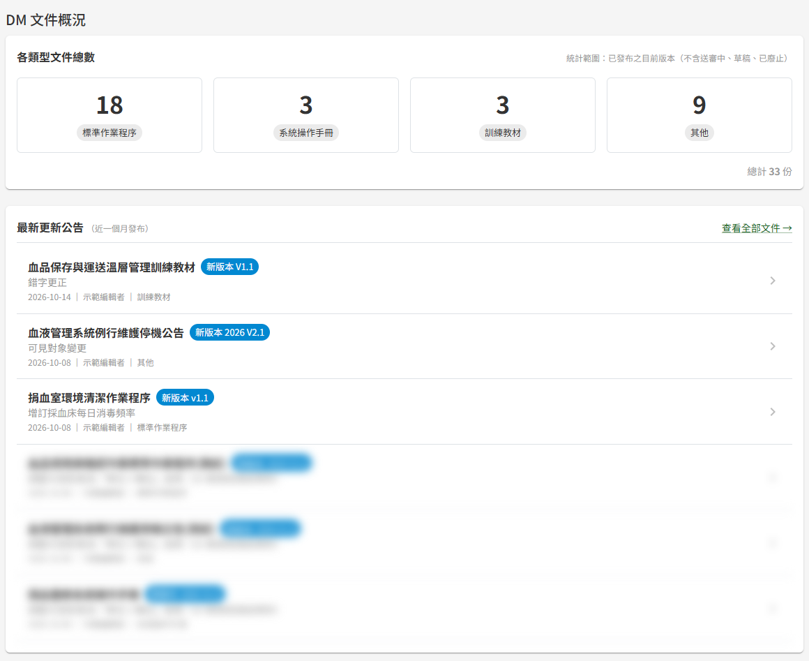

# DM00 系統儀表板

## 作業說明

### 使用情境

本作業供**具任一文件管理角色者**（管理者、編輯者、審核者、閱覽者）於登入後一眼掌握文件管理的概況：各類型文件目前有幾份，以及最近一個月發布了哪些文件。

系統儀表板沒有獨立的畫面，是登入後主頁上的「DM 文件概況」區塊，與教育訓練的概況並列；主頁本身的說明見 DP00 登入後主頁。不具任何文件管理角色者，主頁不會出現此區塊。

### 進入路徑

- 登入成功後自動進入主頁，「DM 文件概況」位於頁面下方
- 任何畫面下，按頂列左側的系統名稱「教育訓練文件管理系統」即回到主頁

## 操作說明

### 畫面與前置設定

「DM 文件概況」分為上下兩塊：上方為「各類型文件總數」，下方為「最新更新公告」。

區塊中的數字與公告，**依登入者看得到的文件計算**，與 DM01 文件庫的可見範圍相同：

| 登入者 | 計入範圍 |
|---|---|
| 具編輯者、審核者或管理者角色者 | 全部已發布文件 |
| 僅具閱覽者角色者 | 可見對象與本人相符的文件；「訓練教材」分類不設可見對象，閱覽者看不到，計數為 0 |

因此不同人看到的數字可能不同，屬正常。

### 檢視各類型文件總數

四張卡片分別為「標準作業程序」「系統操作手冊」「訓練教材」「其他」的文件數，右下方為「總計」。卡片僅供檢視，無法點選。卡片上的分類名稱以分類目前的名稱為準，管理者於 DP03 系統參數與清單維護改名後，卡片隨之顯示新名稱。

計入的是**已發布的目前版本**：

| 文件狀態 | 是否計入 |
|---|---|
| 已發布 | 計入，每份文件只計一次，不論有幾個版本 |
| 已提出廢止申請、尚待審核者核准 | 計入——廢止核准前文件仍在架上 |
| 草稿、送審中 | 不計入 |
| 已廢止 | 不計入 |

數字於開啟主頁當下即時計算。文件核准發布或廢止核准後，回到主頁即反映。

### 檢視最新更新公告

列出**最近一個月內**發布的文件，最新的排在最上方。每列包含：

| 內容 | 說明 |
|---|---|
| 文件名稱與標籤 | 標籤為「新增」加版本號者，是該文件的第一個版本；「新版本」加版本號者，是既有文件發布了新版本 |
| 摘要 | 撰寫者送審時填寫的變更說明 |
| 發布日期 ｜ 撰寫者 ｜ 分類 | 分類以代碼顯示，對照如下 |

| 分類代碼 | 分類 |
|---|---|
| SOP | 標準作業程序 |
| MANUAL | 系統操作手冊 |
| TRAINING | 訓練教材 |
| OTHER | 其他 |

每份文件只列目前發布的版本：既有文件發布新版本後，該文件原有的公告列由「新版本」那一筆取代。文件廢止核准後，該文件的公告列一併移除。公告區最多列出最近 50 筆。

按任一列即進入該文件的 DM07 文件詳細頁；按右上的「查看全部文件 →」進入 DM01 文件庫。

最近一個月沒有任何發布時，公告區顯示「近期無新發布文件」。

## 常見訊息與處置

### 其他情況

| 情況 | 說明 |
|---|---|
| 主頁沒有出現「DM 文件概況」 | 登入者不具任何文件管理角色。需要時請洽管理者於 DP02 權限管理授予 |
| 公告區顯示「近期無新發布文件」 | 最近一個月內沒有可看見的文件發布，可按「查看全部文件 →」至文件庫查詢較早的文件 |
| 本人看到的數字與同事不同 | 數字依各人看得到的文件計算。僅具閱覽者角色者只計入可見對象相符的文件，且不含訓練教材 |
| 文件已核准發布，數字卻沒有變 | 離開主頁後再回來即重新計算。若為既有文件發布新版本，總數本來就不變，公告區最上方會出現該文件標示「新版本」的一筆 |
| 已申請廢止的文件仍計入總數 | 廢止須經審核者核准才生效；核准前文件仍在架上，照常計入 |
