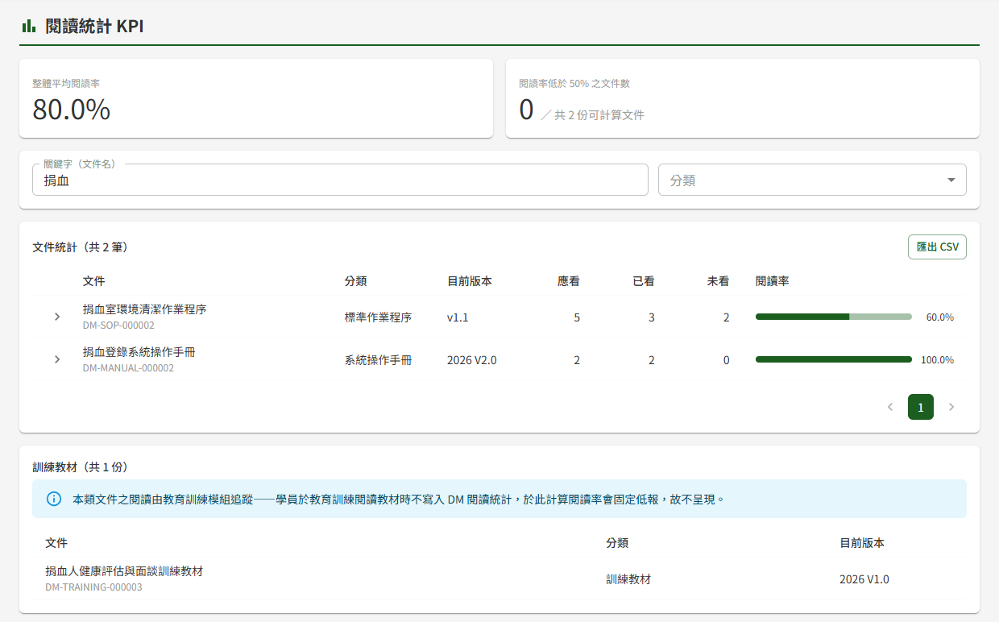
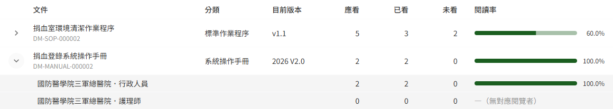

# DM06 閱讀統計 KPI

## 作業說明

### 使用情境

本作業**僅供文件管理模組之管理者使用**，用於追蹤各文件是否已被該讀的人讀過，作為文件落實度的 KPI。

閱覽者於 DM07 文件詳細頁**下載目前發布版**時，系統即記為「已看」。本作業逐文件列出應看、已看、未看人數與閱讀率，統計於進入本作業時即時計算。

除本作業外，系統每週另以排程寄出兩種信件，執行時間由管理者於 DP06 排程作業總覽設定，信件內容與是否寄出由管理者於 DP04 通知範本維護控制：

| 信件 | 收件人 | 內容 |
|---|---|---|
| KPI 週報 | 所有文件管理的管理者 | 總文件數、整體平均閱讀率、閱讀率最低的 5 份文件，以及本作業的連結 |
| 未讀提醒 | 有未看文件的閱覽者，每人一封 | 列出該員所有尚未下載目前發布版的文件 |

### 進入路徑

側邊選單「文件管理 → 閱讀統計 KPI」。

## 操作說明

### 畫面與前置設定

畫面自上而下為兩張統計卡、查詢條件、文件統計清單；有訓練教材時，最下方另有「訓練教材」區。清單依文件名稱排序，每頁 20 筆。

查詢條件**一經變更即自動重新查詢**，畫面上沒有「搜尋」按鈕；每次重新查詢都會回到第一頁。

### 應看、已看與閱讀率怎麼算

| 項目 | 計算方式 |
|---|---|
| 應看 | 具**閱覽者**角色、且可見對象與該文件相符的人數。文件掛「全單位＋全體」時為全部閱覽者。兼具其他角色的閱覽者照樣計入；只有編輯者、審核者或管理者角色、沒有閱覽者角色的人不計入 |
| 已看 | 應看的人之中，已下載**目前發布版**的人數。同一人重複下載只算一次 |
| 未看 | 應看減已看 |
| 閱讀率 | 已看 ÷ 應看。應看為 0（沒有任何對應的閱覽者）時顯示「—（無對應閱覽者）」 |

> 重要：**只有下載才算已看**，線上預覽不計入。文件發布新版本後，改以新版重新計算，只下載過舊版的人回到未看。

### 統計卡

| 統計卡 | 說明 |
|---|---|
| 整體平均閱讀率 | 各文件閱讀率的平均值，每份文件權重相同。應看為 0 的文件不列入 |
| 閱讀率低於 50% 之文件數 | 旁邊的「共 N 份可計算文件」為分母，同樣不含應看為 0 的文件 |

兩張統計卡**跟隨目前的查詢條件**：設定分類或關鍵字後，統計卡只計算查詢結果中的文件。

### 設定查詢條件

| 條件 | 比對方式 |
|---|---|
| 關鍵字（文件名） | 比對文件名稱，輸入其中一段文字即可 |
| 分類 | 選定一個分類 |

### 檢視各可見對象的閱讀情形

文件掛有可見對象時，該列最左側有展開鈕。按下後，於該列下方逐組列出每一組可見對象（如「全體」、某職位、或「單位．職位」）各自的應看、已看、未看與閱讀率，可看出是哪一組讀得較少。

> 注意：一位閱覽者同時符合同一份文件的多組可見對象時（例如身兼兩種職位，而文件兩組都掛），他會分別計入每一組。因此各組應看相加，可能大於該文件的應看。

### 訓練教材

分類為訓練教材的文件**不列入**文件統計、統計卡、匯出的 CSV 與每週信件，也不會寄出未讀提醒，而是另列於最下方的「訓練教材」區，只列出文件與目前版本。

訓練教材的閱讀由教育訓練模組追蹤：學員於教育訓練課程中閱讀教材，不計入本作業的已看，若在此計算閱讀率將固定偏低。教材的閱讀情形請於 ET02 學員學習表現查看。

查詢結果只有訓練教材時，畫面只顯示「訓練教材」區。

### 匯出 CSV

按文件統計右上方「匯出 CSV」，系統即下載一份 CSV 檔，內容為**目前查詢條件下的全部文件**，不限於畫面上的這一頁，不含訓練教材。

| 項目 | 說明 |
|---|---|
| 欄位 | 文件編號、文件名稱、分類、目前版本、應看、已看、未看、閱讀率 |
| 開啟方式 | 可直接以 Excel 開啟，中文不會變成亂碼 |

查詢結果為 0 筆時，「匯出 CSV」無法按下。

## 常見訊息與處置

### 其他情況

| 情況 | 處置 |
|---|---|
| 「查無符合條件之文件統計」 | 沒有符合條件的文件。請減少條件，或改輸入較短的關鍵字 |
| 某人下載後已看人數沒有增加 | 依序確認：①是否為下載而非預覽 ②下載的是否為目前發布版 ③該員是否具閱覽者角色、且可見對象與文件相符 ④該員先前是否已下載過同一版本 |
| 閱讀率顯示「—（無對應閱覽者）」 | 沒有任何具閱覽者角色的人符合該文件的可見對象。請確認文件的可見對象，或請管理者於 DP02 權限管理為相關人員指派閱覽者角色與可見對象 |
| 「您無權限存取此頁面」 | 本人未具文件管理的管理者角色，請洽其他管理者於 DP02 權限管理授予 |
