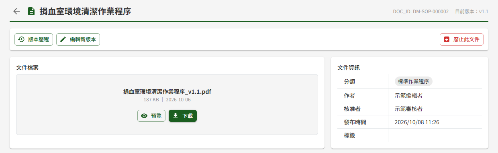
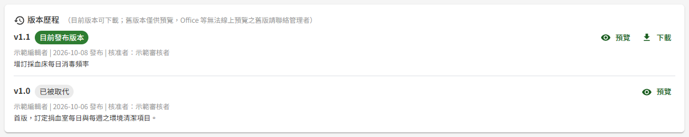
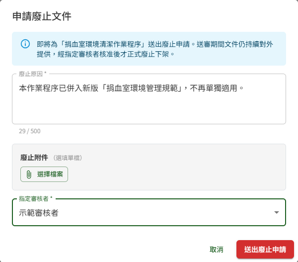
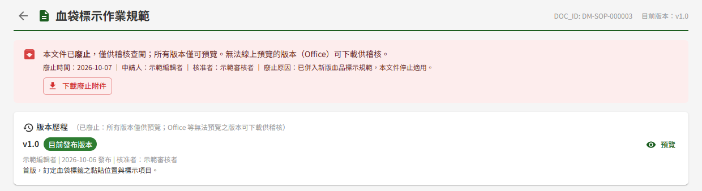

# DM07 文件詳細頁

## 作業說明

### 使用情境

本作業供**具任一文件管理角色者**閱讀單一文件的內容：預覽或下載目前版本、查看文件資訊與版本歷程。依角色可做的事如下：

| 角色 | 可做的事 |
|---|---|
| 閱覽者、審核者、管理者 | 預覽、下載目前版本，查看文件資訊與版本歷程 |
| 編輯者 | 以上全部，另可由本頁「編輯新版本」與「廢止此文件」 |

本頁只呈現**已發布後**的文件——已發布、廢止待簽核與已廢止三種。草稿與送審中的文件不在此呈現，撰寫者於 DM04 個人專區、審核者於 DM02 簽核中心檢視。

### 進入路徑

- 側邊選單「文件管理 → DM01 文件庫」，按文件名稱
- 登入後主頁「DM 文件概況」的最新更新公告，按任一列
- 已廢止的文件：側邊選單「文件管理 → DM03 已廢止文件查詢」，按文件名稱（限管理者）

## 操作說明

### 畫面與前置設定

標題列顯示文件名稱，右側為文件編號（DOC_ID）與目前版本。左側箭頭返回進入前的清單。

標題列下方為操作列：「版本歷程」，具編輯者角色者另有「編輯新版本」與「廢止此文件」。其下左側為「文件檔案」、右側為「文件資訊」。

「文件資訊」中看不出來的欄位：

| 欄位 | 說明 |
|---|---|
| 作者 | 建立此文件的撰寫者。其他編輯者上傳新版本後，作者仍為原建立者 |
| 核准者、發布時間 | 目前版本的核准者與發布時間 |
| 標籤 | 撰寫者掛載的檢索標籤，供 DM01 文件庫篩選用 |
| 關聯作業項目 | 文件與某項作業相關時顯示，例如系統操作手冊對應的作業 |

文件已提出廢止申請、尚待審核者核准期間，仍照常顯示與下載，直到核准才下架。

### 預覽與下載目前版本

「文件檔案」區依檔案格式提供不同的存取方式：

| 檔案格式 | 可用動作 |
|---|---|
| PDF、圖片 | 「預覽」與「下載」 |
| Word、Excel、PowerPoint | 只有「下載」，並顯示「此檔案為 Office 格式，無法線上預覽，請下載原檔以本機應用程式開啟」 |

- 按「預覽」，檔案於**新分頁**開啟
- 按「下載」，檔案存到本機

> 重要：**下載才會記為「已看」**。閱讀統計 KPI 以「是否下載過目前版本」判定已讀，只預覽不會計入；同一人重複下載同一版本只計一次。需要列入閱讀紀錄者，請下載一次。

### 查看版本歷程

按「版本歷程」，下方展開該文件所有已發布過的版本，最新的在最上方。每個版本列出版號、撰寫者、發布日期、核准者與變更摘要；目前版本標示「目前發布版本」，舊版本標示「已被取代」。

**只有目前發布版本可以下載**，舊版本只能預覽，避免誤用已過時的規範：

| 版本 | PDF、圖片 | Office 檔 |
|---|---|---|
| 目前發布版本 | 預覽、下載 | 下載 |
| 已被取代的舊版 | 預覽 | 顯示「無法線上預覽，如需此版本原檔請聯絡管理者」 |

被退回或撤回的送審版本不會出現在版本歷程中。

### 編輯新版本

具編輯者角色者按「編輯新版本」，進入 DM08 文件新增與編輯，以目前版本為基礎修改並送審。新版本核准發布前，目前版本照常提供閱讀。

### 申請廢止文件

文件不再適用時，具編輯者角色者可申請整份廢止。送審期間文件仍照常提供，**經審核者核准後才正式廢止下架**。

1. 按操作列右側的「廢止此文件」
2. 於「申請廢止文件」視窗填寫「廢止原因」（必填）
3. 需要附上公文等依據時，於「廢止附件」按「選擇檔案」附加一個檔案（選填），格式與大小限制同文件上傳
4. 於「指定審核者」選擇一位審核者。名單為具審核者角色者，不含本人
5. 按「送出廢止申請」

送出後顯示「已送出廢止申請」。審核者於 DM02 簽核中心即可看到此申請。

審核結果：

| 結果 | 文件狀態 |
|---|---|
| 核准 | 文件廢止，自文件庫下架，改於 DM03 已廢止文件查詢查閱 |
| 退回 | 文件維持已發布，照常提供 |

送出後若要取消申請，於 DM04 個人專區撤回，文件即維持已發布。

### 送審期間入口暫停使用

同一份文件**不可同時進行兩種送審**。下列期間，操作列的按鈕呈灰色無法按，游標移到按鈕上會顯示原因：

| 期間 | 「編輯新版本」 | 「廢止此文件」 | 顯示的原因 |
|---|---|---|---|
| 新版本送審中 | 無法按 | 無法按 | 此文件新版本送審中，暫無法編輯或廢止 |
| 廢止待簽核 | 無法按 | 無法按 | 此文件廢止待簽核，暫無法編輯或再次廢止 |
| 本人已有此文件尚未送審的草稿 | 無法按 | 可以按 | 您已有此文件的未送簽草稿，請續編既有草稿 |

送審結束（核准、退回或撤回）後，按鈕即恢復可用。本人有草稿時，請至 DM04 個人專區的「草稿匣」繼續編輯該草稿。

### 檢視已廢止的文件

由 DM03 已廢止文件查詢進入的文件，以唯讀方式呈現：

- 上方紅色橫幅標示文件已廢止，並列出廢止時間、申請人、核准者與廢止原因；申請時有附件者，可按「下載廢止附件」
- 不顯示「文件檔案」與「文件資訊」，版本歷程自動展開
- 所有版本只能預覽、不能下載。**管理者例外**：無法線上預覽的 Office 版本，管理者可下載供稽核

標題列左側箭頭返回 DM03 已廢止文件查詢。

## 常見訊息與處置

### 被擋下（動作沒有完成）

| 訊息 | 處置 |
|---|---|
| 「請填寫廢止原因」 | 廢止原因為必填 |
| 「請選擇指定審核者」 | 須指定一位審核者 |
| 「此文件正進行新版本送審，無法同時發起廢止」 | 開啟視窗後，有人送出了此文件的新版本。待該送審結束後再申請廢止 |
| 附件格式不支援或超過大小上限之提示 | 改附 PDF、Word、Excel、PowerPoint 或圖片，且不超過文件上傳的大小上限 |
| 「已廢止文件僅供預覽，如需下載請洽管理者」 | 已廢止文件不開放下載。需要原檔供稽核者請洽管理者 |

### 送出後的結果訊息

| 訊息 | 說明 |
|---|---|
| 「已送出廢止申請」 | 申請已送出，文件轉為廢止待簽核，於核准前仍照常提供 |

### 其他情況

| 情況 | 說明 |
|---|---|
| 開啟時顯示「查無此文件或無權存取。」 | 該文件不存在、尚未發布，或其可見對象未開放給本人。可見對象需調整者請洽撰寫者或管理者 |
| 按「預覽」或「下載」顯示「查無檔案，可能已被移除，請聯絡管理者」 | 該版本的檔案已不存在，請洽管理者 |
| 舊版本只能預覽，需要原檔 | 舊版本不開放下載，避免誤用過時規範；稽核需要時請洽管理者 |
| 沒有看到「編輯新版本」與「廢止此文件」 | 本人不具編輯者角色 |
| 按鈕是灰色的 | 文件正在送審，或本人已有此文件的草稿。游標移到按鈕上可看到原因，見〈送審期間入口暫停使用〉 |
