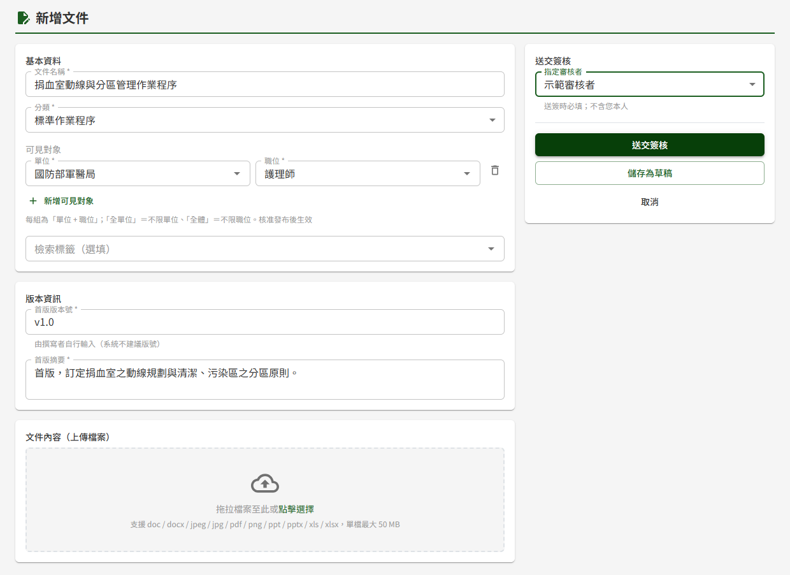
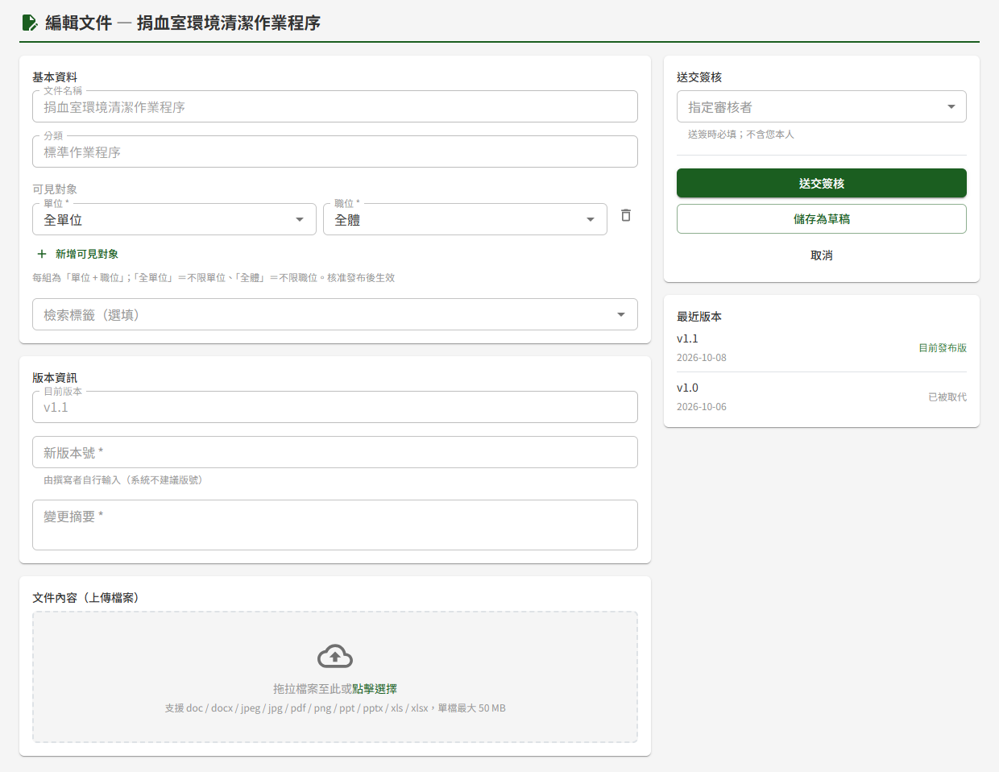

# DM08 文件新增與編輯

## 作業說明

### 使用情境

本作業供**具編輯者角色者**建立新文件，或為既有文件上傳新版本，填妥後送交指定審核者簽核；也可先存為草稿，之後再續編。

文件經審核者於 DM02 簽核中心核准後才發布；核准前，文件庫與詳細頁呈現的仍是原本的內容（新文件則尚未出現）。

本頁有三種開啟方式，可編輯的欄位不同：

| 開啟方式 | 畫面標題 | 可編輯 |
|---|---|---|
| 新增文件 | 新增文件 | 全部欄位 |
| 為已發布文件編輯新版本 | 編輯文件 — 文件名稱 | 可見對象、檢索標籤、版本號、變更摘要、檔案、指定審核者。文件名稱、分類、關聯作業項目不可改 |
| 續編草稿 | 編輯文件 — 文件名稱 | 同上；若為尚未發布過的新文件草稿，文件名稱與關聯作業項目也可修改 |

分類一經建立即不可更改。文件名稱或分類需要變更者，請先廢止原文件，再另行新增。

### 進入路徑

- 新增文件：側邊選單「文件管理 → DM01 文件庫」，按搜尋結果右上方的「新增文件」
- 編輯新版本：於 DM07 文件詳細頁按「編輯新版本」
- 續編草稿：側邊選單「文件管理 → DM04 個人專區」，於「草稿匣」按該草稿的「繼續編輯」

## 操作說明

### 畫面與前置設定

畫面左側由上而下為「基本資料」「版本資訊」「文件內容（上傳檔案）」三區，右側為「送交簽核」，放置指定審核者與動作按鈕。

### 填寫基本資料

1. 輸入「文件名稱」（至多 200 字）並選擇「分類」
2. 分類為「系統操作手冊」時，另須於「關聯作業項目」選擇該手冊對應的作業。**同一個作業項目只能有一份已發布的手冊**；原手冊提出廢止申請、尚在簽核中時亦同，須待廢止核准後才能發布同作業項目的新手冊
3. 設定「可見對象」（分類為訓練教材者免填，見下段）
4. 需要時於「檢索標籤（選填）」選擇標籤，分為適用模組、文件性質、法規關聯、其他四組（尚無標籤的組別不顯示），可多選，供 DM01 文件庫篩選

#### 設定可見對象

可見對象決定**僅具閱覽者角色者**看得到這份文件；編輯者、審核者與管理者一律看得到全部文件。

- 每一列為一組「單位＋職位」，兩欄都要選。按「新增可見對象」可再加一列，按該列右側的垃圾桶圖示移除
- 單位選「全單位」表示不限單位，職位選「全體」表示不限職位
- 至少需設定一組

> 重要：**每一列是一組配對，不是兩份清單**。例如設定「國防部軍醫局＋護理師」與「國防醫學院三軍總醫院＋行政人員」兩列，看得到的只有這兩種人；國防部軍醫局的行政人員**看不到**。要開放給某單位所有人，職位請選「全體」。

分類選「訓練教材」時，可見對象欄改為顯示「訓練教材由教育訓練模組引用，不需設定可見對象」。訓練教材供教育訓練課程引用，學員於課程中開啟；僅具閱覽者角色者於文件庫查不到訓練教材。

> 注意：編輯新版本時修改的可見對象與檢索標籤，**於核准發布時才生效**。送審期間與被退回時，文件庫仍依原本的設定顯示。

### 填寫版本資訊

1. 於「首版版本號」（編輯新版本或續編草稿時為「新版本號」）輸入版本號，例如 v1.0、2026 V2.0，格式不拘，至多 20 字
2. 於「首版摘要」（編輯新版本或續編草稿時為「變更摘要」）說明本版內容或本次變更，至多 1000 字

版本號由撰寫者自行輸入。送交簽核時，版本號**不可與本文件已發布過的版本重複**。為已發布文件編輯新版本時，「目前版本」欄顯示本文件目前發布的版本號（不可修改），右側「最近版本」列出本文件最近 5 個已發布版本的版本號與發布日期，可供對照。

摘要會出現在版本歷程與登入後主頁的最新更新公告，請寫出讀者需要知道的變更內容。

### 上傳檔案

將檔案拖拉到「文件內容（上傳檔案）」框內，或點框內選擇檔案。每個版本只能上傳**一個檔案**，可上傳的格式與大小上限顯示於框內，預設為 PDF、Word、Excel、PowerPoint、JPG、PNG，單檔 50 MB。

選擇 Word、Excel 或 PowerPoint 檔時，系統會先跳出「此檔案無法線上預覽」的確認視窗：

| 按鈕 | 結果 |
|---|---|
| 仍使用此檔案 | 使用該檔，框下方持續顯示橘色提醒：此格式閱覽者僅能下載 |
| 改傳其他檔案 | 取消選擇，可改傳 PDF 等可預覽的格式 |

閱讀者在 DM07 文件詳細頁只能預覽 PDF 與圖片；Office 檔只能下載。希望讀者直接線上閱讀者，建議轉成 PDF 再上傳。

### 送交簽核

1. 於右側「指定審核者」選擇一位審核者。名單為具審核者角色且帳號可正常登入者，不含本人；停用或鎖定中的帳號不列入
2. 按「送交簽核」

送出後顯示「已送交簽核」。審核者於 DM02 簽核中心即可看到此送審；撰寫者可於 DM04 個人專區追蹤結果。

送交簽核時才完整檢查必填欄位：文件名稱、分類、關聯作業項目（系統操作手冊）、可見對象（訓練教材除外）、版本號、摘要、檔案與指定審核者，缺少者會標示於該欄位。

必填欄位齊全後，系統會先保存內容再檢核送審條件。因版本號重複、關聯作業項目已有已發布手冊等原因被擋下時，內容已存為草稿：可直接在同一頁修正後再按「送交簽核」，系統會更新同一份草稿再送出，不會多出另一份草稿。此時若離開本頁，會跳出「尚未儲存」視窗，按「離開不儲存」即可，內容仍保留於 DM04 個人專區「草稿匣」，可按「繼續編輯」續編。

送審期間，該文件的「編輯新版本」與「廢止此文件」暫停使用；送審結果出來（核准、退回）或撤回後即恢復。退回的送審會回到撰寫者的草稿匣，修改後可再次送審。

### 儲存為草稿

尚未完成者，按「儲存為草稿」保存目前內容，顯示「已儲存為草稿」。之後於 DM04 個人專區的「草稿匣」按「繼續編輯」接續。

- 存草稿時**只有「分類」必填**，其他欄位可留空，也可先不附檔
- 新文件存草稿當下即配發文件編號（DOC_ID），之後不會改變
- 每位撰寫者對同一份文件**只能有一份**未送審的草稿；已有草稿時，DM07 的「編輯新版本」呈灰色，請改從草稿匣續編

續編時，版本號與摘要欄帶入上次草稿的內容，欄位下方提示「此為上次草稿內容，送審前請確認反映本次變更」。

### 取消與離開

按「取消」回到進入前的頁面。表單有尚未儲存的修改時，會跳出「尚未儲存」確認視窗，按「離開不儲存」放棄修改，按「繼續編輯」留在本頁。從左側選單切換到其他作業時，同樣會先確認。

## 常見訊息與處置

### 被擋下（動作沒有完成）

| 訊息 | 處置 |
|---|---|
| 欄位下方顯示「請輸入文件名稱」「請選擇分類」「請輸入版本號」「請輸入變更摘要」「請指定審核者」「請選擇要上傳的檔案」等 | 補填該欄後再送出。存草稿時只需選分類 |
| 「請至少指定 1 組可見對象」，或某列的「單位」「職位」欄標為紅框 | 至少設一組完整的「單位＋職位」，紅框的欄位補選即可；不需要的空白列可按垃圾桶移除 |
| 「請選擇關聯作業項目」 | 系統操作手冊須選擇對應的作業項目 |
| 「此關聯作業項目已有對應之已發布手冊」 | 該作業已有一份發布中（或廢止申請簽核中）的手冊。要更新該手冊，請至該手冊的詳細頁「編輯新版本」；否則改選其他作業項目 |
| 「版本號與本文件已發布版本重複」 | 改用一個未用過的版本號，可參考右側「最近版本」 |
| 「檔案大小超過上限」 | 檔案超過上傳框內顯示的上限，請壓縮或拆分後再上傳 |
| 「不支援的檔案格式」或「檔案內容與副檔名不符」 | 改傳上傳框內列出的格式；檔案若是改過副檔名，請以原本的應用程式另存為正確格式 |
| 「檔名過長（上限 255 字元），請縮短檔名後再上傳」 | 將檔案改為較短的檔名後重新選擇 |
| 「檢索標籤無效或已停用」「可見對象無效或已停用」「可見對象之單位無效或已停用」 | 所選標籤已由管理者停用，欄位中標示為「（已停用）」。移除該標籤，必要時改選其他標籤後再送出 |
| 「您已有此文件之未送簽草稿版本，請續編既有草稿」 | 本人已有此文件的草稿，請至 DM04 個人專區「草稿匣」續編 |
| 「此文件已有進行中之送審，無法同時送出另一種送審」 | 此文件已有新版本或廢止申請在送審中，待該送審結束後再送 |
| 「此文件廢止待簽核，無法上傳新版本」 | 此文件正在申請廢止，無法同時上傳新版本 |
| 草稿匣的「繼續編輯」呈灰色，提示「此文件已被廢止，無法繼續編輯，請刪除此草稿」 | 草稿所屬的文件已廢止，請於草稿匣刪除此草稿 |

### 有警告（動作完成但需判斷）

| 訊息 | 說明 |
|---|---|
| 「此檔案無法線上預覽」確認視窗 | 所選為 Office 檔，閱讀者只能下載。可續用，或改傳 PDF |

### 送出後的結果訊息

| 訊息 | 說明 |
|---|---|
| 「已送交簽核」 | 已進入簽核，審核者於 DM02 簽核中心處理；核准後才發布 |
| 「已儲存為草稿」 | 內容已保存，於 DM04 個人專區「草稿匣」續編 |

### 其他情況

| 情況 | 說明 |
|---|---|
| 文件庫沒有「新增文件」按鈕 | 本人不具編輯者角色 |
| 指定審核者清單中沒有本人 | 撰寫者不可審核自己的文件，請另選一位審核者 |
| 送出後文件庫仍是舊版內容或看不到新文件 | 尚待審核者核准，核准後才發布 |
| 修改了可見對象，閱覽者仍看得到或看不到 | 新版本的可見對象於核准發布時才生效 |
