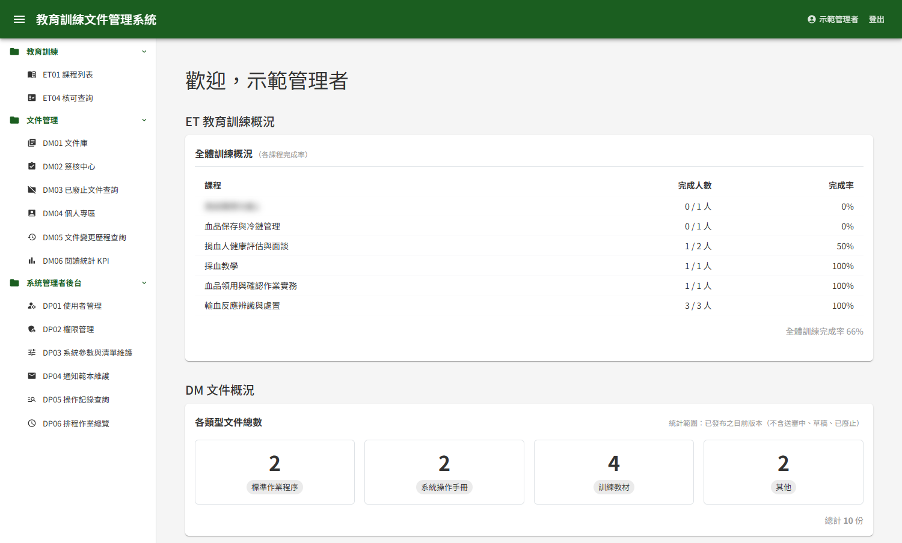
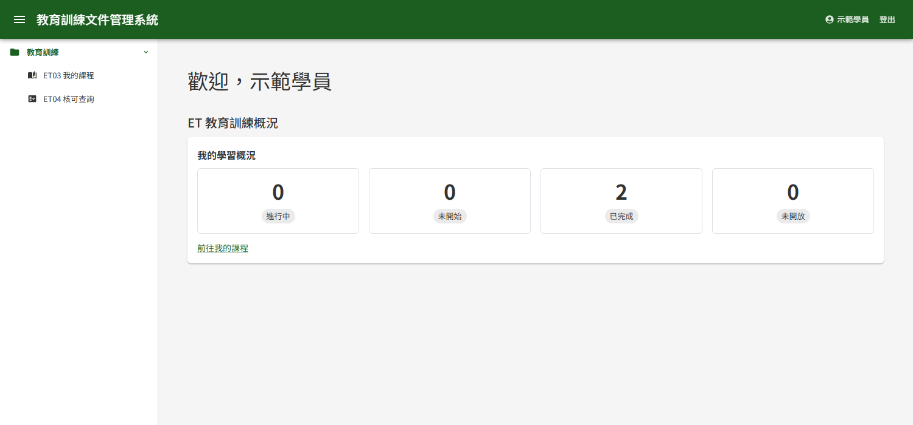
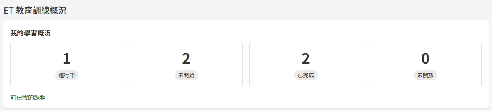
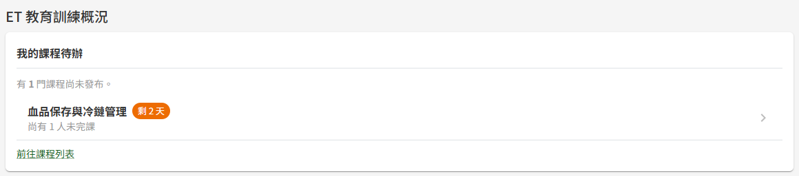

# DP00 登入後主頁

## 作業說明

### 使用情境

本作業為**所有登入者**共用的起始畫面。登入後即進入本頁，也是頂列系統名稱所指向的位置。

本頁有三項用途：

| 用途 | 位置 |
|---|---|
| 確認目前登入的是誰 | 頁面上方的問候語，以及頂列右上的姓名 |
| 前往可使用的作業 | 左側選單，只列出登入者有權使用的作業 |
| 一眼掌握待辦與概況 | 下方的概況區塊，依登入者的身分與資料顯示 |

概況區塊有兩組：「ET 教育訓練概況」與「DM 文件概況」。本手冊說明前者；「DM 文件概況」的內容與操作見 DM00 系統儀表板。

### 進入路徑

- 登入成功後自動進入
- 任何畫面下，按頂列左側的系統名稱「教育訓練文件管理系統」即回到本頁

## 操作說明

### 畫面與前置設定

畫面由三部分組成：頂列、左側選單與內容區。

**頂列**

| 位置 | 作用 |
|---|---|
| 左側的三條線圖示 | 收合或展開左側選單，畫面較窄時可騰出空間 |
| 系統名稱 | 回到本頁 |
| 右上的姓名 | 前往 DP10 個人資料維護，修改姓名、聯絡資料或密碼 |
| 「登出」 | 結束本次登入，回到登入畫面 |

**左側選單**

選單依模組分為「教育訓練」「文件管理」「系統管理者後台」三組，每組可按標題收合或展開。各組與各項目**依登入者的角色顯示**：

| 選單組 | 誰看得到 |
|---|---|
| 教育訓練 | 具任一教育訓練角色者。組內再依角色顯示：課程列表限管理者與教師、學員學習表現限教師、我的課程限學員；核可查詢則三種角色皆可 |
| 文件管理 | 具任一文件管理角色者。組內的簽核中心限審核者；已廢止文件查詢、文件變更歷程查詢與閱讀統計 KPI 限管理者 |
| 系統管理者後台 | 具教育訓練或文件管理任一模組之管理者角色者 |

帳號啟用時（自助註冊或由管理者建立皆同）即自動具備教育訓練的學員角色，因此至少會看到「教育訓練」一組。

若需要使用其他作業，請洽系統管理者於 DP02 權限管理授予角色；角色調整後，重新登入即反映於選單。

**內容區**

上方為問候語「歡迎，」加上登入者姓名，其下依序為「ET 教育訓練概況」與「DM 文件概況」。

### 檢視教育訓練概況

「ET 教育訓練概況」分為三塊，**每一塊都只在有資料時才出現**——同一個人可能看到其中一塊、兩塊或三塊，三塊皆無資料時整組不顯示。

| 區塊 | 誰會看到 | 出現的條件 |
|---|---|---|
| 我的學習概況 | 學員 | 本人已加入至少一門課程 |
| 全體訓練概況 | 管理者 | 系統中至少有一門已發布、且已有學員加入的課程 |
| 我的課程待辦 | 教師 | 本人有課程即將截止，或有尚未發布的課程 |

三塊依上表順序由上而下排列，其中「全體訓練概況」與「我的課程待辦」合放在同一張卡片中。

區塊中的數字皆為**開啟本頁當下即時計算**，不是每日結算。離開本頁後再回來，即依最新資料重新計算。

#### 我的學習概況

列出本人已加入課程的四個數字：

| 數字 | 代表什麼 |
|---|---|
| 進行中 | 已開放學習、已開始但尚未完成全部章節的課程數 |
| 未開始 | 已開放學習、尚未開始任何章節的課程數 |
| 已完成 | 已完成全部章節的課程數 |
| 未開放 | 已加入，但尚未到閱課起始時間的課程數 |

「未開放」的課程**不計入**前三項：課程開放前一律尚未學習，若算進「未開始」，會與「已開放、還沒開始學」混在一起。

四個數字與 ET03 我的課程頁面上方的統計為同一組數字。按「前往我的課程」即進入該頁，查看每門課程的明細。

#### 全體訓練概況

以表格列出每門課程的完成情形，表格下方另有「全體訓練完成率」。

| 欄位 | 代表什麼 |
|---|---|
| 課程 | 已發布或已關閉的課程；**尚未發布的草稿課程不列入**——學員看不到草稿，計入會拉低完成率 |
| 完成人數 | 已完成全部章節的學員數／該課程目前的學員數 |
| 完成率 | 完成人數占學員數的比率 |

課程依**完成率由低到高**排列，最需要關注的課程排在最上方。同名的課程（例如不同年度的同一門年度訓練）分列顯示，不會合併。

完成率一律**無條件捨去到整數**。例如 99.6% 顯示為 99%，避免尚有學員未完成的課程看起來像已全部完成。

「完成人數」以學員**目前**的學習進度計算：課程新增章節後，原已完成的學員會因為尚未學習新章節而不再算作完成。

#### 我的課程待辦

列出本人需要處理的兩類事項：

- **即將截止的課程**：本人開設、閱課期間將於近日結束，且**仍有學員未完成**的課程。每列標示剩餘天數與未完成人數，當天截止者標示「今天到期」。全班皆已完成的課程不列入
- **尚未發布的課程**：顯示「有 N 門課程尚未發布。」——這些課程學員看不到，需於課程列表開啟後發布

「近日」的天數由系統參數「截止前加急提醒天數」決定，預設為 3 天。系統於同一門檻寄送截止前的加急提醒信給未完成的學員，因此本區塊列出的課程，正是該批學員會收到提醒的課程。天數可由管理者於 DP03 系統參數與清單維護調整。

按任一列即進入該課程的編輯頁；按「前往課程列表」進入 ET01 課程列表。

### 登出

按頂列右上的「登出」，系統結束本次登入並回到登入畫面。下次登入後一律從本頁開始。

## 常見訊息與處置

### 其他情況

| 情況 | 說明 |
|---|---|
| 左側選單沒有某一組或某一項作業 | 登入者不具該作業所需的角色。請洽系統管理者於 DP02 權限管理授予；授予後重新登入即顯示 |
| 主頁沒有出現「ET 教育訓練概況」 | 三個區塊皆無資料：本人尚未加入任何課程、沒有即將截止或未發布的課程，且不具管理者角色或系統中尚無已有學員的課程 |
| 主頁沒有出現「DM 文件概況」 | 登入者不具任何文件管理角色 |
| 「我的課程待辦」沒有列出某門將要截止的課程 | 該課程已全班完成、尚未到起始時間，或截止日超出加急提醒天數 |
| 「全體訓練概況」沒有列出某門課程 | 該課程尚未發布，或還沒有任何學員加入 |
| 某門課程的完成率比先前下降 | 該課程新增了章節，原已完成的學員需再完成新章節才算完成 |
