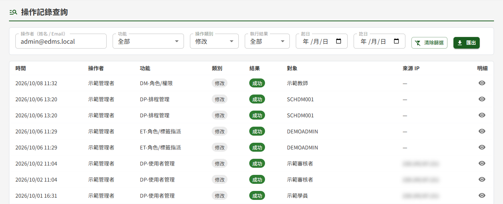
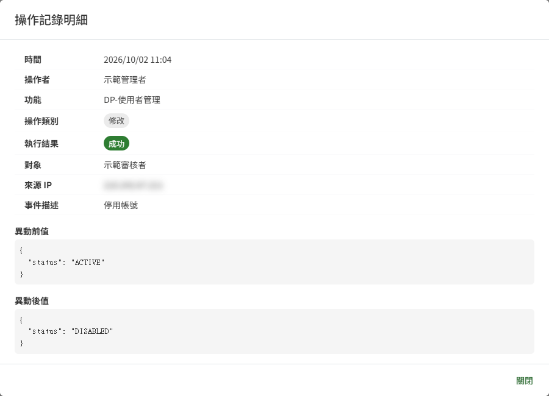

# DP05 操作記錄查詢

## 作業說明

### 使用情境

本作業供**教育訓練或文件管理的管理者**查詢全平台的操作記錄，供資安稽核與異常追查。兩個模組的管理者都可查詢全部記錄，包含登入、登出這類不分模組的事件。

系統會自動記錄下列操作，不需人工登錄：

| 類別 | 例 |
|---|---|
| 帳號與登入 | 登入成功或失敗、登出、變更密碼、密碼重設 |
| 帳號與權限管理 | 建立、停用、啟用帳號；指派角色與授權 |
| 系統設定 | 系統參數、選項清單、通知範本、排程的異動 |
| 文件管理 | 文件的新增與編輯、簽核（核准、退回）、廢止申請、撤回送審 |
| 教育訓練 | 課程維護、學員加入或移除、線下核可、重置作答次數 |
| 資料匯出 | 匯出含個人資料的檔案 |

記錄**只能查詢、無法修改或刪除**。文件的閱讀與下載、學員的學習進度與一般作答不在本作業：前者的閱讀情形於 DM06 閱讀統計 KPI 查看，後者於 ET02 學員學習表現查看。

### 進入路徑

側邊選單「系統管理者後台 → DP05 操作記錄查詢」。

## 操作說明

### 畫面與前置設定

畫面上方為查詢條件，其下為操作記錄清單，依時間由新到舊排列，每頁 20 筆。進入時未設任何條件，即列出全部記錄。

查詢條件**一經變更即自動重新查詢**，畫面上沒有「查詢」按鈕；按「清除篩選」可一次清空所有條件。

### 設定查詢條件

各條件可單獨使用，也可同時設定；同時設定多個條件時，列出**全部條件都符合**的記錄。

| 條件 | 比對方式 |
|---|---|
| 操作者（姓名 / Email） | 比對操作者的姓名或帳號（Email），輸入其中一段文字即可，不分大小寫 |
| 功能 | 選定一項功能。功能名稱前綴標示所屬模組，例如「DP-使用者管理」「DM-簽核」「ET-課程維護」 |
| 操作類別 | 登入、登出、新增、修改、刪除、匯出、查詢 |
| 執行結果 | 成功或失敗。追查登入失敗、權限被拒等異常時，選「失敗」 |
| 起日、訖日 | 依操作發生的日期篩選，起、訖兩日皆含在內，日期以台灣時間計。訖日最晚可選到今天 |

### 檢視查詢結果

清單中各欄看不出來的地方如下：

| 欄位 | 看不出來的地方 |
|---|---|
| 時間 | 台灣時間，顯示到分鐘。需要精確到秒時，請匯出 CSV |
| 操作者 | 顯示姓名；系統排程等非人員操作的記錄，顯示系統的識別碼 |
| 對象 | 被操作的帳號或項目；與特定對象無關的操作（如登入）顯示「—」 |

**檢視單筆明細**

按該列右側的明細鈕，開啟「操作記錄明細」視窗，除清單上的欄位外，另顯示：

- **事件描述**：該次操作的說明，失敗時通常寫明失敗原因
- **異動前值、異動後值**：修改類操作中，資料修改前與修改後的內容，可比對改了什麼；新增類操作只有異動後值，其他類別通常兩者皆為「—」

### 匯出 CSV

按查詢條件右側的「匯出」，系統即下載一份 CSV 檔，內容為**目前查詢條件下的全部記錄**，不限於畫面上的這一頁。

| 項目 | 說明 |
|---|---|
| 欄位 | 操作時間（台灣時間 UTC+8）、操作者帳號、功能、操作類別、執行結果、對象、來源 IP、異動前值、異動後值 |
| 時間 | 台灣時間，精確到秒 |
| 開啟方式 | 可直接以 Excel 開啟，中文不會變成亂碼 |

> 注意：CSV 不含事件描述。需要事件描述時，請於畫面上開啟該筆的明細。

## 常見訊息與處置

### 其他情況

| 情況 | 處置 |
|---|---|
| 「查無符合條件之紀錄」 | 沒有同時符合全部條件的記錄。請減少條件，或按「清除篩選」後重新設定 |
| 「無權限存取操作記錄」 | 不具教育訓練或文件管理的管理者身分。需要時請該模組的管理者於 DP02 權限管理指派 |
