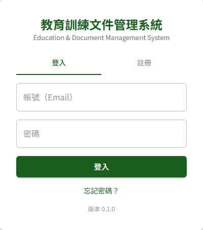
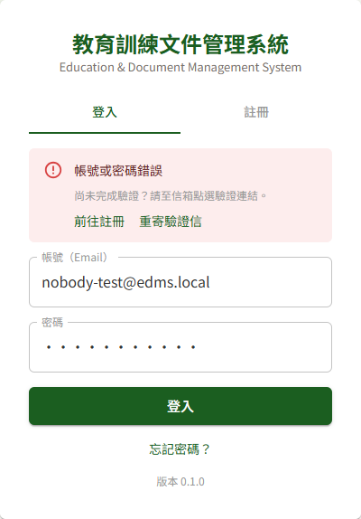
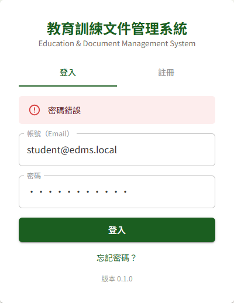

# DP07 使用者登入／登出

## 作業說明

### 使用情境

本作業供**所有使用者**登入與登出系統。教育訓練與文件管理兩個模組共用同一組帳號，登入一次即可使用兩邊有權限的作業。

尚無帳號者請先依 DP08 使用者自助註冊建立帳號；忘記密碼者依 DP09 忘記密碼自行重設。

### 進入路徑

開啟系統網址即出現登入畫面。登入後若因閒置逾時被登出，登入畫面會直接出現在原本所在的頁面上。

## 操作說明

### 畫面與前置設定

登入畫面上方為系統名稱，其下有「登入」與「註冊」兩個頁籤，預設停在「登入」。下方為「忘記密碼？」連結與系統版本號。

回報問題時，請一併提供版本號，方便開發團隊確認所使用的版本。

### 登入

1. 於「帳號（Email）」輸入註冊時使用的 Email
2. 於「密碼」輸入密碼
3. 按「登入」

登入成功後，依進入方式前往不同的畫面：

| 進入方式 | 登入後前往 |
|---|---|
| 直接開啟系統網址 | DP00 登入後主頁 |
| 由通知信中的連結或書籤開啟某一頁 | 該頁 |
| 閒置逾時被登出後重新登入 | 原本所在的頁面 |

登入失敗時，原因以紅底訊息顯示於頁籤下方。若顯示「帳號或密碼錯誤」，表示此 Email 目前沒有可登入的帳號——可能尚未註冊，或已註冊但尚未完成 Email 驗證。訊息下方同時提供三條出路：尚未註冊者按「前往註冊」；已註冊者請至信箱點選驗證連結，找不到信再按「重寄驗證信」。

> 注意：**重新整理瀏覽器頁面會回到登入畫面**，需重新登入。登入狀態只保留在目前開啟的頁面中，關閉分頁或重新整理即結束，重新登入後仍停在原本的頁面。

### 密碼錯誤與帳號鎖定

密碼輸入錯誤時，系統提示「密碼錯誤」並累計失敗次數。**連續錯誤 5 次即鎖定帳號**，鎖定期間即使輸入正確密碼也無法登入。

- 第 5 次錯誤當下仍顯示「密碼錯誤」，再次登入時才顯示「帳號已鎖定，請洽管理者或稍後再試」
- 鎖定 **30 分鐘**後自動解除，或請管理者於 DP01 使用者管理手動解鎖
- 成功登入一次即重新計算失敗次數

失敗次數上限與鎖定時間皆為系統參數，可由管理者於 DP03 系統參數與清單維護調整。

> 重要：不確定密碼時，請改用「忘記密碼？」重設，不要反覆嘗試——錯滿 5 次就會被鎖定。

### 密碼到期時變更密碼

密碼自上次設定起已使用超過 **90 天**者，登入後會先出現「變更密碼」畫面，並提示「密碼已逾效期（或首次登入），請立即變更密碼」。**完成變更前無法使用任何作業。**

效期天數為系統參數「密碼最長效期（天）」，可由管理者於 DP03 系統參數與清單維護調整。

暫不變更者可按「返回登入」離開，下次登入時仍會出現此畫面。

1. 於「舊密碼」輸入剛才登入用的密碼
2. 於「新密碼」與「確認新密碼」輸入新密碼，規則列於欄位下方：至少 8 字元（具教育訓練或文件管理管理者角色者至少 12 字元），含大小寫英文、數字、特殊符號中至少 3 種
3. 按「變更密碼」

變更完成即進入 DP00 登入後主頁，不需重新登入。新密碼**不可與最近 3 次使用過的密碼相同**。

密碼到期前 7 天起，系統每日寄 Email 提醒，可提前於 DP10 個人資料維護自行變更，避免登入時被要求變更。

### 閒置自動登出

**連續 15 分鐘以上沒有任何點擊或鍵盤輸入**，系統自動登出，並於登入畫面提示「閒置逾時已自動登出，請重新登入」。重新登入後回到原本所在的頁面。

實際登出時點落在停止操作後的 15～19 分鐘之間：系統會在停止操作前後自動延長一次登入憑證，因此不會剛好在第 15 分鐘整登出。

只移動滑鼠或捲動頁面不算操作；長時間閱讀文件時，請偶爾點一下頁面。

此外，**單次登入最長可使用 8 小時**，屆時即使持續操作也會自動登出，需重新登入。

### 登出

按頂列右上的「登出」，系統結束本次登入並回到登入畫面。

## 常見訊息與處置

### 被擋下（動作沒有完成）

| 訊息 | 處置 |
|---|---|
| 「帳號或密碼錯誤」 | 此 Email 目前沒有可登入的帳號：尚未註冊，或已註冊但尚未完成 Email 驗證。先確認 Email 沒有打錯；尚未註冊者按訊息下方的「前往註冊」；已註冊者請至信箱點選驗證連結，找不到信可按「重寄驗證信」 |
| 「密碼錯誤」 | 重新輸入密碼，注意大小寫。連續錯誤 5 次會鎖定帳號，不確定時請改用「忘記密碼？」 |
| 「帳號已鎖定，請洽管理者或稍後再試」 | 連續輸錯密碼已達上限。等候 30 分鐘自動解除，或請管理者於 DP01 使用者管理解鎖 |
| 「帳號已停用，請洽管理者」 | 帳號已被管理者停用，或連續 90 天未登入而被系統自動停用。請管理者於 DP01 使用者管理重新啟用 |
| 「操作過於頻繁，請稍後再試」 | 短時間內嘗試過多次，請等候約一分鐘後再試 |
| 「舊密碼不正確」 | 變更密碼畫面的「舊密碼」需填入剛才登入用的密碼 |
| 「不可與最近使用過之密碼相同」 | 新密碼不可與最近 3 次使用過的密碼相同，請另設一組 |

### 有警告（動作完成但需判斷）

| 訊息 | 說明 |
|---|---|
| 「密碼已逾效期（或首次登入），請立即變更密碼」 | 密碼已超過效期。登入已成功，但須完成變更密碼才能繼續使用，見本手冊〈密碼到期時變更密碼〉 |

### 其他情況

| 情況 | 說明 |
|---|---|
| 登入畫面出現「閒置逾時已自動登出，請重新登入」 | 連續 15 分鐘以上未操作（停止操作後 15～19 分鐘之間登出），或單次登入已滿 8 小時。重新登入即回到原本的頁面 |
| 重新整理頁面後回到登入畫面 | 登入狀態不會保留到重新整理之後，重新登入即可，登入後仍停在原本的頁面 |
| 使用中途突然回到登入畫面 | 帳號可能已被管理者停用或鎖定。登入畫面會直接顯示原因（「帳號已停用，請洽管理者」或「帳號已鎖定，請洽管理者或稍後再試」），請依提示處理 |
