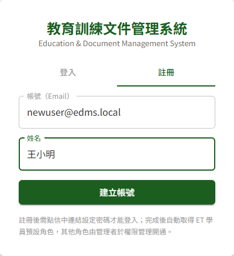
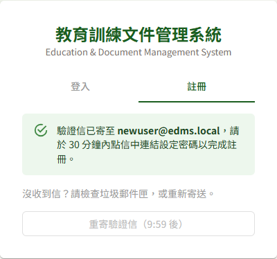
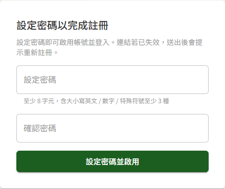

# DP08 使用者自助註冊

## 作業說明

### 使用情境

本作業供**尚無帳號者**自行建立帳號。註冊分兩步完成：

1. 於登入畫面填寫 Email 與姓名，系統寄出驗證信
2. 於驗證信中點選連結，**設定密碼**後帳號即啟用

密碼在第二步才設定，以確保只有實際收得到該信箱的本人能取得帳號。

註冊完成的帳號自動具備教育訓練的**學員**角色，可使用 ET03 我的課程與 ET04 核可查詢。其他角色（教師、教育訓練或文件管理的各類角色）須由管理者於 DP02 權限管理開通。

由管理者於 DP01 使用者管理建立的帳號，會收到另一封「帳號啟用」信，依信中連結設定密碼即可，不需再自行註冊。

### 進入路徑

開啟系統網址，於登入畫面點選「註冊」頁籤。

## 操作說明

### 填寫註冊資料

1. 於登入畫面點選「註冊」頁籤
2. 於「帳號（Email）」輸入本人的 Email，日後登入、重設密碼與各類通知皆使用此信箱
3. 於「姓名」輸入本人姓名，會顯示於頂列及各作業的人員欄位
4. 按「建立帳號」

送出後畫面顯示「驗證信已寄至 ……，請於 30 分鐘內點信中連結設定密碼以完成註冊。」此時帳號**尚未建立**，仍無法登入。

### 重寄驗證信

沒有收到驗證信時，先檢查垃圾郵件匣，仍找不到再按「重寄驗證信」。

- 同一個 Email **每 10 分鐘只能寄送一次**，送出註冊當下即開始計算。冷卻期間按鈕顯示剩餘時間（例如「重寄驗證信（9:59 後）」）且無法按，倒數結束即可再按
- 重寄後，**之前寄出的連結全部失效**，請使用最新一封信中的連結
- 已關閉註冊畫面者，可於登入畫面以該 Email 登入，出現「帳號或密碼錯誤」時按訊息下方的「重寄驗證信」

> 注意：驗證信的連結有效時間為 30 分鐘。超過時間才點連結者，需回到「註冊」頁籤**重新填寫並送出**；此時按「重寄驗證信」不會寄出新信。

### 設定密碼並啟用帳號

1. 開啟驗證信，點選信中的連結，進入「設定密碼以完成註冊」畫面
2. 於「設定密碼」與「確認密碼」輸入同一組密碼。規則列於欄位下方：至少 8 字元，含大小寫英文、數字、特殊符號中至少 3 種
3. 按「設定密碼並啟用」

4. 畫面顯示「帳號已啟用，請以新密碼登入」，點「前往登入」，以 Email 與剛設定的密碼登入

密碼不符規則時，畫面直接於欄位下方提示，修正後再按一次即可，連結不會因此失效。

## 常見訊息與處置

### 被擋下（動作沒有完成）

| 訊息 | 處置 |
|---|---|
| 「此 Email 已有帳號或進行中的啟用程序。……」 | 此 Email 已註冊完成。請直接登入，忘記密碼可用「忘記密碼？」重設 |
| 「操作過於頻繁，請稍後再試」 | 10 分鐘內已從此處對同一個 Email 送出過註冊。請先至信箱找最近寄出的那封，或等候按鈕倒數結束後再試 |
| 「驗證連結無效」 | 連結不完整或已被更新的連結取代。請使用最新一封驗證信中的連結；仍無效者回到「註冊」頁籤重新送出 |
| 「驗證連結已失效，請重新申請」 | 連結已超過 30 分鐘。回到「註冊」頁籤重新填寫並送出，再於 30 分鐘內完成設定密碼 |
| 「兩次輸入之密碼不一致」 | 「設定密碼」與「確認密碼」需輸入相同內容 |
| 密碼長度或字元種類不足之提示 | 依欄位下方的規則重新設定：至少 8 字元，含大小寫英文、數字、特殊符號中至少 3 種 |

### 送出後的結果訊息

| 訊息 | 說明 |
|---|---|
| 「驗證信已寄至 ……，請於 30 分鐘內點信中連結設定密碼以完成註冊。」 | 註冊資料已送出，帳號尚未建立。請至信箱點選連結設定密碼 |
| 「已重新寄出驗證信，請至信箱查收」 | 新的驗證信已寄出，請使用這一封的連結；先前的連結已失效 |
| 「帳號已啟用，請以新密碼登入」 | 帳號已建立並具學員角色，可立即登入 |

### 其他情況

| 情況 | 說明 |
|---|---|
| 註冊後以該 Email 登入，出現「帳號或密碼錯誤」 | 尚未完成設定密碼的步驟。請至信箱點選驗證連結；找不到信可按訊息下方的「重寄驗證信」 |
| 登入後左側選單只有「教育訓練」 | 自助註冊的帳號只具學員角色。需要其他作業者請洽管理者於 DP02 權限管理開通 |
| 註冊時姓名打錯 | 完成註冊並登入後，於 DP10 個人資料維護修改 |
| 畫面顯示已寄出驗證信，卻一直收不到 | 先查看垃圾郵件匣。曾收到「帳號啟用」信者，表示管理者已代為建立帳號，請改用該信中的連結完成設定；不久前曾在其他裝置送出過註冊者，請使用當時寄出的那封信。仍收不到時，請洽管理者於 DP01 使用者管理代為建立帳號 |
