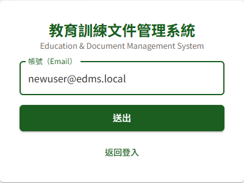
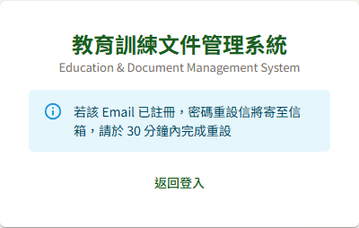
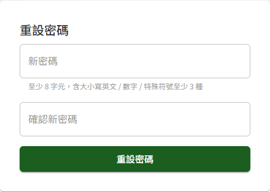

# DP09 忘記密碼

## 作業說明

### 使用情境

本作業供**已有帳號、但忘記密碼者**自行重設密碼，不需透過管理者。重設分兩步完成：

1. 於登入畫面輸入 Email 申請，系統寄出密碼重設信
2. 於重設信中點選連結，設定新密碼

> 注意：重設密碼**不會解除帳號的鎖定或停用**。帳號因連續輸錯密碼被鎖定者，重設後仍需等候鎖定時間結束（預設 30 分鐘）或請管理者解鎖；帳號被停用者需請管理者重新啟用。

### 進入路徑

開啟系統網址，於登入畫面點選「忘記密碼？」。

## 操作說明

### 申請重設密碼

1. 於登入畫面點選「忘記密碼？」
2. 於「帳號（Email）」輸入註冊時使用的 Email
3. 按「送出」

畫面一律顯示「若該 Email 已註冊，密碼重設信將寄至信箱，請於 30 分鐘內完成重設」。為保護帳號資訊，不論 Email 是否已註冊，畫面皆顯示這段相同的文字，而**重設信只寄給已註冊的 Email**——Email 打錯或尚未註冊時，畫面看起來一樣，但收不到信。若遲遲未收到信，請先確認 Email 是否正確並檢查垃圾郵件匣。

按「返回登入」回到登入畫面。

### 設定新密碼

1. 開啟重設信，點選信中的連結，進入「重設密碼」畫面
2. 於「新密碼」與「確認新密碼」輸入同一組密碼。規則列於欄位下方：至少 8 字元，含大小寫英文、數字、特殊符號中至少 3 種
3. 按「重設密碼」

4. 畫面顯示「密碼已更新，請以新密碼登入」，點「返回登入」，以新密碼登入

新密碼**不可與最近 3 次使用過的密碼相同**。

每封重設信的連結**只能使用一次**，且有效時間為 30 分鐘。重複申請時，以**最後一封**信的連結為準，先前寄出的連結隨即失效。

## 常見訊息與處置

### 被擋下（動作沒有完成）

| 訊息 | 處置 |
|---|---|
| 「連結已失效，請重新申請」 | 連結已超過 30 分鐘、已使用過，或之後又申請過一次。回到登入畫面點「忘記密碼？」重新申請，並使用最新一封信的連結 |
| 「連結無效，請重新申請忘記密碼」 | 連結不完整，可能複製時漏掉部分內容。請直接點選信中的連結，或重新申請 |
| 「不可與最近使用過之密碼相同」 | 新密碼不可與最近 3 次使用過的密碼相同，請另設一組 |
| 「兩次輸入之密碼不一致」 | 「新密碼」與「確認新密碼」需輸入相同內容 |
| 密碼長度或字元種類不足之提示 | 依欄位下方的規則重新設定：至少 8 字元，含大小寫英文、數字、特殊符號中至少 3 種 |
| 「操作過於頻繁，請稍後再試」 | 短時間內申請過多次，請等候約一分鐘後再試 |

### 送出後的結果訊息

| 訊息 | 說明 |
|---|---|
| 「若該 Email 已註冊，密碼重設信將寄至信箱，請於 30 分鐘內完成重設」 | 申請已送出。Email 已註冊者會收到重設信；未註冊者不會收到任何信 |
| 「密碼已更新，請以新密碼登入」 | 密碼已重設完成，舊密碼即不可再用 |

### 其他情況

| 情況 | 說明 |
|---|---|
| 申請後一直沒收到信 | 先檢查垃圾郵件匣；再確認輸入的 Email 與註冊時相同。未完成註冊（尚未點驗證信設定密碼）的帳號不會收到重設信，請改依 DP08 使用者自助註冊完成驗證 |
| 重設完成後登入，出現「帳號已鎖定，請洽管理者或稍後再試」 | 重設密碼不會解除鎖定。等候鎖定時間結束，或請管理者於 DP01 使用者管理解鎖 |
| 重設完成後登入，出現「帳號已停用，請洽管理者」 | 重設密碼不會恢復已停用的帳號，請管理者於 DP01 使用者管理重新啟用 |
