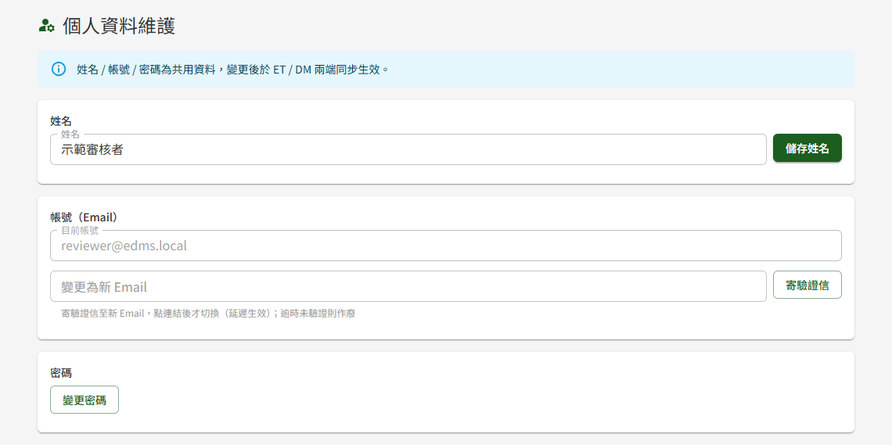
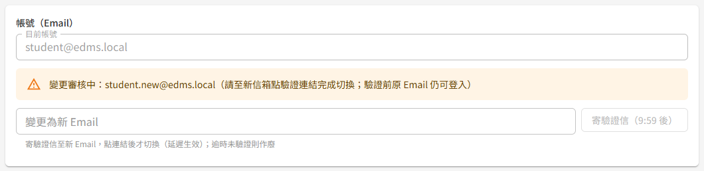
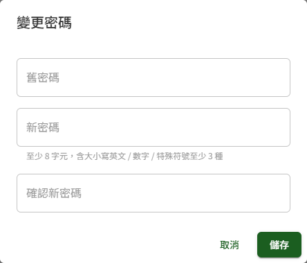

# DP10 個人資料維護

## 作業說明

### 使用情境

本作業供**所有登入者**維護本人的姓名、帳號（Email）與密碼。他人的姓名由管理者於 DP01 使用者管理維護；帳號（Email）與密碼只能由本人變更。

教育訓練與文件管理兩個模組共用同一份個人資料，於本頁修改後兩邊同時生效。

| 項目 | 生效方式 |
|---|---|
| 姓名 | 按「儲存姓名」即生效 |
| 帳號（Email） | 寄驗證信至新 Email，**點選信中連結後才切換**；切換前仍以原 Email 登入 |
| 密碼 | 驗證舊密碼後即生效 |

### 進入路徑

按頂列右上的本人姓名。

## 操作說明

### 畫面與前置設定

畫面由上而下分為「姓名」「帳號（Email）」「密碼」三張卡片，各自獨立儲存。

### 修改姓名

1. 於「姓名」卡片修改姓名
2. 按「儲存姓名」

畫面顯示「姓名已更新」，頂列右上的姓名隨即更新。教育訓練與文件管理各作業中顯示的人員姓名（例如課程建立者、文件撰寫者）一併改為新姓名。

### 變更帳號（Email）

帳號即登入用的 Email，也是密碼重設信與各類通知的收件信箱。為確認新信箱確實可收信，變更須經過驗證：

1. 於「變更為新 Email」輸入新的 Email
2. 按「寄驗證信」，畫面顯示「驗證信已寄至新 Email，請於效期內完成驗證；驗證前原 Email 仍可登入」
3. 卡片中出現「變更審核中：（新 Email）」，提示尚待驗證

4. 至**新信箱**開啟驗證信，於 **30 分鐘內**點選信中的連結
5. 連結開啟後自動完成驗證，顯示「Email 已變更，請以新 Email 登入。」，按「前往登入」以新 Email 登入

完成驗證前，**原 Email 仍是登入帳號**，通知信也仍寄到原信箱。

- 「寄驗證信」**每 10 分鐘只能按一次**，冷卻期間按鈕顯示剩餘時間
- 重新申請時，以**最後一次**寄出的驗證信為準，先前的連結隨即失效
- 超過 30 分鐘未點連結，本次變更作廢，原 Email 照常使用；需要時重新申請即可

### 變更密碼

1. 於「密碼」卡片按「變更密碼」
2. 於視窗中輸入「舊密碼」、「新密碼」與「確認新密碼」
3. 按「儲存」

畫面顯示「密碼已更新」，下次登入即使用新密碼。

新密碼的規則：

| 規則 | 一般使用者 | 具教育訓練或文件管理管理者角色者 |
|---|---|---|
| 最短長度 | 8 字元 | **12 字元** |
| 字元種類 | 大寫英文、小寫英文、數字、特殊符號中至少 3 種 | 同左 |
| 重複使用 | 不可與最近 3 次使用過的密碼相同 | 同左 |

> 重要：**具管理者角色者，新密碼至少需 12 字元**。管理者帳號權限較高，故長度要求較嚴；該要求於本頁變更密碼、密碼到期時的變更（見 DP07 使用者登入／登出），以及忘記密碼後的重設（見 DP09 忘記密碼）皆套用，欄位下方的規則提示會依本人身分顯示；被授予管理者角色當下不需立即變更。

密碼自設定起**每 90 天須變更一次**。到期前 7 天起系統每日寄 Email 提醒，可提前於本頁變更；到期後登入時會先要求變更才能繼續使用，見 DP07 使用者登入／登出。

## 常見訊息與處置

### 被擋下（動作沒有完成）

| 訊息 | 處置 |
|---|---|
| 「此 Email 已被使用」 | 新 Email 已是其他帳號的登入帳號，請改用其他 Email |
| 「操作過於頻繁，請稍後再試」 | 10 分鐘內已寄過驗證信，請先至新信箱找最近寄出的那封，或等候按鈕倒數結束 |
| 「舊密碼不正確」 | 「舊密碼」需填入目前登入用的密碼 |
| 「兩次輸入之新密碼不一致」 | 「新密碼」與「確認新密碼」需輸入相同內容 |
| 「密碼至少 12 字元」、「密碼至少 8 字元」 | 新密碼長度不足。具管理者角色者至少 12 字元，其他使用者至少 8 字元 |
| 「密碼須含大小寫英文 / 數字 / 特殊符號至少 3 種」 | 新密碼需含大寫英文、小寫英文、數字、特殊符號中至少 3 種 |
| 「不可與最近使用過之密碼相同」 | 新密碼不可與最近 3 次使用過的密碼相同，請另設一組 |
| 「連結已失效，Email 變更作廢，原 Email 維持有效」 | 驗證連結已超過 30 分鐘，或之後又重新申請過。原 Email 照常使用；需要變更時回本頁重新申請，並使用最新一封信的連結 |

### 送出後的結果訊息

| 訊息 | 說明 |
|---|---|
| 「姓名已更新」 | 新姓名已於兩個模組生效 |
| 「驗證信已寄至新 Email，請於效期內完成驗證；驗證前原 Email 仍可登入」 | 尚未切換。至新信箱點選連結後才生效 |
| 「Email 已變更，請以新 Email 登入。」 | 新 Email 已生效，原 Email 即不可再用來登入 |
| 「密碼已更新」 | 新密碼已生效 |

### 其他情況

| 情況 | 說明 |
|---|---|
| 卡片中一直顯示「變更審核中」 | 尚未點選新信箱中的驗證連結。若信已超過 30 分鐘，本次變更已作廢，可重新申請 |
| 變更 Email 後收不到驗證信 | 先確認新 Email 輸入無誤並檢查垃圾郵件匣；等候 10 分鐘冷卻結束後可重新寄送 |
