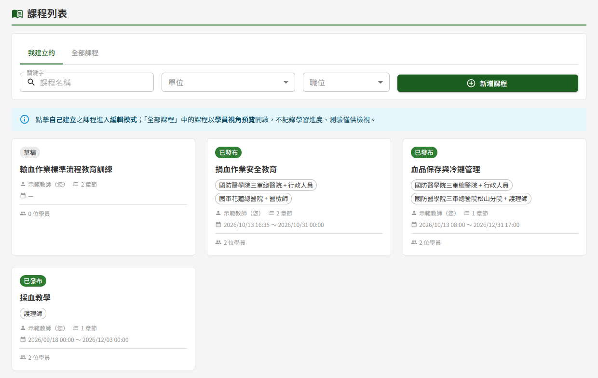
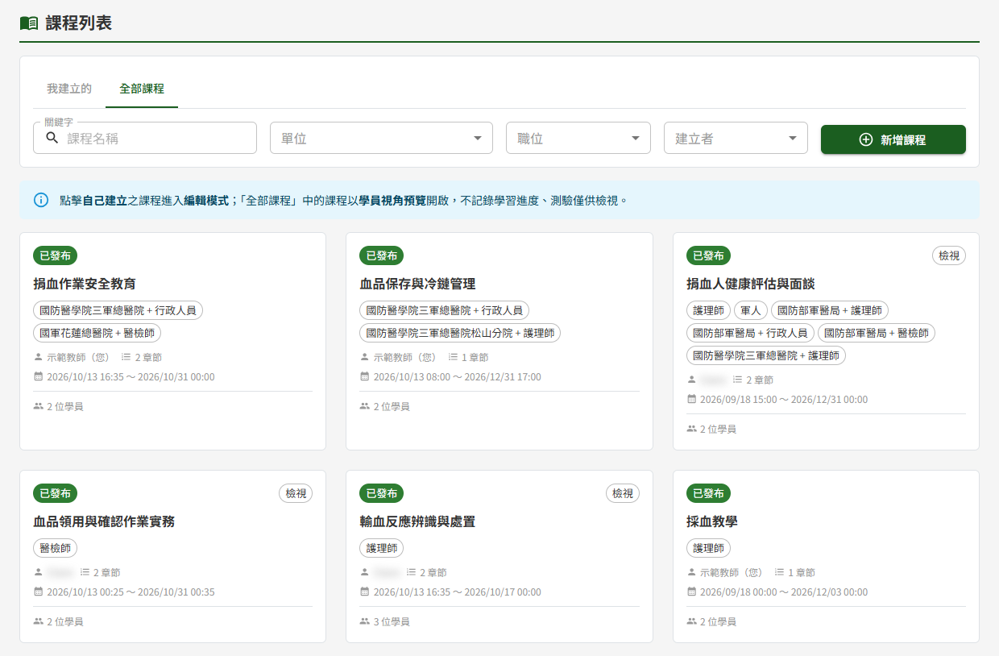
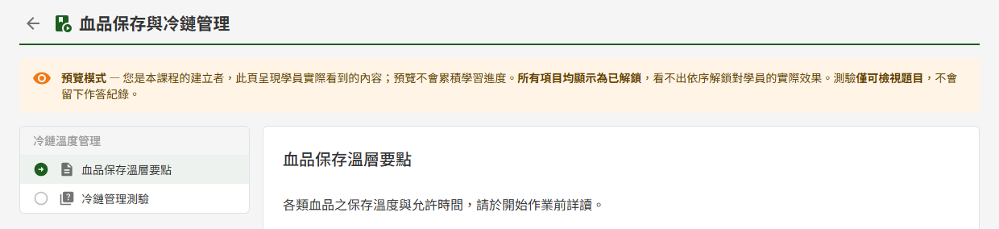

# ET01 課程列表

## 作業說明

### 使用情境

本作業供**具教師或管理者角色者**查找課程，並由此進入課程的編輯或預覽。各角色可做的事如下：

| 角色 | 於本作業可做的事 |
|---|---|
| 教師 | 於「我建立的」管理本人建立的全部課程並進入編輯；按「新增課程」建立新課程；於「全部課程」觀摩其他教師已發布的課程 |
| 管理者（不具教師角色） | 於「全部課程」瀏覽各教師已發布的課程，以學員視角預覽內容 |

課程的建立、編輯、發布、關閉與再開課皆於點入課程後的 ET05 課程建立與編輯進行；本作業為這些動作的入口。學員的學習狀況於 ET02 學員學習表現查看。

### 進入路徑

側邊選單「教育訓練 → 課程列表」。

## 操作說明

### 畫面與前置設定

畫面上方為分頁與查詢條件，其下為操作說明提示，再下方為課程卡片，一頁 12 張，新建立的在前。

兩個分頁列出的課程範圍不同：

| 分頁 | 列出的課程 | 點卡片後進入 |
|---|---|---|
| 我建立的 | 本人建立的全部課程，含草稿、已發布、已關閉 | ET05 編輯頁，可編輯 |
| 全部課程 | 所有教師（含本人）**已發布且閱課期間未過**的課程 | 學員視角的預覽頁 |

「我建立的」分頁與「新增課程」按鈕僅具教師角色者看得到。不具教師角色的管理者進入本作業，畫面只有「全部課程」一個清單。

「全部課程」不列出下列課程：

- 其他教師的草稿與已關閉課程，以及閱課期間已過的課程
- 本人**已以學員身分加入**的課程——這類課程請由「我的課程」進入學習

### 查找課程

查詢條件選定或輸入後，清單隨即更新，不需另按查詢鈕。

| 條件 | 說明 |
|---|---|
| 關鍵字 | 比對課程名稱的任一部分，不分大小寫 |
| 單位、職位 | 比對課程受訓對象中的單位與職位，見下方說明。選「不限」即不以該欄篩選 |
| 建立者 | 僅「全部課程」分頁提供，切換回「我建立的」時自動清除 |

**單位與職位只比對字面**

課程的受訓對象為一組組「單位 + 職位」。篩選時只比對受訓對象上**實際選的值**：

| 篩選條件 | 列出 | 不列出 |
|---|---|---|
| 職位選「護理師」 | 受訓對象為「全單位 + 護理師」或「某單位 + 護理師」的課程 | 受訓對象為「某單位 + 全體」的課程（雖然涵蓋該單位的護理師） |
| 單位選「松山分院」 | 受訓對象單位為松山分院的課程 | 受訓對象為「全單位 + 某職位」的課程 |

要找受訓對象不限職位的課程，職位請選「全體」；要找不限單位的課程，單位請選「全單位」。

> 注意：「不限」與「全體」「全單位」意思不同。「不限」是不篩選；「全體」「全單位」是課程受訓對象上的值，選了只列出受訓對象正好設為該值的課程。

單位與職位同時選時，須是**同一組**受訓對象同時符合。例如課程的受訓對象為「松山分院 + 行政」與「全單位 + 護理師」兩組，以單位「松山分院」加職位「護理師」篩選時，此課程不會列出。

已被管理者停用的單位或職位仍列在下拉中並標示「（已停用）」，可用來查找過去以該值設定受訓對象的課程。

### 卡片上的資訊

卡片上看不出來的規則：

| 項目 | 說明 |
|---|---|
| 課程狀態 | 草稿、已發布、已關閉三種。已發布課程的閱課期間一過，卡片即標示「已關閉」，不必等到每日排程將課程轉為已關閉 |
| 檢視 | 卡片右上標示「檢視」者為其他教師建立的課程，只能預覽、不能編輯 |
| 建立者 | 本人建立的課程於姓名後加註「（您）」 |
| 受訓對象 | 單位為「全單位」者只顯示職位，例如「護理師」即「全單位 + 護理師」 |
| 學員人數 | 目前仍在課程中的學員人數，已被移出課程者不計入 |

### 開啟課程

點整張卡片即可開啟，進入的畫面依所在分頁而定：

- 於「我建立的」點卡片，進入 ET05 課程建立與編輯，可編輯內容並執行發布、關閉、再開課等動作。已關閉的課程同樣可進入編輯並再開課
- 於「全部課程」點卡片，以學員視角開啟課程內容，畫面上方標示「預覽模式」。預覽期間所有項目皆為開放、**不記錄學習進度**，測驗只能檢視題目、不能作答

本人已發布的課程也會出現在「全部課程」，於此點入即可以學員視角確認課程呈現的樣子；要編輯則改由「我建立的」進入。

### 新增課程

按篩選列右側的「新增課程」，進入 ET05 課程建立與編輯的新增畫面。尚未建立任何課程時，「我建立的」清單中央另有「建立第一門課程」，作用相同。

## 常見訊息與處置

### 其他情況

| 情況 | 說明 |
|---|---|
| 顯示「查無符合條件之課程」 | 目前的查詢條件下沒有課程。單位、職位只比對字面，可改選「不限」或「全體」「全單位」再查 |
| 「我建立的」顯示「您尚未建立任何課程」 | 本人尚未建立課程。按「新增課程」或「建立第一門課程」開始 |
| 「全部課程」顯示「目前沒有已發布的課程」 | 目前沒有可觀摩的已發布課程，或已發布的課程皆已過閱課期間、或本人皆已加入 |
| 沒有「我建立的」分頁與「新增課程」按鈕 | 本人不具教師角色。需要建立課程者請洽管理者於 DP02 權限管理授予教師角色 |
| 其他教師的某門課程在「全部課程」找不到 | 該課程為草稿、已關閉、閱課期間已過，或本人已加入該課程。已加入者請由「我的課程」進入 |
| 本人的課程點入後不能編輯 | 由「全部課程」點入的一律為預覽。請改由「我建立的」進入 |
