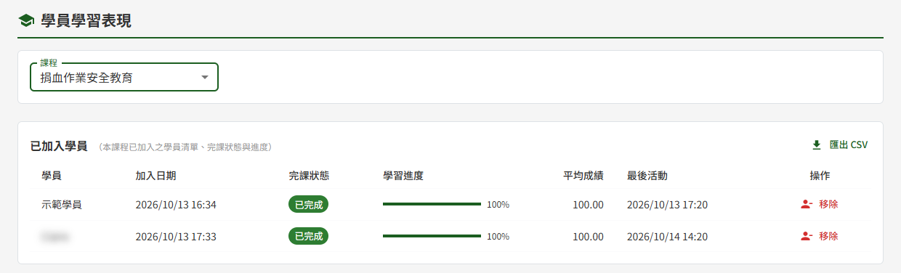
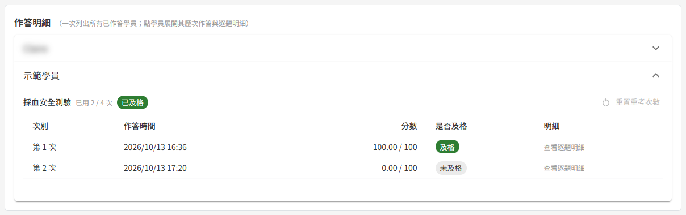
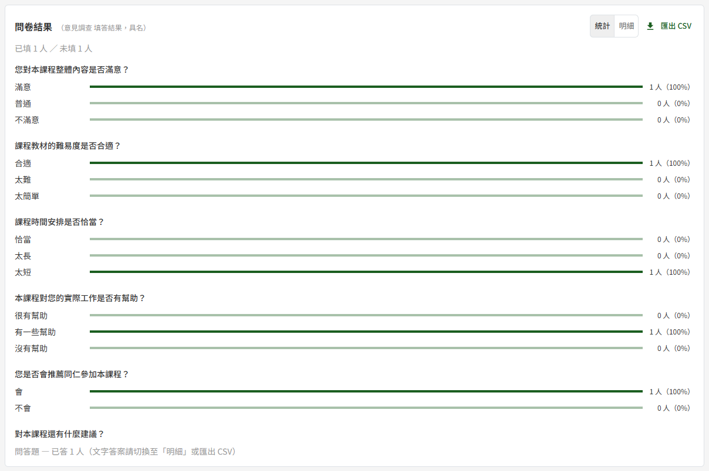

# ET02 學員

## 作業說明

### 使用情境

本作業**僅供具教師角色者使用**，用於追蹤本人所建立課程的學員學習狀況，並對需要線下考核的課程執行核可。

選定一門課程後，畫面由上而下分為三個區塊：

| 區塊 | 用途 |
|---|---|
| 已加入學員 | 每位學員的完課狀態、學習進度與平均成績；可移除學員、匯出清單；需線下核可的課程另於此核可 |
| 作答明細 | 每位學員於各測驗的歷次作答與逐題明細；可重置重考次數 |
| 問卷結果 | 課後問卷的統計與具名明細；可匯出 |

學員經由下列方式加入課程後，即出現在本頁：ET05 課程建立與編輯發布時依受訓對象自動帶入、Email 邀請，或學員於「我的課程」輸入邀請碼自行加入。學員端的學習與作答於 ET06 課程學習、ET07 線上測驗進行；線下核可的結果另可於 ET04 核可查詢跨課程查詢。

本頁所有數字皆於**開啟或重新整理當下即時計算**，不是每日結算；學員剛完成的學習或作答，重新整理即可看到。

> 重要：本頁含學員姓名、個別成績、逐題作答與**具名**問卷填答，個資密度為全系統最高。匯出的 CSV 檔亦含上述內容，請依個資規範保管，勿任意轉寄。

### 進入路徑

側邊選單「教育訓練 → 學員學習表現」，再於上方「課程」下拉選擇要檢視的課程。

## 操作說明

### 畫面與前置設定

「課程」下拉只列出**本人建立**、狀態為已發布或已關閉的課程。草稿課程於發布時才帶入學員，因此不列入；其他教師的課程亦不列入。尚無任何已發布課程時，下拉呈灰色並提示「尚無已發布的課程——課程發布後才會有學員」。

**已關閉的課程為唯讀**

課程已關閉、或閱課訖止時間已過時，選定後上方顯示「此課程已結束閱課期間，目前為唯讀」的提示。此時三區塊照常閱覽、照常匯出 CSV，但「移除」「重置重考次數」以及線下核可的「通過」「不通過」「撤銷」與批次按鈕皆呈灰色。需要管理學員時，請先於 ET05 課程建立與編輯按「再開課」，再開課後上述按鈕即恢復可用。

### 查看已加入學員

選定課程後，「已加入學員」區塊列出目前在課程中的學員，每頁 20 位。各欄在畫面上看不出來的規則：

| 欄位 | 說明 |
|---|---|
| 加入日期 | 學員加入本課程的時點。曾被移除、之後重新邀請回來的學員，為重新加入的時點 |
| 完課狀態 | 「未開始」為尚未完成任何項目；「進行中」為已完成部分項目；「已完成」為課程目前所有項目皆已完成。教材依 ET06 課程學習的完成條件計算，測驗須**及格**才算完成該項目 |
| 學習進度 | 已完成項目數占課程目前項目總數的百分比。教師於已發布課程新增教材或測驗後，總數隨之增加，已完課學員即回到「進行中」 |
| 平均成績 | 每份測驗取該學員歷次作答中的**最高分**，再對該學員**已作答過的測驗**取平均；從未作答的測驗不列入計算。完全沒有作答過任何測驗者顯示「—」 |
| 最後活動 | 該學員最後一次開啟學習項目、交卷或填寫問卷的時間 |

> 重要：平均成績的「—」與「0」意義相反。「—」代表該學員**還沒有作答任何測驗**；「0」代表**作答了但得 0 分**。判斷要催促學習還是要輔導、重置重考次數時，請以此區分。

平均成績只計已作答的測驗，因此課程有兩份測驗而學員只考了第一份時，平均成績即為第一份的最高分。要確認每份測驗各考了幾次、分數多少，請至下方「作答明細」區塊查看。

### 匯出學員清單

按「已加入學員」區塊右上方的「匯出 CSV」，畫面顯示「CSV 已匯出」，檔案存入瀏覽器的下載資料夾。

- 內容為**全班**學員，不受畫面分頁影響
- 欄位依序為學員、加入日期、完課狀態、學習進度、平均成績、最後活動、核可狀態。核可狀態文字與畫面相同；課程未設定線下核可時，該欄一律填「—」
- 時間一律為台灣時間
- 課程已關閉時同樣可以匯出

> 注意：學員清單與問卷結果的匯出動作都會記入平台的操作記錄（匯出人、時間與筆數），管理者可於 DP05 操作記錄查詢查閱。

### 移除學員

學員不應再參加本課程時（例如 Email 邀請時寄錯人），將其移出課程：

1. 於該學員列右側的「操作」欄按「移除」
2. 於「移除學員」確認視窗按「確定」

完成後顯示「已移除學員」。移除的效果如下：

| 對象 | 移除後 |
|---|---|
| 本頁 | 該學員立即自三個區塊消失；不計入完課率，也不計入問卷的未填人數 |
| 學員端 | 「我的課程」不再顯示本課程；以網址直接進入時顯示「您已被該課程移除」；以邀請碼也無法自行加入 |
| 學習紀錄 | 學習進度、作答紀錄與問卷填答完整保留於系統中 |

> 重要：學員**正在作答**測驗時，確認視窗會改以橘色警告呈現「（學員姓名）作答中，移除後其當前作答將保留並計入歷史。確定移除？」。確定後該學員仍可把手上這一次作答交卷並計分，之後即無法再進入課程。

**讓被移除的學員回到課程**

課程的受訓對象**只會帶入從未加入過的學員**，被移除的學員要由教師明確重新邀請：於 ET05 課程建立與編輯按「邀請學員」，以「Email 邀請（補件）」輸入該學員的 Email 寄出。該學員隨即重新出現在本頁，原有的學習進度與成績接續保留，加入日期改為重新邀請的當天。

### 查看作答明細

「作答明細」區塊一次列出**至少交過一次卷**的學員；尚未交卷過的學員只出現在「已加入學員」區塊。

1. 按學員姓名展開，依章節順序列出本課程的每一份測驗
2. 每份測驗的標題列顯示「已用 X / Y 次」——Y 為該測驗可作答的總次數（重考次數上限加 1），X 為本輪已用的次數；已及格者另標示「已及格」
3. 該學員未作答的測驗顯示「尚未作答」；已作答的測驗列出每一次作答的次別、作答時間、分數與是否及格
4. 按任一次作答（不限最近一次），開啟該次的逐題明細

正在作答、尚未交卷的那一次不列入清單，也不計入已用次數，交卷後才出現。

**逐題明細**

逐題明細依**該次作答當時**的題目、選項、配分與正確答案呈現。教師之後修改或刪除題目，已作答的明細與分數維持原樣。

| 標示 | 意義 |
|---|---|
| 題目左側綠色、黃色、紅色 | 分別為答對、部分對、答錯；題目旁顯示「得分 / 配分」 |
| 選項文字為綠色 | 學員選了、且為正確答案 |
| 選項文字為紅色 | 學員選了、但不是正確答案 |
| 選項文字為黃色並註明「（正確答案，未選）」 | 正確答案但學員漏選 |

單選題選對得全部配分、選錯得 0 分；多選題依「選對數減去選錯數」占正確選項數的比例給分，最低 0 分，因此會出現「部分對」。

### 重置重考次數

學員把測驗的作答次數用完仍未及格時，該學員無法再作答、也就無法完成這門課。此時由教師為其重置該測驗的次數。

「重置重考次數」按鈕位於作答明細中每份測驗的標題列，**只有在該學員於該測驗的次數已用盡、且目前未及格時才可以按**。其餘情況按鈕呈灰色，滑鼠移上去會說明原因：

| 停用原因 | 說明 |
|---|---|
| 尚未作答 | 次數本來就是滿的 |
| 已及格 | 已通過該測驗 |
| 尚有 N 次可作答 | 學員可自行重考 |
| 課程已關閉 | 需先再開課 |

1. 於作答明細展開該學員
2. 於該測驗標題列按「重置重考次數」
3. 於確認視窗按「確定」

完成後顯示「已重置重考次數」，該測驗的已用次數回到 0，學員可再作答完整的次數（重考次數上限加 1）。

- 重置以**一份測驗**為單位，其他測驗的次數不受影響
- 歷次作答紀錄與分數**全部保留**，仍可逐次點開檢視；平均成績照樣取歷次最高分

> 注意：教師於 ET05 課程建立與編輯修改測驗時選了「儲存並要求重測」，該批學員原本的及格即不再算數、須重新及格。重測未及格且次數用盡時，「已及格」標示消失、「重置重考次數」即可按。

### 查看問卷結果

課程有建立課後問卷時，才顯示「問卷結果」區塊。區塊上方顯示「已填 N 人 ／ 未填 M 人」，兩者合計為目前在課程中的學員數。課後問卷於學員完課後才開放填寫，因此未填人數含尚未完課的學員。

右上方可切換兩種檢視：

| 檢視 | 內容 |
|---|---|
| 統計 | 單選題列出各選項的人數與百分比（以**該題作答人數**為分母）；問答題只列已答人數 |
| 明細 | 每位填答學員一列，**具名**列出填答時間與各題答案，問答題顯示完整文字 |

問答題的文字答案請切換至「明細」，或匯出 CSV 檢視。

按「匯出 CSV」後顯示「CSV 已匯出」。**不論目前切換在哪一種檢視，匯出內容一律為明細**：每位填答學員一列，含姓名、填答時間與每一題的答案（含問答題全文）。

### 線下核可

課程於 ET05 課程建立與編輯開啟了「本課程需線下核可」時，「已加入學員」區塊上方多一列「本課程需線下核可」的提示與兩個批次按鈕，清單另增「核可狀態」與「核可」兩欄。用於學員線上完課後，教師另行進行的實機操作或口頭考核；結果只有通過與不通過兩種，不記考核分數。

核可狀態與可用的操作：

| 核可狀態 | 意義 | 「核可」欄的按鈕 |
|---|---|---|
| 未達核可資格 | 尚未線上完課 | 無 |
| 待核可 | 已線上完課、尚無核可結果（含已撤銷者） | 通過、不通過；左側可勾選以批次核可 |
| 已通過 | 核可通過，狀態下方顯示核可人與核可時間 | 撤銷 |
| 未通過 | 核可不通過，狀態下方另顯示備註 | 撤銷 |

**逐一核可**

1. 於「待核可」學員列的「核可」欄按「通過」或「不通過」
2. 選「不通過」時，可於確認視窗的「備註（選填）」說明原因，例如未達標準的項目
3. 按「確定」

完成後顯示「已完成核可」。**核可通過時，系統寄一封核可通過通知信給該學員**；不通過與撤銷只記錄結果、由教師自行向學員說明。

**批次核可**

同一梯次考核完成時，可一次核可多人：

1. 勾選清單左側「待核可」學員的勾選框（其他狀態的勾選框呈灰色）
2. 按上方「批次核可通過」或「批次不通過」
3. 確認視窗顯示所選人數，核對無誤後按「確定」

批次核可通過時，每位學員各收到一封通知信。批次不通過時填寫的備註，套用到這次所選的每一位學員。

> 注意：勾選只對**目前這一頁**有效，換頁時勾選即清空。學員超過 20 位時，請逐頁勾選、逐頁送出。

**撤銷核可（改判）**

已有核可結果的學員，「核可」欄只有「撤銷」。要更正結果時，先撤銷再重新核可：

1. 按該學員列的「撤銷」
2. 於「撤銷原因」填寫撤銷的理由（必填，會寫入稽核紀錄）
3. 按「確定」

完成後顯示「已撤銷核可」，該學員回到「待核可」，即可重新按「通過」或「不通過」。重新核可為通過時，學員會再收到一封通知信。

**核可與完課的關係**

核可是完課以外的另一項紀錄：完課狀態、學習進度、平均成績與完課率**只依線上學習計算**，不因核可結果而改變。

已核可的學員若因教師新增教材或測驗而回到「進行中」，核可狀態暫時顯示「未達核可資格」，但原核可紀錄完整保留；該學員補完新增的項目後，即自動回到原本的「已通過」或「未通過」，不需重新核可。

教師於 ET05 課程建立與編輯關閉「本課程需線下核可」後，本頁的核可欄位與按鈕一併隱藏；重新開啟即恢復顯示，既有的核可結果維持原樣。

## 常見訊息與處置

### 被擋下（動作沒有完成）

| 訊息 | 處置 |
|---|---|
| 「請填寫撤銷原因」 | 撤銷原因為必填，填寫後再按「確定」 |
| 「此測驗不符重置條件（次數未用盡、已及格或尚未作答）」 | 開啟畫面後學員的作答狀況已有變化（例如剛好交卷及格）。重新整理後依最新狀態判斷 |
| 「課程已關閉，無法執行此管理動作」 | 開啟畫面後課程已關閉或已過閱課訖止時間。需要管理時先於 ET05 課程建立與編輯再開課 |
| 「查無此學員之選課紀錄」 | 該學員已被移除（可能已於其他分頁或裝置操作過）。重新整理清單 |
| 「學員尚未完課，無法核可」 | 開啟畫面後學員的完課狀態已改變（例如課程剛新增了項目）。待學員完課後再核可 |
| 「無法核可：已有核可紀錄」 | 該學員已有核可結果（可能已於其他分頁或由他人先完成）。重新整理；要改判時先撤銷 |
| 「無法核可：已不在此課程」 | 該學員已被移除。需要核可時先重新邀請 |
| 「核可狀態已被其他人變更，請重新整理後再試」 | 開啟畫面後該學員的核可結果已被變更。重新整理後再操作 |
| 「此課程未啟用線下核可」 | 開啟畫面後課程的「本課程需線下核可」已被關閉。重新整理；需要核可時於 ET05 課程建立與編輯重新開啟 |

### 有警告（動作完成但需判斷）

| 訊息 | 代表什麼 |
|---|---|
| 移除確認視窗以橘色顯示「（學員姓名）作答中，移除後其當前作答將保留並計入歷史。確定移除？」 | 該學員此刻正在作答。確定移除後，手上這一次仍可交卷並計分 |
| 「此課程已結束閱課期間，目前為唯讀」 | 課程已關閉或閱課期間已過，只能閱覽與匯出。需管理時先再開課 |
| 批次核可後顯示「已核可 N 筆；已跳過：…」 | 只有 N 位寫入成功，其餘依括號內的原因跳過：「尚未完課」待學員完課後再核可；「已有核可紀錄」須先撤銷；「已不在此課程」須先重新邀請。N 為 0 時以紅色顯示，表示這次沒有任何一位寫入 |

### 送出後的結果訊息

| 訊息 | 代表什麼 |
|---|---|
| 「已移除學員」 | 學員已移出課程，學習紀錄保留 |
| 「已重置重考次數」 | 該學員於該測驗可重新作答完整次數，歷次紀錄保留 |
| 「已完成核可」 | 核可結果已寫入；結果為通過者已寄出通知信 |
| 「已撤銷核可」 | 該學員回到待核可，可重新核可 |
| 「CSV 已匯出」 | 檔案已存入瀏覽器的下載資料夾 |

### 其他情況

| 情況 | 說明 |
|---|---|
| 側邊選單沒有「學員學習表現」 | 本人不具教師角色。需要時請管理者於 DP02 權限管理設定 |
| 下拉找不到某門課程 | 只列本人建立、已發布或已關閉的課程；草稿與其他教師的課程不列入 |
| 某位學員不在作答明細中 | 該學員尚未交過任何一份測驗的卷 |
| 沒有「問卷結果」區塊 | 該課程沒有建立課後問卷 |
| 已移除的學員在本頁找不到 | 移除後不再顯示於本頁。需要讓其回到課程時，於 ET05 課程建立與編輯以 Email 邀請重新邀請 |
