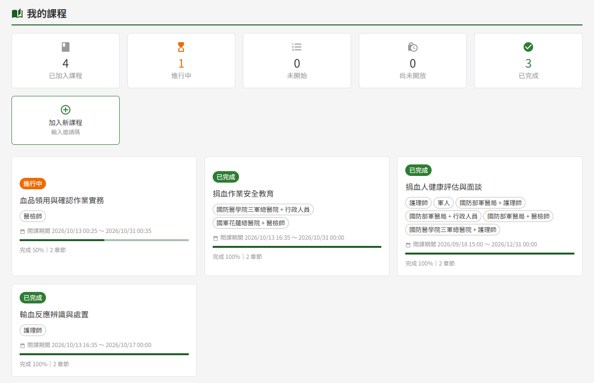
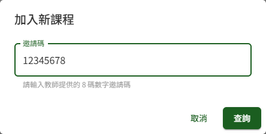
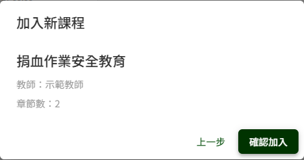

# ET03 我的課程

## 作業說明

### 使用情境

本作業**供具學員角色者使用**，集中呈現本人已加入的全部課程與各課程的學習狀態，並提供以邀請碼自行加入新課程的入口。

學員加入課程的來源有三種：

| 來源 | 學員要做的事 |
|---|---|
| 課程發布時依受訓對象自動加入 | 不需操作，課程直接出現在「我的課程」 |
| 教師以 Email 邀請 | 不需操作，課程直接出現在「我的課程」；通知信只是告知 |
| 教師提供的邀請碼 | 於本作業「加入新課程」輸入邀請碼後加入 |

點課程卡片即進入 ET06 課程學習；章節內的測驗於 ET07 線上測驗作答。

學員退出課程由教師於 ET02 學員學習表現執行「移除」。被移除後，該課程即自「我的課程」清單與統計中移除，原有的學習紀錄由系統保留。

### 進入路徑

- 側邊選單「教育訓練 → 我的課程」
- 登入後主頁「我的學習概況」，按「前往我的課程」
- 開啟教師提供的邀請連結，或以手機掃描邀請 QR Code：登入後直接進入本頁並開啟「加入新課程」視窗、預先填好邀請碼

## 操作說明

### 畫面與前置設定

畫面上方為學習狀態統計與「加入新課程」，下方逐門列出已加入課程的卡片，最近加入的課程排在最前面。

**學習狀態統計**

| 項目 | 計算方式 |
|---|---|
| 已加入課程 | 下列四項的合計 |
| 進行中 | 已開放學習，已完成部分教材或測驗、尚未全部完成 |
| 未開始 | 已開放學習，尚未完成任何一項教材或測驗 |
| 已完成 | 已開放學習，課程內全部教材與測驗皆已完成 |
| 尚未開放 | 已加入、但課程起始時間尚未到達 |

「尚未開放」的課程**不計入進行中、未開始、已完成三項**——此時尚無法開始學習，與「已開放、尚未開始學」是兩種不同的情況。起始時間到達後，該課程自動改計入「未開始」，不需任何操作。

統計於**每次開啟本頁時即時計算**。已關閉的課程依其完成情形照常計入進行中、未開始或已完成。

> 注意：登入後主頁的「我的學習概況」與本頁統計**為同一份數字**，主頁上的「未開放」即本頁的「尚未開放」。主頁的「我的學習概況」於本人已加入至少一門課程後才顯示。

### 課程卡片

每張卡片上方的標記代表該課程目前的狀態：

| 卡片標記 | 代表什麼 | 點擊卡片 |
|---|---|---|
| 進行中、未開始、已完成 | 課程開放學習中，標記為本人的學習狀態 | 進入 ET06 課程學習 |
| 尚未開放 | 課程起始時間未到。卡片改顯示「將於（開放時點）開放學習」，不顯示進度 | 不可點擊 |
| 已關閉（與學習狀態並列） | 課程已由教師關閉，或已過課程訖止時間 | 進入 ET06，**唯讀回看**已學過的內容與成績 |

卡片上的「完成 N%」為**已完成的教材與測驗數 ÷ 課程全部教材與測驗數**；各項教材與測驗何時算完成，見 ET06 課程學習與 ET07 線上測驗。課後問卷**不計入進度**，填寫與否不影響「已完成」。

課程到達訖止時間的當下，卡片即標示「已關閉」，不必等系統每日排程將課程轉為已關閉。

> 注意：教師於已發布的課程新增教材或測驗後，該課程的完成比例隨之下降；原為「已完成」者回到「進行中」，完成新增的項目後即恢復「已完成」。

### 進入課程學習

點開放學習中或已關閉課程的卡片，即進入 ET06 課程學習。已關閉課程僅能回看，不能再累積進度、開始新的測驗作答、解鎖新章節或填寫課後問卷。

### 以邀請碼加入新課程

1. 按畫面上方的「加入新課程」
2. 於「邀請碼」欄輸入教師提供的 8 碼數字邀請碼

3. 按「查詢」，視窗顯示課程名稱、教師與章節數
4. 確認是要加入的課程後按「確認加入」；不是的話按「上一步」重新輸入

「邀請碼」欄只接受數字，最多 8 碼；自通訊軟體複製而夾帶空白或其他符號時，貼上後只保留其中的數字。滿 8 碼才能按「查詢」。

按「查詢」只顯示課程資訊、**不會加入課程**；按下「確認加入」才正式加入。

**加入後的去向**

| 情況 | 結果 |
|---|---|
| 課程已開放學習 | 顯示「已加入課程」，直接進入 ET06 課程學習 |
| 課程尚未開放 | 查詢結果下方提示「本課程將於（開放時點）開放學習」，仍可加入。加入後顯示「已加入，課程開放後即可開始學習」並留在本頁，課程卡片標「尚未開放」，起始時間到達後即可點入學習 |

**已加入的課程**

輸入的邀請碼若是本人已加入的課程（包括發布時自動加入、或由教師以 Email 邀請加入者），系統沿用原有的加入紀錄，依課程狀態處理如下：

| 情況 | 結果 |
|---|---|
| 課程已開放學習 | 按「查詢」後直接進入該課程的 ET06 課程學習 |
| 課程尚未開放 | 顯示「您已加入「課程名稱」，課程開放後即可開始學習」，留在本頁 |

**邀請連結與 QR Code**

教師可提供邀請連結或 QR Code 代替邀請碼。開啟連結（或掃描 QR Code）並登入後，本頁的「加入新課程」視窗會自動開啟並填好邀請碼，按「查詢」確認課程資訊後再按「確認加入」即可，步驟與手動輸入相同。

> 重要：邀請碼於課程**關閉期間失效**，教師再開課後恢復有效。課程訖止時間已過者亦同。

## 常見訊息與處置

### 被擋下（動作沒有完成）

| 訊息 | 處置 |
|---|---|
| 「邀請碼無效，請確認後重試」 | 邀請碼輸入錯誤，或該課程已不存在。核對教師提供的邀請碼後重新輸入 |
| 「此課程目前關閉中」 | 該課程已關閉或已過課程訖止時間，邀請碼暫時失效。請洽教師；再開課後即可加入 |
| 「您已被移除出此課程，如需重新加入請聯繫教師」 | 本人曾被教師移出該課程，無法以邀請碼自行重新加入。請洽教師重新邀請 |

### 送出後的結果訊息

| 訊息 | 代表什麼 |
|---|---|
| 「已加入課程」 | 加入完成，畫面進入該課程的 ET06 課程學習 |
| 「已加入，課程開放後即可開始學習」 | 加入完成，但課程起始時間未到。課程卡片已列於本頁並標「尚未開放」，起始時間到達後即可點入學習 |
| 「您已加入「課程名稱」，課程開放後即可開始學習」 | 本人原本就在該課程中，沿用原有的加入紀錄；課程起始時間到達後即可點入學習 |

### 其他情況

| 情況 | 說明 |
|---|---|
| 課程卡片點不下去 | 該課程標「尚未開放」，卡片上顯示開放時點，屆時即可點入 |
| 由課程通知信的連結進入，顯示「此課程尚未開放，請於開放時間後再進入」 | 課程起始時間未到。屆時再由「我的課程」點入 |
| 進入課程後上方提示「此課程目前關閉中，僅可回看已學內容」 | 課程已關閉或已過訖止時間，僅供回看。需要繼續學習者請洽教師 |
| 原本在清單上的課程不見了 | 本人已被教師移出該課程。如有疑問請洽教師 |
| 主頁沒有「我的學習概況」 | 本人尚未加入任何課程 |
| 側邊選單沒有「我的課程」 | 本人不具學員角色，請洽管理者 |
