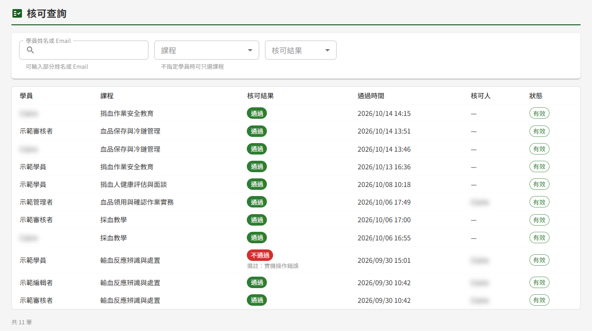
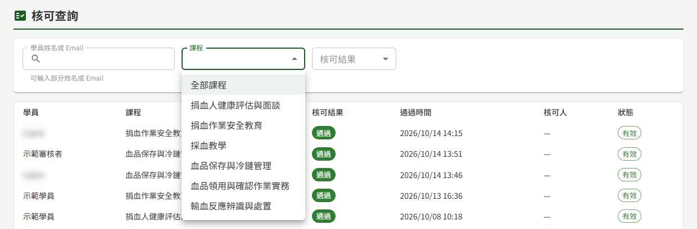
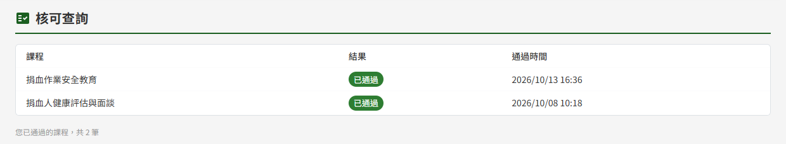

# ET04 核可查詢

## 作業說明

### 使用情境

本作業供**具任一教育訓練角色者**查詢學員的受訓完成狀況，依角色看到的內容不同：

| 角色 | 於本作業可做的事 |
|---|---|
| 教師、管理者 | 依學員姓名或 Email、課程、核可結果查詢**全部課程、全部學員**的通過、不通過與已撤銷紀錄；兩種角色的查詢範圍相同 |
| 學員 | 查看**本人已通過**的課程清單 |

本作業為唯讀查詢。線下核可的「通過」「不通過」與撤銷，由開設課程的教師於 ET02 學員學習表現執行，結果即時反映於本作業。

本作業所稱「通過」有兩種成立方式，畫面上不加區分：

| 課程設定 | 何時列為通過 | 通過時間 | 核可人 |
|---|---|---|---|
| 需線下核可 | 教師於 ET02 核可為「通過」，且未撤銷 | 核可當下的時間 | 執行核可的教師 |
| 不需線下核可 | 學員完成課程全部項目 | 學員第一次完成全部項目的時間 | 顯示「—」 |

> 重要：**需線下核可的課程，學員線上完課後、教師尚未核可前，不會出現在本作業**——查詢結果為「查無」不代表該學員未受訓，可能只是尚待教師核可。排班前確認受訓狀況時，請一併向開設課程的教師確認。

課程是否需線下核可，由教師於 ET05 課程建立與編輯的「本課程需線下核可」設定。

### 進入路徑

側邊選單「教育訓練 → 核可查詢」。同時具教師或管理者角色與學員角色者，進入後一律為查詢畫面；本人已通過的課程，可於查詢欄輸入本人姓名查得。

## 操作說明

### 畫面與前置設定

以教師或管理者身分進入時，上方為查詢列（「學員姓名或 Email」「課程」「核可結果」），下方為查詢結果與筆數，每頁 20 筆。

進入畫面即依預設條件（全部課程、全部結果）列出全部紀錄。查詢列**任一條件變動即自動重新查詢**，不需按查詢鈕；條件變動後回到第 1 頁。

> 注意：**未輸入學員姓名或 Email 的查詢**（包括一進入畫面時的全部列出、只選課程或結果的查詢），系統會留下一筆操作記錄，內容為查詢者、課程與結果條件及查得筆數，不含任何學員姓名或 Email。管理者可於 DP05 操作記錄查詢以操作類別「查詢」查閱，事件描述為「核可查詢（未指定學員）」。離開本視窗再切換回來時，畫面會依目前條件自動重新查詢，同樣留下一筆記錄。輸入學員姓名或 Email 的查詢不留此記錄。

### 依學員查詢

於「學員姓名或 Email」輸入要查的人，停止輸入片刻後即列出結果。比對方式如下，不分大小寫：

| 輸入內容 | 比對方式 |
|---|---|
| 姓名 | 姓名中含有輸入的字即列出，可只輸入一部分 |
| Email「@」之前的部分 | 含有輸入的字即列出，可只輸入帳號中的一段 |
| 完整 Email | 須與該學員的 Email 完全相同 |

> 注意：Email「@」之後的網域部分**不列入部分比對**，只輸入網域查不到任何人。同名同姓時，改以 Email 查詢即可區分。

### 依課程查詢

於「課程」下拉選擇課程，即列出該課程的全部紀錄；不選則列出全部課程。

下拉列出**已有核可紀錄（含不通過與已撤銷）的課程**，以及**已有學員完成的不需線下核可課程**，依課程名稱排序，不限開設者，已關閉的課程也在其中。尚無任何人完成或被核可的課程不會出現在下拉中。

> 注意：課程下拉的內容於進入畫面時載入，距上次載入約 5 分鐘後重新進入本作業，或切換回本視窗，才會更新。剛完成第一筆核可的課程若尚未出現在下拉中，待約 5 分鐘後再進入本作業即可。

### 依核可結果篩選

「核可結果」的四個選項與列出的紀錄：

| 選項 | 列出的紀錄 |
|---|---|
| 全部結果 | 通過、不通過與已撤銷皆列出 |
| 僅通過 | 目前有效的通過，含不需線下核可課程的完課；**不含已撤銷者** |
| 僅不通過 | 目前有效的不通過；不含已撤銷者 |
| 僅已撤銷 | 只列出已撤銷者，不論原本判定為通過或不通過 |

三個查詢條件可任意組合，例如選定課程再選「僅不通過」，即列出該課程目前不通過的學員。

### 檢視查詢結果

畫面上看不出來的欄位說明：

| 欄位 | 說明 |
|---|---|
| 核可結果 | 已撤銷者顯示「已撤銷（原通過）」或「已撤銷（原不通過）」，整列以淡色呈現。核可時填寫的考核備註，顯示於下方「備註：」 |
| 通過時間 | 需線下核可的課程為教師作出判定的時間，判定為不通過者亦同；不需線下核可的課程為學員第一次完成全部項目的時間。顯示「—」者為系統開始記錄完課時間之前即已完課的學員 |
| 核可人 | 不需線下核可的課程沒有核可人，顯示「—」 |
| 狀態 | 「有效」或「已撤銷」；已撤銷者下方列出撤銷人、撤銷時間與撤銷原因 |

同一位學員於同一門課程只有一筆紀錄。撤銷後由教師於 ET02 重新核可，該列即改為最新的判定，狀態回到「有效」，先前的撤銷資訊不再顯示。

**考核備註與撤銷原因的顯示範圍**

考核備註與撤銷原因屬於該課程的考核評語，**僅開設該課程的教師與管理者看得到**：

| 查詢者 | 本人開設的課程 | 他人開設的課程 |
|---|---|---|
| 管理者 | 顯示備註與撤銷原因 | 顯示備註與撤銷原因 |
| 教師 | 顯示備註與撤銷原因 | 不顯示備註與撤銷原因；「已撤銷」狀態、撤銷人與撤銷時間照常顯示 |

需要了解他人課程的考核備註或撤銷原因時，請洽開設該課程的教師或管理者。

### 學員查看已通過課程

學員進入本作業，即列出本人已通過的課程、結果與通過時間，沒有查詢條件。

清單內容如下：

- 列出需線下核可且已核可通過的課程，以及不需線下核可且已完成的課程
- 不通過與已撤銷的紀錄不列出；原本已列出的課程，教師撤銷核可後即自清單移除
- 需線下核可的課程完成線上學習後，待教師核可通過才會列入

## 常見訊息與處置

### 其他情況

| 訊息或情況 | 處置 |
|---|---|
| 「查無符合條件的紀錄。」 | 依目前條件沒有任何紀錄。查詢特定學員時，可改以 Email 查詢或縮短輸入的字；若該學員修習的是需線下核可的課程，可能已完成線上學習但教師尚未核可，請洽開設課程的教師於 ET02 學員學習表現核可 |
| 「課程」下拉呈灰色，下方顯示「系統中尚無通過紀錄」 | 系統中尚無任何核可紀錄或完課紀錄，可直接以學員姓名或 Email 查詢；待教師核可或學員完課後即有選項 |
| 「您目前尚無已通過的課程」 | 學員本人尚無已通過的課程。需線下核可的課程於教師核可通過後才會列入 |
| 看不到考核備註或撤銷原因 | 該課程非本人開設，請洽開設課程的教師或管理者 |
| 「操作過於頻繁，請稍後再試」 | 短時間內查詢、翻頁或核可的次數過多，稍候約一分鐘再操作 |
