# ET05 課程建立與編輯

## 作業說明

### 使用情境

本作業**供教師建立與編輯自己的課程**。各角色可做的事如下：

| 角色 | 於本作業可做的事 |
|---|---|
| 教師 | 建立新課程；編輯、發布、關閉與再開課**自己建立的**課程；刪除自己的草稿課程 |
| 教師、管理者 | 於課程列表「全部課程」分頁點課程（含本人已發布的課程），以學員視角預覽內容（不記錄進度、測驗僅供檢視） |

一門課程的完整內容包含課程基本資料、章節、教材、測驗與課後問卷，於內容齊備後發布。課程發布後，系統依課程所設的受訓對象，自動將符合的學員加入課程並各寄一封通知信，學員即可於「我的課程」看到這門課程。

課程建立後的後續作業銜接如下：學員的學習狀況於 ET02 學員學習表現查看；學員端的學習與作答於 ET06 課程學習、ET07 線上測驗進行。

課程的擁有者於建立當下記錄，**永久不可變更、亦不可轉讓**。

> 重要：建立課程的教師若日後帳號停用，該課程即無人可再編輯——課程列表的建立者會顯示為「姓名（已停用帳號）」。需要異動時由其他教師另建一門課程。

### 進入路徑

側邊選單「教育訓練 → 課程列表」，再依下表其中一種方式進入：

| 要做的事 | 進入方式 |
|---|---|
| 建立新課程 | 點篩選列右側的「新增課程」 |
| 編輯既有課程 | 於「我建立的」分頁點該課程卡片 |
| 預覽課程（含本人的已發布課程） | 於「全部課程」分頁點該課程卡片，進入學員視角的預覽頁 |

「新增課程」與「我建立的」分頁僅具教師角色者看得到。「全部課程」只列出已發布、在閱課期間內、且本人尚未加入的課程。

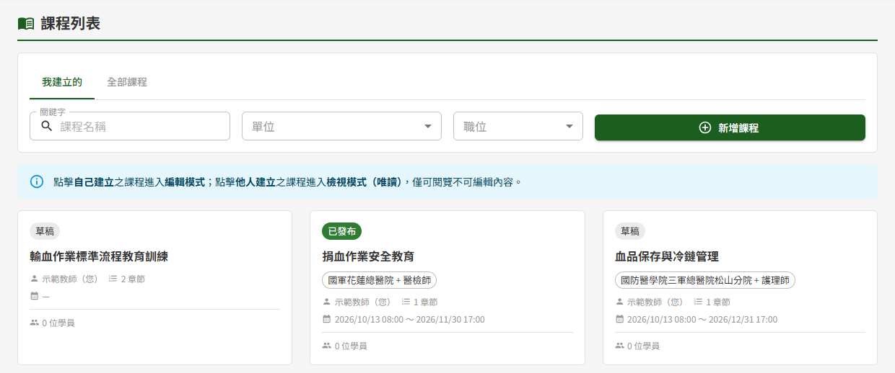

## 操作說明

### 畫面與前置設定

畫面自上而下依序為：標題列（課程狀態標記與右上操作按鈕）、基本資料、章節編排、課後問卷，最下方為固定於畫面底部的動作列。

課程狀態決定畫面上出現哪些操作：

| 課程狀態 | 標題列右上 | 底部動作列 |
|---|---|---|
| 新增中（尚未儲存） | 不顯示操作按鈕 | 取消、儲存草稿、儲存並發布（灰色，需先儲存草稿） |
| 草稿 | 不顯示操作按鈕 | 刪除草稿、取消、儲存草稿、儲存並發布 |
| 已發布（閱課期間內） | 邀請學員、關閉課程 | 取消、更新 |
| 已關閉 | 不顯示操作按鈕 | 取消、保留編輯、更新並重開課 |
| 已發布但閱課期間已過 | 不顯示操作按鈕 | 取消、保留編輯、更新並重開課 |

「儲存並發布」只在草稿狀態出現。已發布與已關閉的課程**沒有「儲存」鈕**：學員已經看得到這門課程，所以基本資料、受訓對象、章節、教材、測驗與課後問卷的編輯都先保留在編輯頁上，按「更新」（或「更新並重開課」）並通過檢核後才**一次**對學員生效，詳見〈更新已發布課程的內容〉與〈關閉課程與再開課〉。

閱課期間已過的課程，在系統每日排程將其轉為「已關閉」之前，課程狀態仍顯示「已發布」，但學員端已視同關閉，對教師而言與已關閉的課程是同一件事：標題列右上不顯示「邀請學員」「關閉課程」，底部動作列與已關閉的課程相同，上方同樣顯示「此課程已關閉」的提示。本手冊以下所稱「已關閉」皆含這種課程。

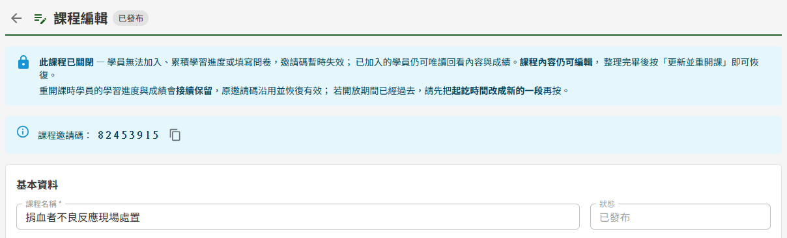

**預覽課程**

以學員視角檢視整門課程時，於課程列表「全部課程」分頁點該課程卡片（見 ET01 課程列表）。預覽期間所有章節皆為開放、**不記錄學習進度**，測驗只能檢視題目、無法作答，課後問卷只能檢視題目、無法送出（見 ET06 課程學習）。

> 注意：預覽呈現的是**學員目前看到**的內容，編輯頁中尚未按「更新」的編輯不會出現在預覽中。「全部課程」只列出已發布且閱課期間未過的課程，因此草稿、已關閉與閱課期間已過的課程沒有預覽入口。

下列前置資料由管理者於平台後台維護，教師無法自行新增，缺漏時請先請管理者處理：

| 前置資料 | 影響 |
|---|---|
| 受訓對象的單位與職位 | 可選的單位與職位清單於 DP03 系統參數與清單維護管理；決定發布時自動邀請哪些學員 |
| 訓練教材文件 | 教材可引用的文件僅來自文件管理「訓練教材」分類之已發布文件 |
| 通知信範本 | 發布與邀請所寄出的信件，主旨與內文統一維護，教師不可逐課修改 |

### 建立課程基本資料

1. 填寫「課程名稱」
2. 於「受訓對象」每列選一組「單位」與「職位」，需要多組時按「新增受訓對象」加列
3. 設定「課程起始時間」與「課程訖止時間」
4. 需要線下考核者，開啟「本課程需線下核可」
5. 「課程描述」選填，至多 500 字
6. 按底部「儲存草稿」

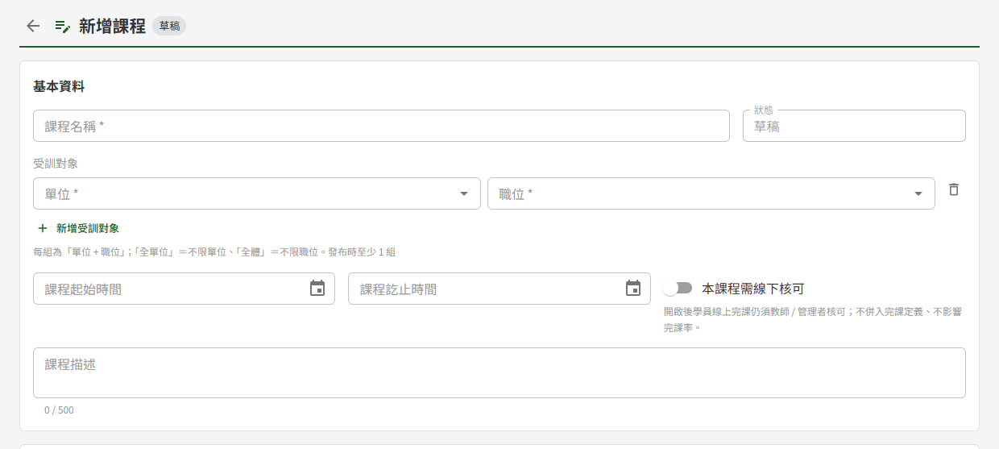

> 重要：草稿階段**只有課程名稱必填**，受訓對象與起訖時間留空仍可存成草稿，但發布時會被擋下。受訓對象的列**一旦開始填就要填完**：只選了單位或職位其中一欄的列、或與其他列重複的組合，連儲存草稿都會被擋下，請補齊或按該列的刪除鈕移除。

**受訓對象**

每列為一組「單位 + 職位」。學員本人的受訓對象（於 DP02 權限管理設定）與課程的任一組相符，發布時即被自動加入。「全單位」代表不限單位、「全體」代表不限職位；兩者都選即為全部學員。

各欄位在畫面上看不出來的規則：

| 欄位 | 看不出來的地方 |
|---|---|
| 受訓對象 | 決定發布時自動邀請誰，課程的建立者本人不會被加入。草稿與已關閉的課程可自由增刪；**已發布的課程，既有的組別鎖定**（兩欄停用、無刪除鈕），只能新增新的組別。管理者停用的單位或職位，在既有組別中會標示「（已停用）」 |
| 課程起始時間、課程訖止時間 | 點欄位右側的日曆鈕選擇日期與時間，以 24 小時制呈現（如 2026/10/15 14:00），選好後按「確認」 |
| 課程起始時間 | 起始時間到達前，學員在「我的課程」**看得到**該課程（卡片標「尚未開放」、不可點擊、標示開放時點），但**無法進入學習**——連用網址直接開也會被擋下；教師端不受影響，仍可正常編輯與預覽 |
| 課程訖止時間 | 到達訖止時間後，學員即無法再學習與作答；課程狀態於系統每日排程執行時自動轉為「已關閉」，不需教師操作 |
| 本課程需線下核可 | 學員線上完課後仍須教師或管理者另行核可。此設定**不影響完課率**，且草稿、已發布、已關閉狀態皆可調整 |

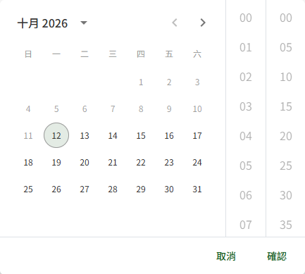

起始時間不可設為過去的時間；但已開課的課程再次編輯時，原本就落在過去的起始時間可以沿用，只是不能再往前調整。

按「儲存草稿」後畫面會**回到課程列表**，不會停留在編輯頁。

已發布與已關閉課程的基本資料（課程名稱、受訓對象、起訖時間、本課程需線下核可、課程描述）於按「更新」「更新並重開課」或「保留編輯」時與其他編輯一起送出；只改了基本資料、未按其中任何一顆就離開，這些修改不會保留。

**已發布後新增受訓對象，按「更新」時寄信**

已發布課程新增一組受訓對象並按「更新」生效後，系統對該組相符、且尚未加入本課程的學員執行補邀請並逐一寄出通知信；已在課程中的學員不受影響、不會重複收信，曾被教師移出課程的學員也不會被重新加入。已關閉課程新增的受訓對象，於「更新並重開課」時一併帶入（見〈關閉課程與再開課〉）。

### 刪除草稿課程

草稿課程不再需要時，按底部動作列最左側的「刪除草稿」，於確認視窗按「確認刪除」。課程連同其章節、教材、測驗與課後問卷一併移除，**無法復原**。已發布與已關閉的課程無法刪除。

### 編排章節

於「章節編排」區按「新增章節」，於視窗中填章節名稱後儲存。需要連續建立多個章節時，按「儲存並繼續新增」可留在視窗中接著填下一個。

> 注意：新增課程尚未儲存前所建立的章節，只暫存在畫面上，按「儲存草稿」時才與課程一起寫入；未儲存就離開，這些章節不會保留。草稿課程儲存後，章節、教材、測驗與問卷皆各自即時存入課程；已發布與已關閉課程的這些編輯則先保留在編輯頁上，按「更新」（已關閉課程為「更新並重開課」）後才對學員生效。

章節建立後可直接於列上修改名稱，**游標離開欄位即自動儲存**，沒有另外的儲存按鈕。

拖曳章節左側的手把可調整順序；章節內的教材與測驗同樣以手把拖曳調整。學員必須依序完成每個章節才能進入下一章，此規則系統內建，不需逐章設定。

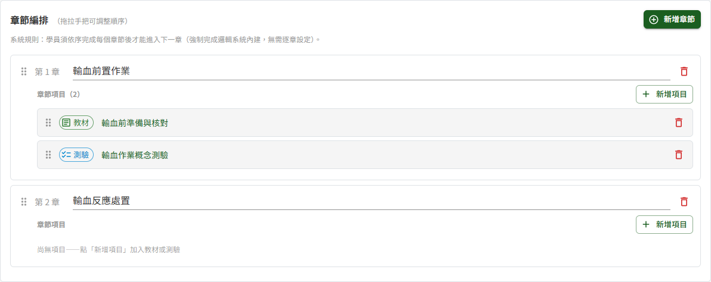

> 重要：刪除章節會**連帶移除學員在該章節的學習紀錄與測驗成績**，且不再計入完課率。刪除前會跳出確認視窗，確認後後續章節的順序自動往前遞補。已發布與已關閉課程的學員紀錄於按「更新」（或「更新並重開課」）生效的當下才移除。

**新增教材或測驗**

於章節內按「新增項目」，選「教材」或「測驗」後，於「新增教材」（或「新增測驗」）視窗填寫名稱並按「建立」，系統隨即開啟該項目的編輯視窗。

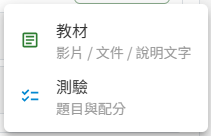

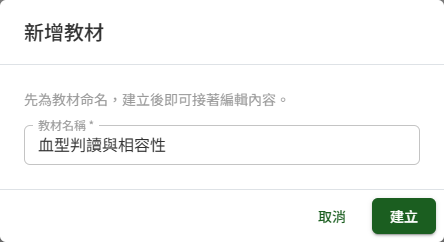

新增課程尚未儲存時按「新增項目」，系統會先檢查課程基本資料，接著在按下「建立」時自動把課程存成草稿（畫面顯示「已自動儲存草稿」）並轉入該課程的編輯頁，再開啟項目視窗。這是正常流程，不是操作失敗；此時課程已經建立，離開本頁也不會遺失。

剛建立的項目若在第一次儲存前就關閉視窗（教材按「取消」、測驗按「關閉」），該項目會被移除，不會留下空白項目。

### 新增教材

於教材編輯視窗中，「項目標題」已帶入建立時填的名稱，可再修改。教材由三類素材自由組合，至少要提供其中一項：

| 素材 | 說明 |
|---|---|
| 說明文字 | 於編輯器直接撰寫 |
| 影片檔 | 支援的格式與單檔大小上限顯示於上傳區（預設為 mp4 / webm、500 MB，由 IT 人員於系統參數設定）；長度由系統自動解析 |
| 教材文件 | 自文件管理「訓練教材」分類選取 |

填妥後按「儲存」。

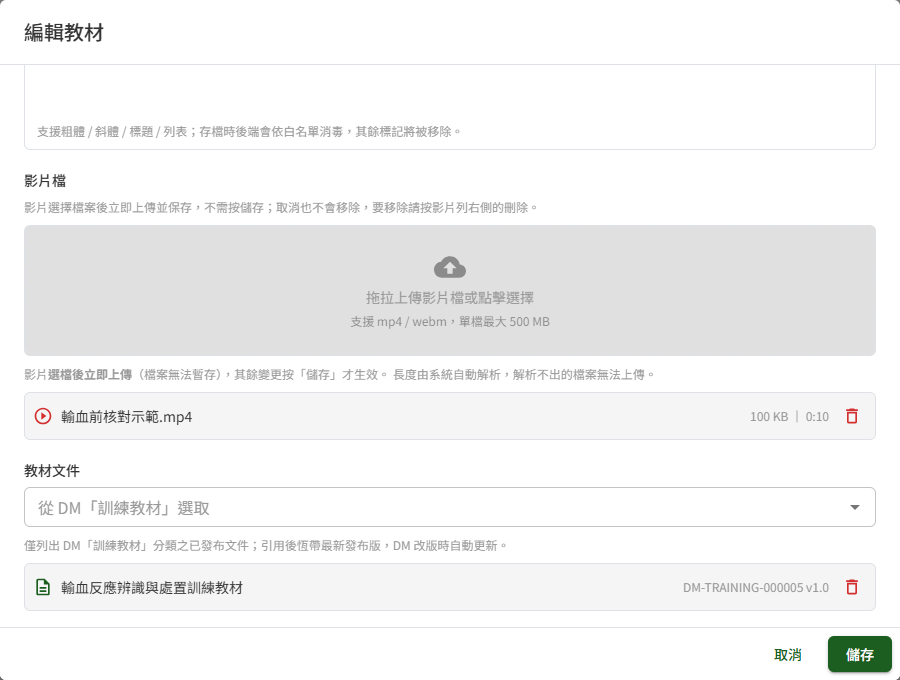

> 重要：**影片是選檔後立即上傳**，其餘變更（標題、說明文字、文件引用的增刪）一律按「儲存」才生效。因此上傳影片後才按「取消」，影片仍會留在教材中，需要再開啟教材將它移除。

引用文件時，下拉只列出已發布的文件。引用後**恆帶最新發布版本**——文件管理端改版後，學員下次開啟章節即取得新版，教師不需回頭更新。

引用的文件於文件管理端發布新版本或被廢止時，系統於每日排程寄 Email 通知課程建立者並列出受影響的課程：改版信提醒確認測驗題目是否仍符合新內容（草稿課程不寄），廢止信提醒移除引用。剛加入引用時不寄信：改版信以加入引用後**第一次排程執行時**的版本為基準，其後再發布的新版本才會寄信。

引用的文件若被廢止，該筆旁邊會顯示「此文件已廢止」標籤，而且**課程會因此無法發布**。處理方式是開啟該教材編輯視窗，於教材文件區移除廢止文件的引用後按「儲存」。若顯示的是「文件已失效」，表示該文件在文件管理端已取不到，同樣需要移除引用。

### 建立測驗與題目

測驗編輯視窗分「測驗設定」與「題庫管理」兩個分頁。

「測驗設定」分頁填寫下列欄位後按「儲存」：

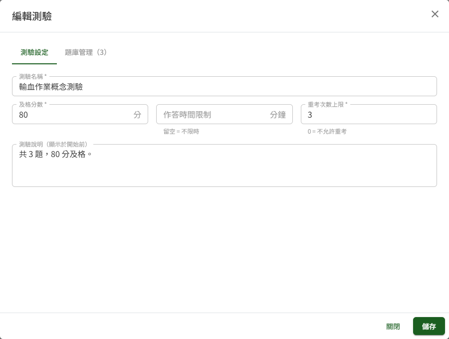

| 欄位 | 看不出來的地方 |
|---|---|
| 及格分數 | 預設 80，範圍 0 至 100 |
| 作答時間限制 | **留空表示不限時**；填入數字即為限時分鐘數 |
| 重考次數上限 | 預設 3，範圍 0 至 999；**填 0 表示不允許重考** |
| 測驗說明 | 選填，顯示於學員按下開始作答之前 |

「題庫管理」分頁按「新增題目」逐題建立。每題設定題型（單選或多選）、題幹、配分與選項，單選以圓鈕標記唯一正確答案、多選以核取方塊勾選所有正確答案。每題選項數為 2 至 6 個，配分範圍 1 至 100 分。填妥後按該題的「儲存題目」。

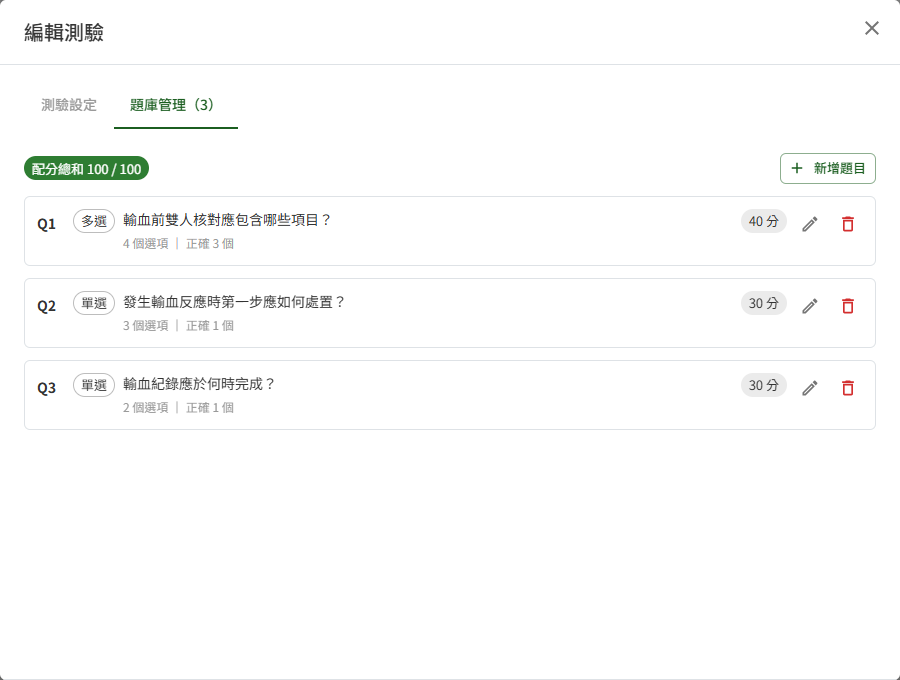

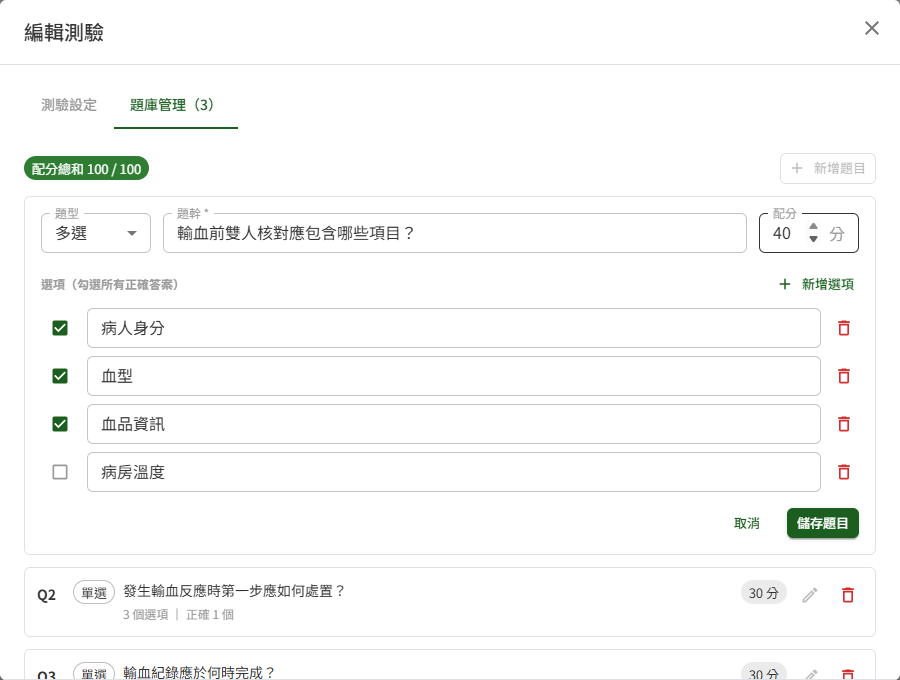

> 重要：題目一次只能展開編輯一題，且題目是**逐題各自儲存**的。底部的「儲存」只存測驗設定，不會儲存展開中的題目；關閉視窗會讓展開中、尚未按下「儲存題目」的內容消失。

分頁上方常駐顯示「配分總和 N / 100」。**總和不等於 100 時不會阻擋儲存**，但會在發布課程時被擋下——逐題建立的過程中總和本來就不會是 100，此處只是提醒。尚無題目的測驗，於章節的項目列上標示「尚無題目」。

題目呈現給學員的順序由系統自動洗牌，教師不需也無法指定，因此題庫沒有拖曳排序的手把。

> 重要：刪除題目後，該題不再出現於**之後**的作答；**已作答學員的紀錄與成績完整保留**，教師與學員都仍可回看當時的完整考卷，成績也不會變動。已發布與已關閉課程的測驗至少須保留 1 題：題目刪光時，按「更新」（或「更新並重開課」）會被檢核擋下，學員看到的題目維持原樣。

**已有學員作答時修改測驗**

測驗已有學員作答時，修改測驗設定或新增、修改、刪除題目，儲存前會跳出「是否要求學員重新測驗？」視窗，並顯示已作答的人數。題目有誤或內容大幅更動、原本的成績不再適用時，選「儲存並要求重測」：

| 選擇 | 結果 |
|---|---|
| 儲存並要求重測 | 已作答的學員（**不論是否已通過**）作答次數重新計算、該測驗回到未完成，完課狀態隨之回退，並各收到一封通知信。該測驗的最高分改為**只計重測之後的作答** |
| 僅儲存，不要求重測 | 只儲存修改，學員的作答次數、及格與成績維持原樣 |
| 取消 | 不儲存 |

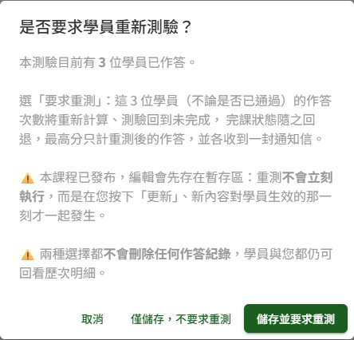

尚未作答過該測驗的學員不受影響。兩種儲存方式都**不會刪除任何作答紀錄**，學員與教師仍可回看歷次明細。

> 重要：已發布與已關閉的課程選「儲存並要求重測」時，重測**不會立刻執行**，而是在按「更新」（或「更新並重開課」）、新題目對學員生效的那一刻才一起發生，視窗中亦有此說明。同一輪編輯中已選過要求重測、之後再修改同一份測驗時，視窗會提示已有一筆待生效的重測要求；此時改選「僅儲存，不要求重測」是否會取消它，依儲存的方式而定，見下表。

| 儲存方式 | 視窗中的說明 |
|---|---|
| 於「測驗設定」分頁按「儲存」 | 「選「僅儲存，不要求重測」會把它一併取消。」 |
| 新增、修改或刪除題目 | 「本次選「僅儲存，不要求重測」不會取消它；要取消，請到「測驗設定」分頁存檔並選「僅儲存，不要求重測」。」 |

### 建立課後問卷

課後問卷掛在課程層級，一門課程最多一份，為選配。學員完課後才會開放填寫，採具名、一人一次；**填寫問卷不是完課條件，也不計入學習進度**。

於「課後問卷」區按「新增問卷」，於「新增課後問卷」視窗填問卷名稱後按「建立」，同一視窗隨即切換為題目編輯，可接著逐題撰寫。問卷建立後「新增問卷」鈕即不再顯示，之後要再修改時，按問卷卡片上的「編輯」。新增課程尚未儲存時按「新增問卷」，系統會先檢查課程基本資料，接著在視窗中按下「建立」時自動把課程存成草稿（畫面顯示「已自動儲存草稿」），與新增教材或測驗相同。

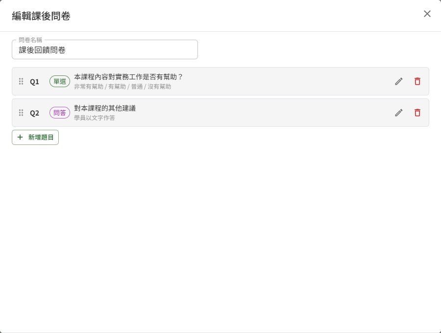

問卷題目有兩種題型：

| 題型 | 教師要填的內容 | 學員如何作答 |
|---|---|---|
| 單選 | 題幹與選項，每題 2～20 個選項 | 選擇其中一個選項 |
| 問答 | 只填題幹，不可有選項 | 以文字作答，至多 150 字 |

單選題的選項區標示「選項（單選；2～20 個）」，選項達 20 個時「新增選項」即呈灰色不可按。由單選改為問答時，原本已填的選項會被清空；再改回單選時，選項欄回到兩個空白欄，須重新填寫。題目可拖曳調整順序。

問卷尚無題目時，視窗內會出現「套用模板」，可一次帶入一組常用題目，套用後即為一般題目、可自由增刪修改。**已有題目後就不再提供模板**，需要改用模板內容時得先把既有題目刪除。

> 重要：建立了問卷，就**至少要有 1 題才能發布課程**；問卷卡片上會提示「至少須有 1 題才能發布課程」。草稿課程若決定不出問卷，請將問卷刪除。停用中的問卷不計入此項檢核，卡片上也不顯示這句提示。

> 重要：**一旦有任何學員填答，整份問卷即凍結**，題目、選項與問卷名稱都不能再修改。此時問卷卡片上的「編輯」按鈕會呈灰色不可按，滑鼠移上去會說明原因。凍結後只能停用問卷——停用後學員端不再顯示填寫入口，已填寫的內容仍然保留。已發布課程於尚無人填答時修改了問卷題目、而學員在按「更新」之前送出填答，按「更新」時會被擋下，處理方式見〈更新已發布課程的內容〉。

刪除與停用是互補的，不會同時出現：

| 課程狀態 | 問卷可用的操作 |
|---|---|
| 草稿 | 刪除（連同題目與選項一併移除，之後可重新建立） |
| 已發布、已關閉 | 停用 |

已發布與已關閉課程的問卷卡片上有「停用問卷」，按下後於「停用課後問卷」確認視窗按「停用」。停用中的問卷卡片標示「已停用」，並改為出現「啟用問卷」，按下即恢復啟用（不另跳確認視窗）；已有學員填答、題目已凍結的問卷同樣可以再啟用。停用與啟用都和其他編輯一樣，按「更新」（已關閉課程為「更新並重開課」）後才對學員生效。再啟用的問卷若沒有題目，按「更新」（或「更新並重開課」）時會被檢核擋下，須先補上題目。

### 發布課程

按底部「儲存並發布」。基本資料沒有錯誤時，系統會先把目前的編輯內容存檔；有錯誤時不存檔，錯誤一併列入缺漏。接著開啟視窗逐項檢核下列條件：

| 檢核項目 | 要求 |
|---|---|
| 章節 | 至少 1 個章節，且每個章節至少有 1 份教材或測驗 |
| 教材 | 整門課程至少 1 份教材 |
| 項目名稱 | 每份教材與測驗都要有名稱 |
| 受訓對象 | 至少 1 組，且每組的單位與職位都已選 |
| 課程起訖時間 | 起、訖兩個時間都要填，且符合時間先後 |
| 測驗 | 每份測驗至少 1 題，且各題配分總和等於 100 |
| 教材文件 | 沒有引用已廢止的文件 |
| 課後問卷 | 已建立且啟用中的問卷，至少 1 題 |

**未通過時**

視窗列出全部缺漏，並說明該去哪裡補，下方只有「關閉」。關閉視窗後，可在畫面上直接補正的缺漏處（基本資料欄位、沒有內容的章節、沒有名稱的項目、題數或配分不符的測驗、沒有題目的問卷）會以**紅框**標出並附說明，**補好後紅框隨即消失**。全部補齊後重新按一次「儲存並發布」。

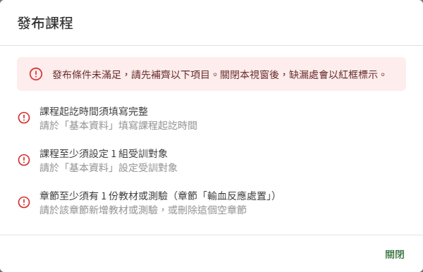

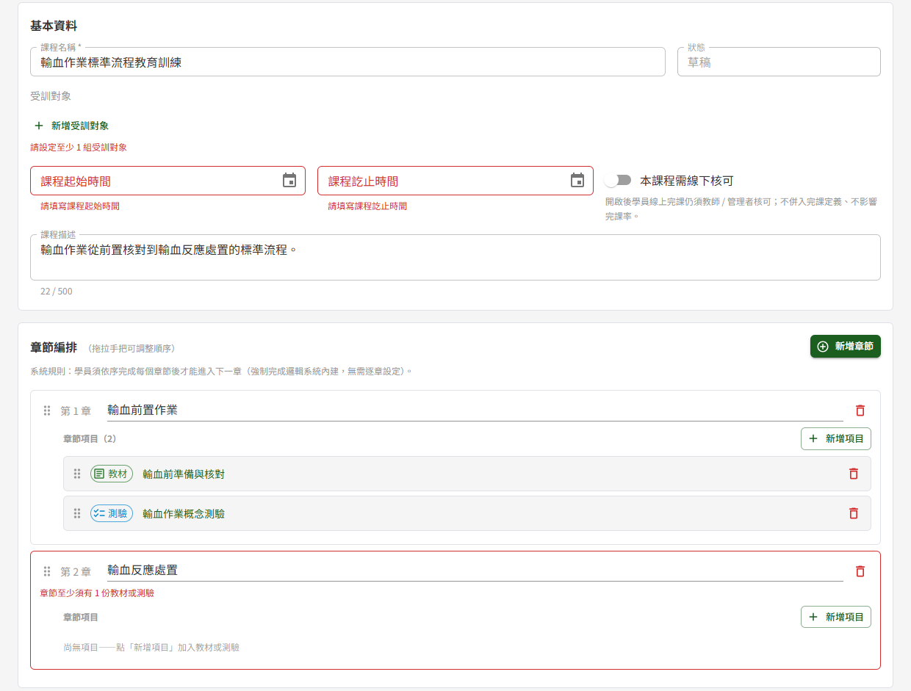

> 注意：沒有章節、沒有教材、引用已廢止文件這三種缺漏只列在視窗中，畫面上沒有對應的紅框。

**通過時**

視窗顯示發布前的確認，按「確認發布」完成發布。發布當下系統會連續做四件事：

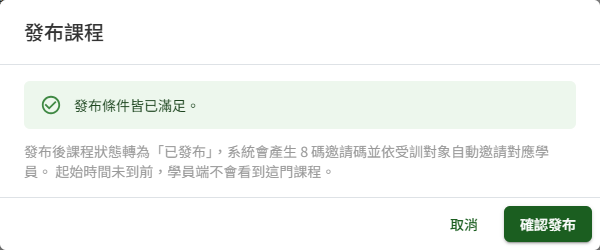

1. 課程狀態轉為「已發布」
2. 產生一組 8 碼數字邀請碼
3. 依課程的受訓對象，把相符且具學員角色的人員加入課程（多組取聯集、重複者只加入一次；課程的建立者本人除外）
4. 對每位被加入的學員各寄一封通知信

視窗隨即顯示帶入的人數與邀請碼，關閉後回到課程列表。

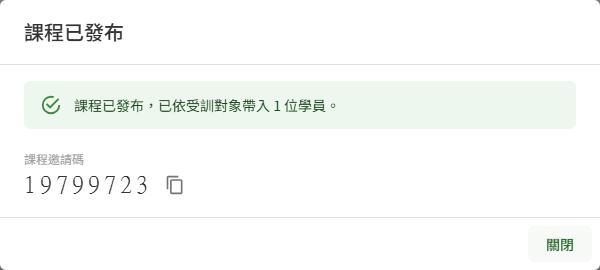

> 重要：邀請碼**於發布當下產生，之後沿用同一組**，常駐顯示於編輯頁上方，可按旁邊的複製鈕取用。

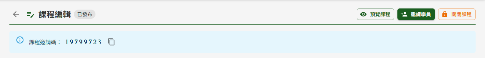

發布後仍可繼續編輯課程，但編輯要按底部的「更新」才對學員生效，見下一節。

### 更新已發布課程的內容

已發布課程的所有編輯——基本資料、受訓對象、章節、教材、測驗、題目與課後問卷——都先保留在編輯頁上，教師在畫面上看到的是自己編輯中的樣子，學員看到的仍是上一次生效的內容。編輯期間底部動作列左側改以警示色提示「有尚未更新的變更」。

**按「更新」**

1. 按底部「更新」，基本資料有錯時就地標示，不往下進行
2. 系統隨即以本次的編輯跑一次**與發布相同的檢核**（檢核項目見〈發布課程〉）
3. 依檢核結果：
   - **有缺漏**：**不跳確認視窗**，直接跳出「更新未生效」視窗列出缺漏，下方只有「關閉」；關閉後缺漏處以紅框標示，作法與發布檢核相同。學員看到的內容維持原樣，本次的編輯仍保留在編輯頁上，補齊後再按一次「更新」即可。缺漏若是課後問卷沒有題目，導引為「請為課後問卷新增至少 1 題，或停用該問卷」
   - **沒有缺漏**：跳出確認視窗「更新課程內容」，說明這一下會同時影響所有已加入的學員；按「確認更新」後本次累積的全部編輯一次對學員生效，顯示「課程內容已更新，學員已可看到」並回到課程列表

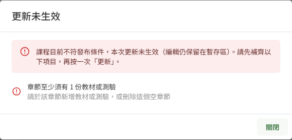

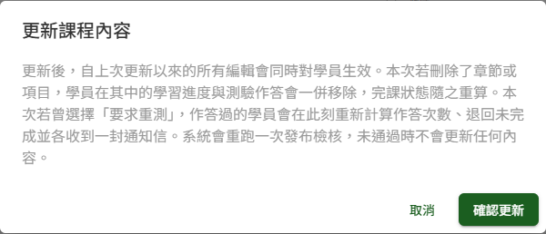

按「確認更新」時系統會再檢核一次，此時才被擋下的情形見下方「課後問卷已有學員填答時」。

> 重要：按「更新」生效的當下，系統會連帶處理下表的事情，**按下前請先確認**。按「更新」之前，學員不會收到任何信、進度與完課狀態也不會變動。

| 本次編輯包含 | 生效當下會發生 |
|---|---|
| 新增章節 | 系統自動寄信通知所有已加入的學員 |
| 新增教材或測驗 | 已完課學員的完課狀態回退為「進行中」（學員已填寫的課後問卷不會失效、不需重填） |
| 刪除章節或項目 | 學員在其中的學習進度與測驗作答一併移除，完課狀態隨之重算 |
| 測驗選過「儲存並要求重測」 | 作答過的學員作答次數重新計算、退回未完成，並各收到一封通知信 |
| 新增受訓對象 | 該組相符、尚未加入的學員被補加入並各收到一封通知信 |

**課後問卷已有學員填答時**

尚無人填答時修改了問卷題目、而學員在按「更新」之前送出了填答，按「更新」並「確認更新」後會跳出「課後問卷已有學員填答，本次更新未生效」視窗，課程內容維持原樣。此時把題目改回原樣也無法通過，請按視窗中的「放棄問卷的編輯」：課後問卷回到學員目前看到的版本，畫面顯示「已放棄課後問卷的編輯，其餘編輯仍保留。請再按一次「更新」」，章節、教材與測驗的編輯都還在，接著再按一次「更新」即可。已關閉課程按「更新並重開課」時遇到同樣情形，視窗標題為「課後問卷已有學員填答，本次更新並重開課未生效」，處理方式相同，放棄後再按一次「更新並重開課」。

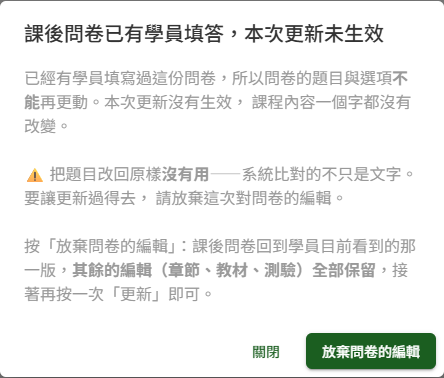

**按「取消」與離開本頁**

尚未按「更新」的編輯，離開編輯頁即**放棄**，課程維持學員目前看到的版本；唯一的例外是已關閉課程按過「保留編輯」者（見下表第三種）。依離開方式與課程狀態出現下列確認視窗：

| 視窗 | 何時出現 | 內文 |
|---|---|---|
| 放棄本次的編輯 | 有尚未更新的編輯時，按底部「取消」 | 「取消後，自上次更新以來的所有編輯會全部放棄，課程回到學員目前看到的版本。此動作無法復原。離開本頁同樣會放棄這些編輯；要讓學員看到，請按「更新」。」 |
| 離開將放棄本次的編輯 | 有尚未更新的編輯時，點側邊選單或返回鍵等離開編輯頁 | 「離開後，自上次更新以來的所有編輯都會放棄，課程維持學員目前看到的版本。要讓學員看到這些編輯，請先按「更新」。」 |
| 離開後編輯仍會保留 | 已關閉課程按過「保留編輯」後再次進入，點側邊選單或返回鍵等離開編輯頁 | 「你先前按過「保留編輯」，這些編輯會留到下次進來。要讓學員看到，請按「更新並重開課」；要整份丟掉，請按「取消」。」 |

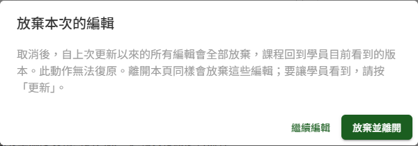

前兩種視窗按「放棄並離開」即放棄編輯並離開本頁。「離開後編輯仍會保留」的按鈕為「離開」：離開後編輯仍保留，下次進入可接著編輯。三種視窗按「繼續編輯」皆留在編輯頁，編輯仍在。已關閉課程的前兩種視窗內文另有提示，見〈關閉課程與再開課〉。

> 注意：只改了基本資料、尚未按「更新」時，按「取消」或離開都不跳確認，直接離開且修改不保留。關閉瀏覽器分頁時同樣不會跳確認，下次進入編輯頁時，上次未按「更新」的編輯已放棄。例外是已關閉課程按過「保留編輯」者：該課程的編輯（含之後再做的修改）會留到按「更新並重開課」或「取消」為止，關閉分頁後再進入也不會被丟棄。

> 注意：同一門已發布課程請勿同時在兩個分頁或裝置編輯：後開啟編輯頁的一方，會放棄先開啟那一方尚未按「更新」的編輯。

### 邀請學員

「邀請學員」按鈕僅於課程「已發布」且仍在閱課期間內時顯示於標題列右上；草稿、已關閉與閱課期間已過的課程都不顯示，按「更新並重開課」後會恢復。

學員的主要來源是**發布當下依受訓對象自動邀請**，本視窗供補件之用，分兩個分頁：

**Email 邀請（補件）**

供臨時追加不在受訓對象內的人。於「學員 Email」欄輸入名單，每行一筆或以逗號分隔，單次至多 50 筆，按「下一步」顯示邀請信預覽，確認後按「確認寄出」。

> 重要：收件對象**限已建立帳號、且帳號為啟用中者**。名單中只要有一筆查無帳號或帳號已停用，整批都不會寄出，畫面會列出是哪幾筆；需要邀請尚無帳號的人員時，得先請管理者建立帳號。

預覽的主旨與內文不可編輯，且**不會帶入任何一位收件人的資料**——稱謂逐人不同，於寄出時才各自代入，預覽中以佔位字樣呈現。因此更動收件名單後不需要重新預覽。

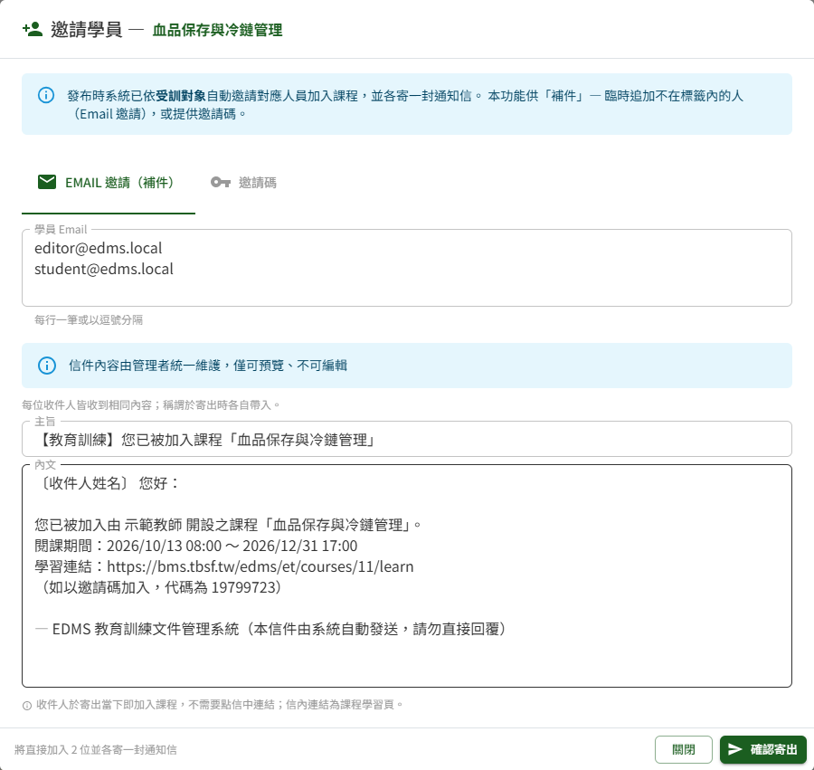

名單中的人若已在課程中，再寄一次只會讓他再收到一封邀請信，不會重複加入。曾於 ET02 學員學習表現被移除的學員，可用 Email 邀請重新加入本課程；依受訓對象自動帶入（發布、新增受訓對象後更新、更新並重開課）時，則不會帶回已被移除的學員。

> 重要：按下「確認寄出」的當下，名單上的人就**已經加入課程**，會立刻出現在 ET02 學員學習表現的清單裡；信只是通知，他們不需要點信裡的連結。
>
> 因此**沒有「待加入」清單，也沒有撤回**。通知信若寄送失敗，畫面會列出是哪幾位——他們已經在課程裡了。此時可再按一次「確認寄出」重寄，但會對名單上**全部**的人各再寄一封（已在課程中的人不會重複加入），視窗底部也會說明這一點；只需通知寄送失敗的那幾位時，建議改以其他方式告知。若是**邀請錯人**，請到 ET02 學員學習表現把他移除。

**邀請碼**

顯示本課程的 8 碼邀請碼與 QR Code，並提供「複製邀請連結」與「複製邀請碼」。學員於「我的課程 → 加入新課程」輸入此碼即可自行加入。

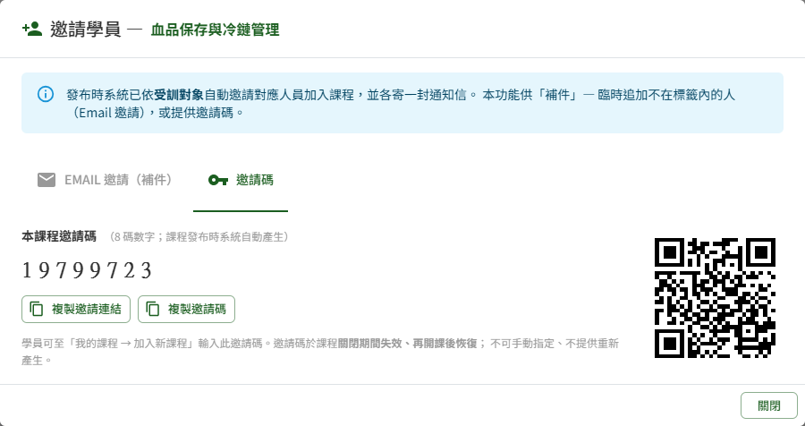

> 重要：邀請碼於課程**關閉期間失效**，學員會被擋下；再開課後自動恢復有效。

### 關閉課程與再開課

課程關閉有兩種情形，效果完全相同：

| 情形 | 說明 |
|---|---|
| 到期自動關閉 | 到達課程訖止時間後，於系統每日排程執行時轉為「已關閉」，不需教師操作 |
| 手動關閉 | 教師按標題列右上的「關閉課程」，確認後立即生效 |

按「關閉課程」會跳出確認視窗，說明關閉後會停掉哪些事；按「確認關閉」後課程立即轉為「已關閉」。

> 重要：有尚未按「更新」的編輯時，確認視窗最上方另以粗體、帶警示符號提醒「您有尚未按「更新」的編輯，關閉後這些編輯不會保留。」，並說明「若要保留，請先關閉此視窗，再按頁面上的「更新」。」確認關閉後，這些編輯於下次進入編輯頁時即已放棄，不會帶到關閉期間；要保留就先按「更新」使其生效，再關閉課程。

關閉後各方受到的影響：

| 對象 | 關閉後 |
|---|---|
| 學員 | 課程仍留在「我的課程」並標示已關閉，可**唯讀回看**已學過的內容與成績；不能再累積進度、開始新的測驗作答、解鎖新章節或填寫問卷 |
| 正在作答的學員 | 當下那次作答**可以完成並計分**，交卷後不能再開始新的作答 |
| 教師 | 課程內容**仍可編輯**，供整理後再開課；但不能邀請學員（按鈕隱藏），亦不能於 ET02 學員學習表現重置重考次數或移除學員 |
| 邀請碼與 Email 邀請 | 暫時失效 |

> 重要：關閉是**可逆**的，不是終止課程。關閉期間編輯頁上方會有提示說明課程內容仍可編輯，整理完畢後按「更新並重開課」即可恢復。

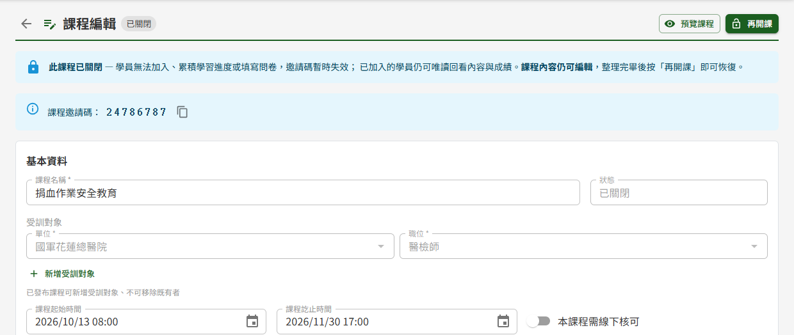

**關閉期間的編輯**

已關閉課程的編輯與已發布課程相同，都先保留在編輯頁上、學員唯讀回看的仍是關閉前的內容。底部動作列為「取消」「保留編輯」「更新並重開課」：

| 按鈕 | 作用 |
|---|---|
| 取消 | 有尚未生效的編輯時跳出「放棄本次的編輯」視窗，確認後放棄全部編輯（含先前按「保留編輯」留下的）並離開 |
| 保留編輯 | 留下目前的編輯供下次繼續，**不跑發布檢核、不對學員生效**，顯示「編輯已保留，學員看到的仍是關閉前的內容」並回到課程列表 |
| 更新並重開課 | 編輯生效並重新開課，步驟見下方說明 |

> 注意：「保留編輯」會留下目前的編輯供下次繼續，之後的修改會蓋過去；它不是還原點，無法回到按下當時的版本。

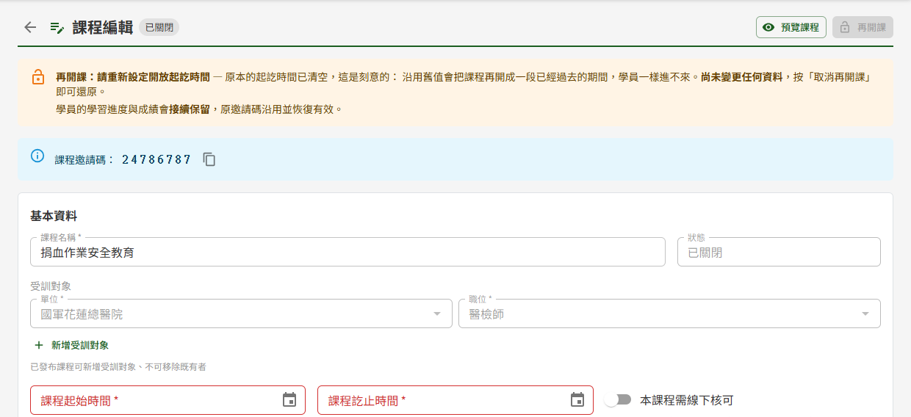

已關閉課程有尚未生效的編輯時，兩種確認視窗的內文改為提示「保留編輯」：

| 視窗 | 內文 |
|---|---|
| 放棄本次的編輯（按「取消」） | 「取消後，自上次更新以來的所有編輯會全部放棄，課程回到學員目前看到的版本。此動作無法復原。若只是想先離開、下次再繼續，請改按「保留編輯」。」 |
| 離開將放棄本次的編輯（點側邊選單等離開） | 「離開後，自上次更新以來的所有編輯都會放棄。若想留著下次再繼續，請先按「保留編輯」；要讓學員看到，請按「更新並重開課」。」 |

按過「保留編輯」之後再進入編輯頁，點側邊選單等離開時改為出現「離開後編輯仍會保留」（見〈更新已發布課程的內容〉），離開後編輯仍在；按「取消」則仍為「放棄本次的編輯」，確認後連同保留的編輯一併放棄。

**更新並重開課**

1. 於基本資料確認「課程起始時間」與「課程訖止時間」；閱課期間已過者，先改成新的一段期間
2. 按底部「更新並重開課」
3. 系統檢核起訖時間並**重新跑一次發布的檢核**——關閉期間的編輯可能把必要內容移除了
4. 通過後，關閉期間的編輯一次生效、課程回到「已發布」，跳出「課程已重新開課」視窗，顯示本次依受訓對象新帶入的學員人數與邀請碼；按「關閉」回到課程列表

起訖時間的規則與一般編輯不同：起始時間**允許填在過去**（例如想讓學員從上週起就看得到），訖止時間則須晚於起始時間與目前時間。提前手動關閉、訖止時間仍在未來的課程，不改日期即可直接重新開課。

有缺漏時跳出「更新並重開課」視窗列出全部缺漏，下方只有「關閉」；課程維持已關閉，學員看到的內容維持原樣。關閉視窗後缺漏處同樣以紅框標出，補齊後再按一次「更新並重開課」即可。已發布課程的問卷若沒有題目，可補上題目或將問卷停用。

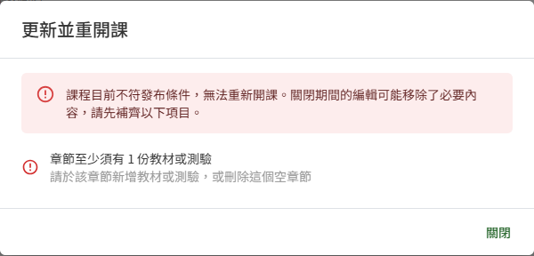

重新開課後：學員的學習進度與成績**接續保留、不會歸零**；原邀請碼沿用並恢復有效；統計與提醒恢復納入該課程。關閉與再開課可以重複多次。

重新開課時，系統比照發布，依課程**全部**受訓對象帶入目前相符、且尚未加入的學員，並對新加入者逐一寄出邀請信——關閉期間新增的受訓對象，或關閉期間才符合條件的學員，都在此時加入。已在課程中的學員不受影響、不會重複收信，曾被移出課程的學員也不會被帶回。

「課程已重新開課」視窗顯示的人數只計**本次新加入**的學員。沒有新的學員被帶入時，視窗以提示顯示「課程已重新開課。本次沒有新的學員被自動帶入——符合受訓對象的人多半已在課程中。原有學員可直接繼續學習。」這是常態，不需要檢查受訓對象設定。

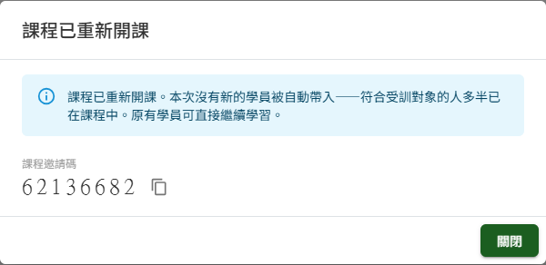

## 常見訊息與處置

### 被擋下（動作沒有完成）

**基本資料**

| 訊息 | 處置 |
|---|---|
| 「請輸入課程名稱」 | 課程名稱為必填 |
| 「請選擇單位與職位，或刪除此列」 | 受訓對象有列只選了一欄。補選另一欄，或按該列的刪除鈕 |
| 「此組受訓對象已存在」 | 兩列為相同的單位與職位，刪除其中一列 |
| 「課程起始時間不可早於目前時間」 | 改選現在之後的時間 |
| 「課程已開課，起始時間不可再往前調整」 | 已開課的課程可沿用原起始時間，但不能往前挪 |
| 「課程訖止時間須晚於起始時間」 | 檢查兩個時間的先後 |
| 「已發布課程不可清空閱課結束時間，如需停止請改用關閉課程」 | 已發布課程必須有訖止時間；要停止課程請用「關閉課程」 |
| 「指定之受訓對象無效或未啟用」 | 所選的單位或職位已被管理者停用，請改選其他項目 |

**教材**

| 訊息 | 處置 |
|---|---|
| 「教材須至少提供影片、文件或說明文字其中一項」 | 三類素材至少要有一項才能儲存 |
| 「此教材已有同名影片，請先移除原有影片或改用其他檔名」 | 移除原影片，或把檔案改名後再上傳 |
| 「影片格式或大小不符」 | 依上傳區顯示的格式與大小上限準備檔案 |
| 「無法解析影片長度，請改用其他格式」 | 系統無法讀出該檔案的長度，請轉檔後再上傳 |
| 「影片檔名過長（上限 200 字元），請縮短檔名後再上傳」 | 縮短檔名後重新上傳 |

**測驗題目**

| 訊息 | 處置 |
|---|---|
| 「單選題須恰好指定 1 個正確選項」 | 單選題只能有一個正確答案 |
| 「多選題須至少指定 1 個正確選項」 | 多選題至少要勾一個正確答案 |
| 「每題選項數須介於 2 至 6 個」 | 調整選項數量 |
| 「配分須介於 1 至 100」 | 每題配分不可為 0 |

**課後問卷**

| 訊息 | 處置 |
|---|---|
| 「每題至少需 2 個選項」 | 單選題至少要兩個選項 |
| 「問答題不可設定選項」 | 問答題只填題幹、不設選項；題型改為問答時，畫面上的選項會自動清空 |
| 「已有學員填答，題目與選項不可修改」 | 已有人填答，題目凍結；只能停用問卷 |
| 「問卷已有題目，無法套用模板」 | 模板僅在問卷還沒有任何題目時可套用 |
| 「一門課程僅可建立 1 份課後問卷」 | 一門課程最多一份問卷 |
| 「僅草稿課程之問卷可刪除，已發布課程請改用停用」 | 已發布課程的問卷只能停用 |

**發布、更新、關閉與再開課**

| 訊息 | 處置 |
|---|---|
| 「發布條件未滿足，請先補齊以下項目。關閉本視窗後，缺漏處會以紅框標示。」 | 關閉視窗後依紅框與清單逐項補齊，再按一次「儲存並發布」 |
| 「課程目前不符發布條件，本次更新未生效（編輯仍保留在暫存區）。請先補齊以下項目，再按一次「更新」。」 | 按「更新」時檢核未通過，學員看到的內容維持原樣、本次的編輯仍在。依紅框與清單補齊後再按一次「更新」 |
| 「課後問卷已有學員填答，本次更新未生效」 | 修改問卷題目後、按「更新」之前已有學員送出填答。按視窗中的「放棄問卷的編輯」，再按一次「更新」；已關閉課程的視窗標題為「……本次更新並重開課未生效」，放棄後再按一次「更新並重開課」 |
| 「課程目前不符發布條件，無法重新開課。關閉期間的編輯可能移除了必要內容，請先補齊以下項目。」 | 依紅框與清單補齊後，再按一次「更新並重開課」 |
| 「請重新設定課程起始時間」、「請重新設定課程訖止時間」 | 起訖時間欄位空白。於基本資料填入一組起訖時間後再按「更新並重開課」 |
| 「課程訖止時間須晚於目前時間」 | 重新開課的訖止時間不可落在過去，改為未來的時間 |
| 「請重新設定一組新的起訖時間後方可再開課」 | 按「更新並重開課」時課程訖止時間已過。於基本資料改成新的一段期間後再按一次；提前手動關閉、訖止時間仍在未來的課程不必改日期。正常操作會先在欄位上看到「課程訖止時間須晚於目前時間」，出現此句多半表示另一個分頁或裝置剛做過同一件事 |
| 「僅已關閉課程可保留編輯，運作中的課程請改用「更新」」 | 正常操作不會看到，多半表示另一個分頁或裝置剛把課程重新開課，課程已回到閱課期間內的已發布狀態。離開本作業後再進入，改用「更新」 |
| 「此課程目前關閉中」 | 課程閱課期間已過，不能邀請學員；請先按「更新並重開課」 |
| 「僅已發布課程可邀請學員」 | 課程已關閉，不能邀請學員；請先按「更新並重開課」。已關閉課程不顯示「邀請學員」，出現此句多半表示另一個分頁或裝置剛關閉了這門課程 |
| 「僅已發布課程可關閉」 | 課程已是已關閉狀態，不需再關閉。已關閉課程不顯示「關閉課程」，出現此句多半表示另一個分頁或裝置剛關閉了這門課程；離開本作業後再進入即可看到目前狀態 |
| 「內容已被其他裝置變更，請重新整理後再儲存。」 | 同一門課程在其他裝置或分頁被改過，**這次的編輯沒有存進去**。按「重新載入」取得最新內容後重做 |

**邀請學員**

| 訊息 | 處置 |
|---|---|
| 「以下 Email 尚未建立 EDMS 帳號，無法寄送邀請」 | 名單中有人尚無帳號，**整批都沒有寄出**，名單上的人也都沒有加入課程。請管理者先建立帳號，或把該筆從名單移除後再按「下一步」 |
| 「以下帳號已停用，無法邀請（請確認名單或請管理者先啟用）」 | 名單中有已停用的帳號，**整批都沒有寄出**，名單上的人也都沒有加入課程。把該筆從名單移除後再按「下一步」，或請管理者先啟用 |
| 「通知範本已停用」 | 於「Email 邀請（補件）」按「下一步」時出現，邀請信無法寄出、名單上的人也不會加入課程。請管理者於 DP04 通知範本維護將「課程邀請通知」範本啟用，或改提供邀請碼讓學員自行加入 |

**權限**

| 訊息 | 處置 |
|---|---|
| 「您沒有檢視此課程的權限。課程編輯僅開放教師與管理者。」 | 需具教師或管理者角色 |

### 有警告（動作完成但需判斷）

| 訊息 | 代表什麼 |
|---|---|
| 「課程已發布，但沒有任何學員符合本課程的受訓對象。請確認受訓對象設定，或將下方邀請碼提供給學員。」 | 課程確實已發布，但沒有任何人被自動加入。發布時的 0 人表示受訓對象真的沒有對應的學員，請確認設定，或改以邀請碼、Email 邀請補件 |
| 「以下收件人已加入課程，但通知信寄送失敗，請改以其他方式告知」 | 那幾位**已經在學員清單裡了**，只有通知信沒寄出去。可再按「確認寄出」重寄，但名單上已收到信的人也會再收到一封；只需通知失敗的那幾位時，建議以其他方式告知 |
| 「此文件已廢止」 | 該教材引用的文件已在文件管理端廢止。**課程將無法發布**，須移除該引用 |
| 「文件已失效」 | 該文件於文件管理端已取不到，同樣須移除引用 |
| 「已有學員填答，題目與選項不可再修改。此時僅可停用問卷。」 | 滑鼠移到問卷卡片上呈灰色的「編輯」按鈕時顯示。問卷已被填答，題目與選項不能再改 |

### 送出後的結果訊息

| 訊息 | 代表什麼 |
|---|---|
| 「草稿已儲存」 | 草稿課程的基本資料已存檔，畫面回到課程列表 |
| 「課程內容已更新，學員已可看到」 | 按「更新」且檢核通過，本次累積的編輯已一次對學員生效，畫面回到課程列表 |
| 「已放棄課後問卷的編輯，其餘編輯仍保留。請再按一次「更新」」 | 課後問卷已回到學員目前看到的版本，其餘編輯仍在，接著再按一次「更新」；已關閉課程的訊息與動作為「更新並重開課」 |
| 「編輯已保留，學員看到的仍是關閉前的內容」 | 已關閉課程按「保留編輯」，編輯留待下次繼續，畫面回到課程列表 |
| 「已自動儲存草稿」 | 新增課程時建立項目或問卷，系統先把課程存成草稿 |
| 「草稿已刪除」 | 草稿課程與其內容已移除，畫面回到課程列表 |
| 「教材已儲存」 | 教材內容已存檔，視窗關閉 |
| 「測驗已儲存」 | 測驗設定已存檔，視窗關閉（題目另行逐題儲存） |
| 「課程已發布，已依受訓對象帶入 N 位學員。」 | 發布完成，並顯示自動帶入的人數與邀請碼 |
| 「已將 N 位加入課程並寄出通知信」 | Email 邀請完成，名單上的人已加入課程 |
| 「課程已關閉」 | 課程立即轉為已關閉，學員端轉為唯讀回看 |
| 「課程已重新開課，已依受訓對象帶入 N 位學員。」 | 按「更新並重開課」完成，課程回到已發布，視窗另顯示邀請碼；邀請碼恢復有效，學員進度保留 |
| 「課程已重新開課。本次沒有新的學員被自動帶入——符合受訓對象的人多半已在課程中。原有學員可直接繼續學習。」 | 按「更新並重開課」完成，但本次沒有新的學員被帶入。重新開課只計新加入者，符合受訓對象的人多半在關閉前就已加入，**不必檢查受訓對象設定**；這與發布時的 0 人（真的沒人符合，需檢查設定）意思不同 |
