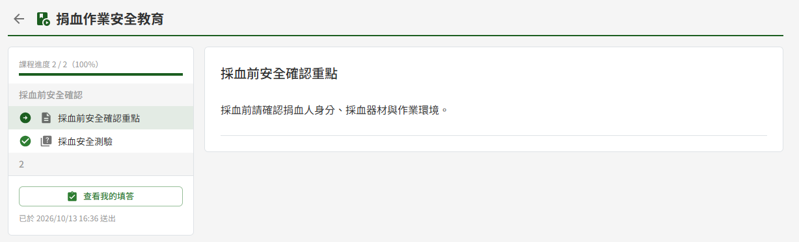
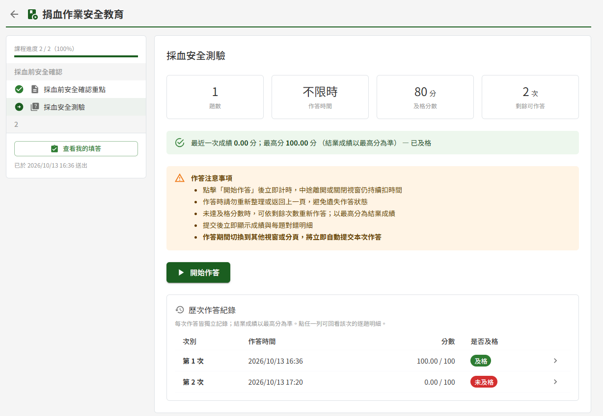
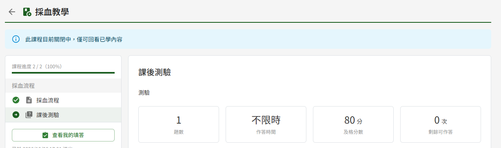

# ET06 課程學習

## 作業說明

### 使用情境

本作業供學員**學習已加入的課程**：依序觀看影片、閱讀文件、作答測驗，完課後填寫課後問卷。各角色可做的事如下：

| 角色 | 於本作業可做的事 |
|---|---|
| 學員 | 學習已加入的課程、累積學習進度、作答測驗、完課後填寫課後問卷 |
| 教師、管理者 | 以預覽身分檢視課程內容（不記錄進度，測驗與課後問卷僅供檢視；由課程列表「全部課程」進入，見 ET01 課程列表） |

學員加入課程的方式有三種：課程發布時依受訓對象自動加入、教師以 Email 邀請加入、學員以邀請碼自行加入。加入後課程即出現在「我的課程」，由此進入本作業。

本作業的後續銜接如下：測驗的作答與成績於 ET07 線上測驗進行；學員的學習進度、完課狀態與問卷填答，教師於 ET02 學員學習表現查看。課程需要線下核可者，學員完課後另由教師或管理者核可。

### 進入路徑

側邊選單「教育訓練 → 我的課程」，點該課程的卡片。課程相關通知信（加入課程、新增章節等）中的課程連結，同樣直接開啟本作業。

> 注意：課程起始時間到達前，卡片標示「尚未開放」且不可點擊；以通知信連結或網址直接開啟也會被擋下。到達起始時間後即可進入。

## 操作說明

### 畫面與前置設定

畫面左側為章節導覽，右側為內容區：

- 左側上方為「課程進度」，下方依章節列出每一份教材與測驗，並以圖示標示已完成、目前所在、未完成與鎖定
- 右側顯示目前所選項目的內容；點左側其他項目即切換
- 課程設有課後問卷且已完課時，左側最下方另出現問卷入口（見〈填寫課後問卷〉）；預覽時不論完課與否皆出現（見〈預覽時的課後問卷〉）

進入時的落點：

| 情況 | 落點 |
|---|---|
| 第一次進入該課程 | 第一章的第一個項目 |
| 曾經學習過 | 上次檢視的項目；影片自上次播放到的位置繼續 |

「課程進度 N / M（P%）」中，M 為課程內**全部教材與測驗的項目數**、N 為其中已完成的項目數，不是章節數。課後問卷不計入。

### 學習順序與解鎖

課程內容必須**依序**完成，規則如下：

| 層級 | 規則 |
|---|---|
| 同一章節內 | 前一個項目完成後，下一個項目才開放 |
| 章節之間 | 前一章的**所有**項目都完成後，下一章才開放 |

各類項目的完成條件：

| 項目 | 完成條件 |
|---|---|
| 含影片的教材 | 教材內**每一支**影片的觀看進度皆達 80%（以影片下方顯示的整數百分比判定，四捨五入至整數） |
| 只有文件或說明文字的教材 | 點開即完成，不需捲動到底或下載 |
| 測驗 | 作答成績達及格分數 |

> 注意：含影片的教材，完成與否只看影片；同一份教材中的文件與說明文字不另外計算。

項目一完成，左側即標為已完成，下一個項目隨即開放，不需重新整理頁面。點選鎖定中的項目時，畫面不切換，並提示擋在前面的項目名稱，例如「請先完成「○○」後解鎖」或「請先通過測驗「○○」後解鎖」，完成提示中的項目即可繼續。

已完成的項目**隨時可以回頭重看**，不受解鎖順序限制。

### 觀看影片

點含影片的教材，內容區依序顯示說明文字、影片與教材文件。影片下方可切換「播放速度」（0.75 至 2 倍），並顯示影片長度與觀看進度「完成 N%（達 80% 後解鎖下一項）」；達 80% 後影片名稱旁標示「已完成」。

觀看進度依下列方式計算：

| 情形 | 計算方式 |
|---|---|
| 正常播放 | 只計入實際播放過的片段 |
| 拖曳進度條跳過 | 可以跳轉，但**被跳過的部分不計入**；直接拖到結尾不算看完 |
| 同一段重複觀看 | 只計一次，重看不會增加進度 |
| 倍速播放 | 依影片內容計算，以 2 倍速從頭播到尾即為 100% |

觀看進度於播放中、暫停或切換項目時自動儲存，沒有儲存按鈕；中途關閉頁面，下次進入會回到同一支影片的同一個位置繼續播放。

> 重要：80% 是**看過的影片內容比例**，不是播放的時間長度。拖曳進度條跳過的片段要實際播放過才算數；已經看過的片段反覆重看，進度不會再增加。

### 閱讀文件與說明文字

教材文件依檔案格式呈現：

| 檔案格式 | 呈現方式 |
|---|---|
| PDF | 於內容區直接預覽 |
| Word、Excel 等其他格式 | 按「下載原檔以本機應用程式開啟」存到本機開啟 |

教材文件一律呈現該文件目前的發布版本。文件若已在文件管理端廢止，會標示「此文件已廢止」，內容仍可照常閱讀，呈現的是廢止前的最後一個版本。

只有文件或說明文字的教材，點開即算完成。

### 作答測驗

點測驗項目，內容區顯示該測驗的題數、作答時間、及格分數與剩餘可作答次數，以及歷次作答紀錄。按「開始作答」即進入 ET07 線上測驗作答。作答、計分與回看明細的操作見 ET07 線上測驗。

交卷後於成績頁按「返回課程」（或「回課程重新作答」）回到本作業，落點為剛才作答的測驗：

| 結果 | 後續 |
|---|---|
| 及格 | 該測驗標為已完成，下一個項目隨即開放 |
| 未及格 | 下一個項目維持鎖定；可在剩餘次數內重新作答 |

> 重要：重考次數用完仍未及格者，後續章節**無法再解鎖**。此時請洽課程教師於 ET02 學員學習表現重置該測驗的重考次數，重置後即可重新作答。

### 完課

課程內**所有教材與測驗皆完成**即為完課，課程進度顯示 100%，「我的課程」該課程的狀態轉為「已完成」。完課狀態依目前的課程內容即時計算，下列情形會使已完課的學員回到「進行中」：

| 情形 | 處理方式 |
|---|---|
| 教師於課程新增教材或測驗 | 依左側順序完成新增的項目，即恢復完課 |
| 教師於既有教材新增影片 | 教師按「更新」的當下，已完成該教材的學員即退回未完成，不必等學員重新開啟該教材；同一學員其他項目的完成狀態不受影響。將新增的影片看到 80% 以上（原有影片已看過的進度保留），該教材即恢復已完成 |
| 教師要求已通過的學員重新測驗 | 該測驗回到未完成，重新作答及格即恢復完課 |

已填寫的課後問卷**不因此失效，也不需重填**。

### 填寫課後問卷

課程設有課後問卷時，學員**完課後**左側最下方出現「填寫課後問卷」。問卷採**具名**填答、每人一次，送出後不可修改；填寫問卷不是完課條件，也不計入課程進度。

1. 按左側最下方的「填寫課後問卷」
2. 逐題作答。單選題（題號旁有星號）每題必答；問答題選填、可留空，至多 150 字
3. 按「送出問卷」
4. 於確認視窗按「送出」

送出後顯示「問卷已送出，感謝您的回饋」並回到課程頁，左側入口改為「查看我的填答」並註明送出時間，點入即可唯讀回看自己填答的內容。

尚有單選題未作答就按「送出問卷」時，頁面上方提示「尚有題目未作答，請完成後再送出」，未答的題目以紅色標示「尚未作答」，補答後再送出。

> 注意：同一份問卷只會記錄一次填答。在另一個分頁或裝置已經送出過的，再按一次「送出」同樣顯示送出成功並回到課程頁，不會重複記錄。

左側問卷入口依情況呈現：

| 情況 | 左側入口 |
|---|---|
| 尚未完課 | 不顯示 |
| 已完課、尚未填寫 | 「填寫課後問卷」 |
| 已填寫 | 「查看我的填答」，之後無論課程關閉、完課狀態回到進行中或問卷遭停用，皆可回看 |
| 尚未填寫，但教師已停用問卷 | 不顯示 |
| 尚未填寫，且課程已關閉 | 入口仍在，點入後提示「課程已關閉，無法填寫問卷」，沒有送出按鈕；再開課後恢復可填寫 |

#### 預覽時的課後問卷

教師或管理者預覽課程時，課後問卷啟用中即於左側最下方出現「預覽課後問卷」，並註明「預覽模式，不可送出」，不受完課限制。點入後頁面上方提示「預覽模式：僅供檢視題目，無法送出。」，題目只能檢視、沒有送出按鈕，不會留下任何填答。問卷停用時不顯示入口。

### 課程關閉後的回看

課程由教師關閉、或已過課程訖止時間時，頁面上方顯示「此課程目前關閉中，僅可回看已學內容」，課程轉為唯讀回看：

| 項目 | 關閉後 |
|---|---|
| 已開放的項目 | 照常開啟、播放影片與閱讀文件 |
| 尚未開放的項目 | 維持鎖定，無法開啟 |
| 學習進度 | 不再累積；影片下方不再顯示觀看進度 |
| 測驗 | 可回看歷次作答，不能開始新的作答；關閉當下正在作答的那一次可以完成並計分 |
| 課後問卷 | 已填者可回看；未填者無法填寫 |

教師再開課後恢復正常學習，學習進度與成績接續保留。

## 常見訊息與處置

### 被擋下（動作沒有完成）

| 訊息 | 處置 |
|---|---|
| 「請先完成「（教材名稱）」後解鎖」 | 提示中點名的教材尚未完成。將其中每支影片看到 80% 以上；只有文件或說明文字的教材點開即可 |
| 「請先通過測驗「（測驗名稱）」後解鎖」 | 提示中點名的測驗尚未及格。點該測驗重新作答；重考次數已用完者請洽課程教師於 ET02 重置 |
| 「請先依序完成前面的學習項目後解鎖」 | 依左側順序完成前面尚未完成的項目 |
| 「尚有題目未作答，請完成後再送出」 | 問卷有單選題未作答，依紅色標示補答後再送出 |
| 「課程已關閉，無法填寫問卷」 | 課程關閉期間無法填寫問卷，待教師再開課後再填寫 |
| 「此課程尚未開放，請於開放時間後再進入」 | 課程起始時間尚未到達，請於「我的課程」卡片標示的開放時點之後再進入 |

### 有警告（動作完成但需判斷）

| 訊息 | 代表什麼 |
|---|---|
| 「此文件已廢止」 | 該文件已在文件管理端廢止，內容仍可閱讀（廢止前最後一個版本）。對內容適用性有疑義者請洽課程教師 |
| 「此課程目前關閉中，僅可回看已學內容」 | 課程已關閉或已過訖止時間，可回看已開放的內容，但不再累積進度、不能開始新的測驗作答 |

### 送出後的結果訊息

| 訊息 | 代表什麼 |
|---|---|
| 「問卷已送出，感謝您的回饋」 | 問卷填答已記錄，之後只能唯讀回看 |

### 其他情況

| 情況 | 說明 |
|---|---|
| 開啟課程顯示「您尚未加入此課程」 | 本人不在該課程的學員名單中。請以邀請碼加入，或洽課程教師邀請 |
| 開啟課程顯示「您已被該課程移除」 | 教師已將本人移出該課程，需要重新加入時請洽課程教師 |
| 點項目顯示「此內容已刪除」 | 教師已刪除該項目或其所屬章節。回到「我的課程」後重新進入該課程，即顯示目前的課程內容 |
| 文件處顯示「此文件目前無法取得，請聯繫課程教師」 | 該文件在文件管理端已取不到，請洽課程教師更換引用 |
| 文件處顯示「此文件的檔案已不存在，請聯繫課程教師重新上傳」 | 該文件的檔案已不存在，請洽課程教師處理 |
| 問卷頁顯示「課程尚未完成，完課後即可填寫本問卷。」 | 尚未完課（例如教師剛新增了項目，完課狀態回到進行中）。完成全部項目後即可填寫 |
| 左側沒有出現問卷入口 | 尚未完課、課程未設課後問卷，或教師已停用問卷 |
