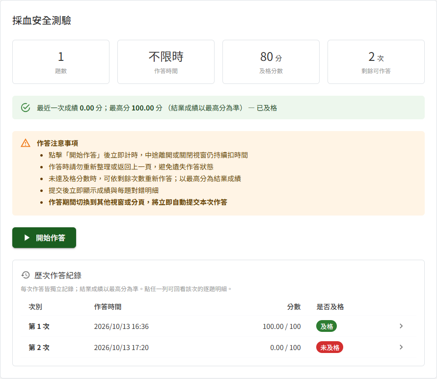
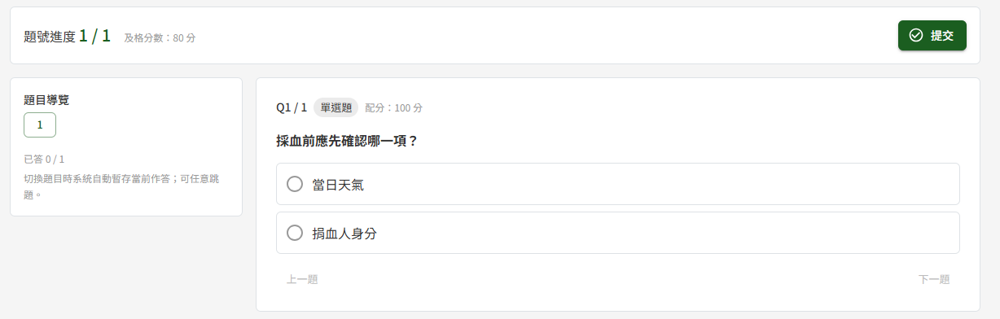
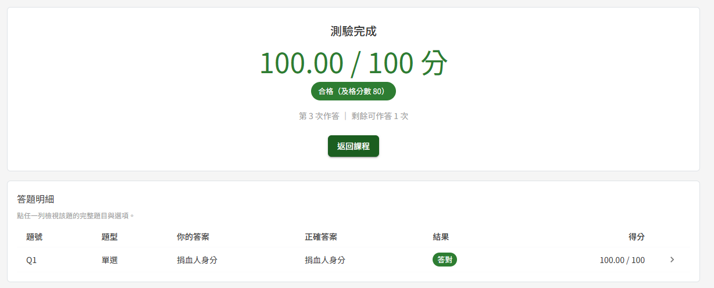
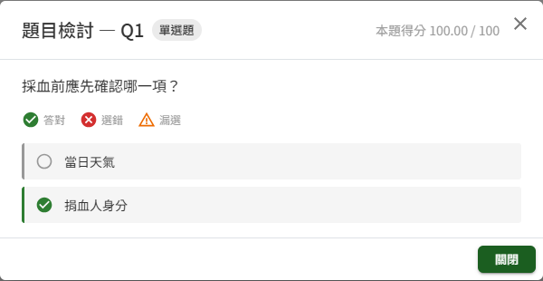
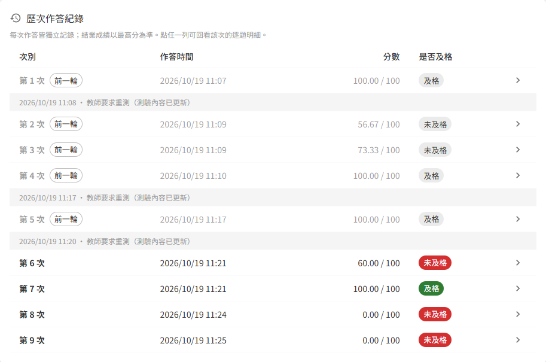

# ET07 線上測驗

## 作業說明

### 使用情境

本作業**供學員作答課程中的測驗**，並查看成績與歷次作答明細。各角色可做的事如下：

| 角色 | 於本作業可做的事 |
|---|---|
| 學員 | 作答已加入課程中的測驗；查看成績、逐題對錯與正確答案；回看自己每一次的作答 |
| 教師、管理者 | 預覽課程時檢視測驗的題目內容，不能作答、不留下作答紀錄（由課程列表「全部課程」進入，見 ET01 課程列表） |

測驗是課程章節中的一個項目，及格分數、作答時間與重考次數上限由教師於 ET05 課程建立與編輯設定。學員須先完成同一章節中排在測驗前面的教材，才能點開測驗。

測驗**及格後**，該測驗項目即標示完成，同一章節後續的項目與下一章隨之解鎖；未及格則後續內容維持鎖定，須重新作答直到及格。學員的測驗成績與作答明細，教師於 ET02 學員學習表現查看。

### 進入路徑

側邊選單「教育訓練 → 我的課程」，點課程卡片進入 ET06 課程學習，再於左側章節清單點測驗項目。測驗資訊與作答入口直接顯示於右側內容區；按下作答後才進入獨立的作答畫面。

## 操作說明

### 畫面與前置設定

點測驗項目後，右側內容區自上而下為：測驗名稱與說明、四格測驗資訊（題數、作答時間、及格分數、剩餘可作答次數）、目前成績、作答注意事項、「開始作答」按鈕，以及「歷次作答紀錄」。

看不出來的地方：

| 項目 | 說明 |
|---|---|
| 作答時間 | 顯示「不限時」者，作答時沒有倒數，只能自行按「提交」交卷 |
| 剩餘可作答 | 教師設定的重考次數上限 **加 1**（含第一次作答）減去已作答次數。重考次數上限為 0 的測驗只能作答 1 次 |
| 目前成績 | 作答過後顯示「最近一次成績」與「最高分」，以百分制呈現（配分總和不是 100 時依比例換算）。**結業成績以最高分為準**，重考考得較低不會拉低成績。教師要求重新測驗後，最高分只計重測之後的作答；重測後尚未作答時改顯示「教師已要求重測，重新作答後才會計算結業成績。」 |
| 歷次作答紀錄 | 尚未交過卷時不顯示 |

### 開始作答

1. 閱讀作答注意事項
2. 按「開始作答」，進入作答畫面

按下「開始作答」的當下即**計入一次作答次數**並開始計時。題目與選項的順序於此時隨機排列，同一次作答中固定不變；每次重新作答都會重新排列。

> 重要：限時測驗的時間自按下「開始作答」起計算，倒數歸零即自動提交。

### 作答與跳題

作答畫面上方為題號進度、及格分數、剩餘時間（限時測驗才有）與「提交」；左側為題目導覽，右側為目前這一題。

- 單選題點選一個選項，多選題勾選所有認為正確的選項
- 點左側題號可任意跳題，也可用題目下方的「上一題」「下一題」切換。已作答的題號以實心標示，可據此找出還沒作答的題目
- 切換題目時，系統自動暫存目前這一題的作答

> 重要：作答期間**切換到其他視窗或分頁，本次作答即立即自動提交**，並計入一次作答次數。點瀏覽器的網址列、點選跳出的系統通知、將視窗縮到最小，都算離開作答視窗。作答前請先關閉可能跳出通知的程式。

作答開始後教師若修改了題目、選項或配分，**本次作答不受影響**，仍以開始作答當時的題目閱卷；下一次作答才套用新內容。

### 離開作答畫面

作答開始後，**離開作答畫面即交卷**，計入一次作答次數，並以當下已作答的內容計分。依離開方式不同：

| 離開方式 | 結果 |
|---|---|
| 切換到其他視窗或分頁、將視窗縮到最小、點瀏覽器網址列或跳出的系統通知 | 立即自動提交，不另確認 |
| 點左側選單、瀏覽器「上一頁」或頁面上的連結 | 先跳出「離開作答」確認視窗：按「提交並離開」即交卷並前往該頁（顯示「已提交本次作答」）；按「繼續作答」則留在作答畫面，作答不變 |
| 重新整理或關閉瀏覽器 | 視為離開，本次作答即自動提交。若提交未及完成（例如瀏覽器程式被強制結束），該次作答保留為尚未提交，測驗項目會提示「您上次的作答尚未提交。按「開始作答」將以已暫存的作答提交，並顯示該次成績。」；按「開始作答」後，結果頁上方顯示「您上次的作答未提交，已以暫存的作答自動提交。」，仍有剩餘次數者可再開始新的一次。有尚未提交的作答時，即使次數已用完或課程已關閉，「開始作答」仍可按，按下只結算那一次 |

> 注意：每一次離開都計入一次作答次數。作答期間請留在作答畫面，完成後再按「提交」。

### 提交

作答完成後按上方的「提交」。**按下即交卷並立即閱卷**，不另跳確認視窗，交卷後作答不能再修改；請先由左側題目導覽確認每一題都已作答。

尚未作答的題目以 0 分計。按下「提交」時畫面上的所有作答（含正在作答、尚未切換離開的那一題）會一併送出計分。

**時間到自動提交**

限時測驗的倒數歸零時，系統自動以當下的作答提交，不需操作。結果頁會標示「作答時間到，已自動提交」，歷次作答紀錄中該次標示「逾時」；逾時提交照常計分。

### 成績計算方式

每一題依題型計分，各題得分相加為總分：

| 題型 | 計分方式 |
|---|---|
| 單選題 | 選對得該題全部配分，選錯或未作答 0 分 |
| 多選題 | 得分 =（選對的選項數 − 選錯的選項數）÷ 正確選項數 × 配分，**最低 0 分**、不倒扣其他題 |

多選題舉例：某題配分 30、正確選項 3 個，選對 2 個又多選了 1 個錯的，得分為（2 − 1）÷ 3 × 30 = 10 分，結果標示「部分對」；選錯的數量不少於選對的數量時，該題 0 分。

總分換算成百分制後**達到及格分數即為合格**（配分總和為 100 時即為總分）。每一次作答都獨立計分、獨立保存；該測驗的**結業成績取歷次作答的最高分**（百分制），ET02 學員學習表現的平均成績亦以各測驗的最高分計算。教師要求重新測驗後，只取重測之後的作答計算最高分。

### 查看結果

提交後進入結果頁，顯示本次總分、合格與否、第幾次作答與剩餘可作答次數，下方為答題明細。

- 答題明細**一律顯示正確答案**，逐題列出本人的答案、正確答案、結果（答對／部分對／答錯）與得分
- 點任一列開啟「題目檢討」視窗，查看完整題目，並逐選項標示答對、選錯與漏選

**結果頁之後的動作**

| 結果 | 結果頁的按鈕 | 下一步 |
|---|---|---|
| 合格 | 返回課程 | 回到課程學習頁，後續項目已解鎖 |
| 未合格，仍有次數 | 回課程重新作答 | 回到課程學習頁並停在該測驗，閱讀注意事項後再按「開始作答」 |
| 未合格，次數已用完 | 返回課程 | 見〈重考次數用完〉 |

兩種按鈕都回到課程學習頁、並停在剛作答的測驗項目上，**不會直接開始新的作答**。結果頁按瀏覽器的上一頁同樣回到課程學習頁，不會回到作答畫面。

### 回看歷次作答

測驗項目下方的「歷次作答紀錄」依次序列出每一次已交卷的作答，含作答時間、分數與是否及格。點任一列即可回看該次的逐題明細與正確答案，題目順序與該次作答當時相同。

回看較早的作答時，結果頁只有「返回課程」；要再作答，請回到測驗項目按「開始作答」。

教師要求重新測驗或重置重考次數後，清單於新一輪的第一次作答前插入一列，標示日期與原因：

| 分隔列文字 | 意義 |
|---|---|
| 教師要求重測（測驗內容已更新） | 教師修改了測驗內容。此列之前的作答以灰色顯示並標「前一輪」，**不計入結業成績**，仍可點開回看 |
| 重考次數已重置 | 教師恢復了作答次數。此列之前的作答照常顯示，最高分照舊計入 |

次別連續編號，不因分段而重新起算。

### 重考次數用完

未及格且剩餘可作答次數為 0 時，測驗項目顯示「重考次數已用完，請聯繫教師重置」，「開始作答」無法按（仍有尚未提交的作答時例外，按下只結算那一次）；歷次作答紀錄仍可點閱，供複習錯在哪裡。

此時請聯繫課程教師。教師於 ET02 學員學習表現對該測驗「重置重考次數」後，剩餘可作答次數**恢復為完整的一輪**（重考次數上限加 1），即可再開始作答。重置不會刪除任何先前的作答紀錄與成績，最高分照舊計入。

> 注意：教師修改測驗內容並要求重新測驗時，作答過該測驗的學員（不論是否已通過）該測驗會回到未完成、作答次數重新計算，並收到通知信；原本已及格者，之後尚未完成的項目也會回到鎖定（已完成的項目仍可開啟回看），須重新作答及格才會開放。最高分改為只計重測之後的作答。

### 課程關閉後

課程關閉（教師手動關閉，或已過課程訖止時間）當下**仍在作答中、尚未交卷**的作答，於系統每日排程執行時以已暫存的作答自動提交並計分，成績列入歷次作答紀錄。

課程關閉後測驗項目顯示「此課程已關閉，無法再開新作答」，「開始作答」無法按（仍有尚未提交的作答時例外，按下只結算那一次）；已交卷的成績與歷次作答明細仍可回看。教師再開課後即恢復作答，先前的作答次數與成績接續保留。

> 注意：課程關閉期間，教師無法重置重考次數。

## 常見訊息與處置

### 被擋下（動作沒有完成）

| 訊息 | 處置 |
|---|---|
| 「重考次數已用完，請聯繫教師重置」 | 本輪次數已用完且未及格。請課程教師於 ET02 學員學習表現重置重考次數 |
| 「此課程已關閉，無法再開新作答」 | 課程已關閉或已過課程訖止時間，無法開始新的作答；已交卷的成績仍可回看。需要再作答請洽課程教師再開課 |
| 「此課程目前關閉中，無法開始新的作答」 | 畫面開啟期間課程被關閉。重新點一次測驗項目查看最新狀態 |
| 「請先通過測驗「（測驗名稱）」後解鎖」 | 於課程學習頁點了鎖定中的項目。先通過提示中的測驗，後續項目才會解鎖 |

### 有警告（動作完成但需判斷）

| 訊息 | 代表什麼 |
|---|---|
| 「因離開作答視窗，本次作答已自動提交。」 | 作答期間切換到其他視窗或分頁，本次作答已交卷並計分，計入一次作答次數 |
| 「（作答時間到，已自動提交）」 | 限時測驗時間已到，系統以時間到之前的作答交卷並照常計分 |
| 「此課程已關閉，無法再開新作答」（結果頁） | 本次作答照常計分，但課程已關閉，之後不能再重新作答 |
| 「未達及格分數，您仍有重考機會」 | 本次未及格，仍有剩餘次數。按「回課程重新作答」回到測驗項目再開始作答 |
| 「教師已要求重測，重新作答後才會計算結業成績。」 | 教師修改了測驗內容並要求重新測驗，重測之前的成績不再計入。按「開始作答」重新作答 |
| 「您上次的作答尚未提交。按「開始作答」將以已暫存的作答提交，並顯示該次成績。」 | 上一次作答在交卷前離開（如重新整理或關閉瀏覽器）。按「開始作答」即以已暫存的作答提交計分 |
| 「您上次的作答未提交，已以暫存的作答自動提交。」（結果頁） | 上一次未提交的作答已以暫存內容交卷並計分，計入一次作答次數 |

### 送出後的結果訊息

| 訊息 | 代表什麼 |
|---|---|
| 「已提交並完成閱卷」 | 已交卷，結果頁顯示本次成績與答題明細 |
| 「已離開作答視窗，本次作答已自動提交」 | 因離開作答視窗而自動交卷，結果頁顯示本次成績 |
| 「已提交本次作答」 | 由左側選單、上一頁或頁面連結離開，並於確認視窗按「提交並離開」；已交卷並前往所點的頁面 |

### 其他情況

| 情況 | 說明 |
|---|---|
| 作答畫面顯示「本次作答已提交，無法再變更。」 | 這次作答已交卷（例如已在其他分頁交卷後，又開啟這次作答的畫面）。按「查看成績」查看該次結果 |
| 點測驗項目只看到題目、沒有「開始作答」 | 本人為教師或管理者，正以預覽方式檢視課程；預覽只能看題目，不能作答 |
